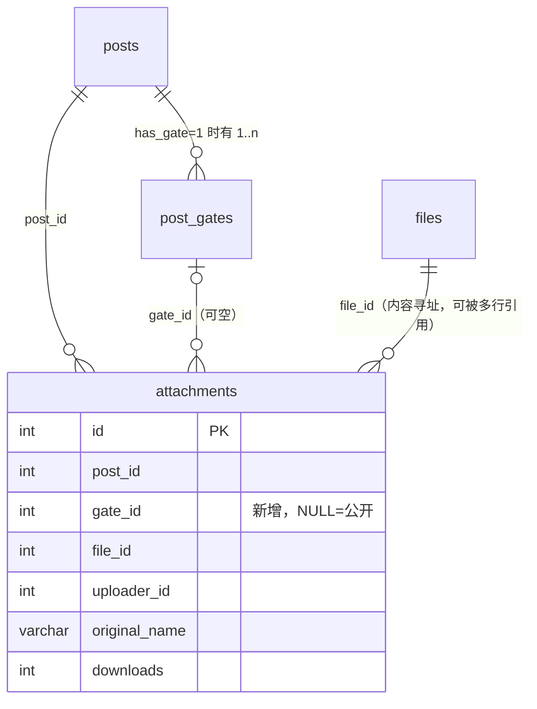
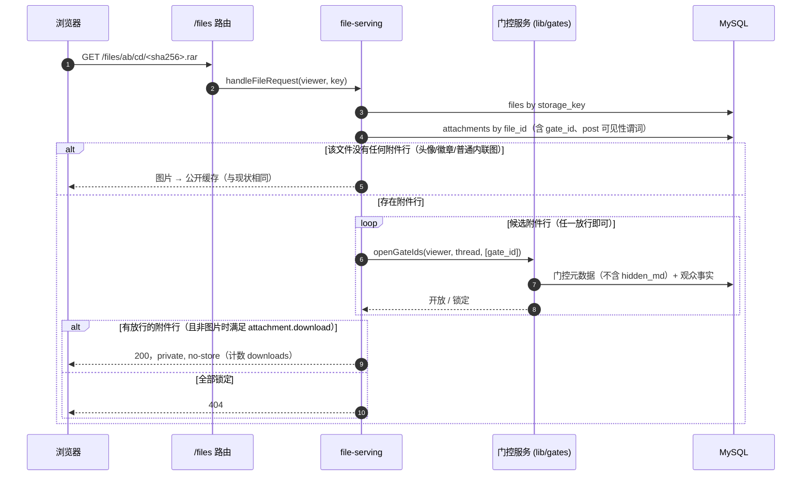

# 附件与门控（设计稿）

> 状态：**已确认**（2026-10-24，站长对 §9 的 Q1~Q6 全部采纳推荐方案）。按 §11 分步实现，每步单独汇报、单独提交。
> 来源：[M5.5 之后审查报告](reviews/2026-10-24-post-m5.5-review.md) P1-2。
> 影响文档：`DESIGN-MODEL.md` §5（文件与附件）、`GATES.md`（新增附件一节）、`MODULES.md` 无需改动。
> 影响里程碑：先于 M6 实现（M6 的上传与门控创作直接建立在它之上）。

## 1. 问题

门控只拆分了**正文**（`hidden_md`）。附件没有任何门控语义：

- 帖子页 `getAttachments` 按 `post_id` 取全部附件，不看 `posts.has_gate`；
- `/files/<key>` 对非图片附件只校验「帖子可见」和「版块 `attachment.download`」，**图片类附件连这个权限都不查**（能力 URL，任何人拿到 key 即可看）；
- 结果：付费 / 回复可见的帖子，附件对所有有下载权限的会员直接开放。

### 1.1 真实数据规模（迁移库 `qysub_next`，实测）

| 指标                           | 数量                                                  |
| ------------------------------ | ----------------------------------------------------- |
| 门控帖                         | 325（其中 32 个含多个门控）                           |
| 门控帖上的附件                 | **130**，分布在 63 个帖子（图片 88 / 非图片 42）      |
| 同一文件被门控帖与非门控帖共用 | 0                                                     |

按「附件在正文里的出现位置」细分（由迁移后的 `body_md` / `hidden_md` 反查）：

| 引用位置                     | 数量 | 说明                                                                 |
| ---------------------------- | ---- | -------------------------------------------------------------------- |
| 仅出现在**公开正文**         | 74   | 作者有意公开（多为内联图）                                           |
| 仅出现在某个门控的**隐藏块** | 32   | 明确属于该门控；其中 12 张图都在同一个 8 门控帖里                    |
| 两处都出现                   | 0    |                                                                      |
| **哪里都没引用**             | 24   | 旧站帖尾「附件列表」型，其中 23 个是非图片（字幕包、种子等，最值钱） |

最后一类 24 个里，11 个所在帖只有 1 个门控（归属无歧义），**13 个所在帖有 2~4 个门控（有歧义）**。

## 2. 设计目标与不变量

1. **隐藏正文与它的附件同权**：能看到门控内容的人，才能取到门控附件；反之一律拿不到。
2. **fail-closed**：任何无法确认归属或门控状态的附件，一律按「锁定」处理，不得因为数据缺口而公开。
3. **越权对外表现为 404**（硬约定 7）：`/files` 不暴露「这个文件存在但被锁」。
4. **锁定的附件，元数据也不外泄**：文件名、大小、下载数、`storage_key` 都不下发（文件名常常就是剧透，如 `第12集.rar`）。
5. **单点读取**（类比硬约定 3b）：门控附件的读取与判定只有一个出口，并配守卫测试。
6. 门控条件的判定逻辑**只有一份**（`evaluateGate` + `resolveViews` 的元数据与观众事实加载），附件不得另起一套。

## 3. 方案对比

| 方案                                                     | 描述                                                                                             | 结论                                                                                        |
| -------------------------------------------------------- | ------------------------------------------------------------------------------------------------ | ------------------------------------------------------------------------------------------- |
| **A. 附件挂门控**（推荐）                                | `attachments.gate_id` 可空；`NULL` = 公开，否则 = 归属的门控                                     | 粒度细；与迁移数据（74 公开 / 32 门控内 / 24 待定）天然对应；M6 上传时作者选择归属          |
| B. 整帖约束                                              | 门控帖的全部附件统一受约束（例如「任一门控开放」）                                               | 粗暴：74 个公开内联图会被误锁；多门控帖无法表达「第 3 关才给种子」                          |
| C. 由 `hidden_md` 内的引用派生                           | 读隐藏正文解析 `/files/<key>`，引用者即受保护                                                    | 违反 3b（`hidden_md` 只能在 `service.ts` 读）；24 个未被引用的附件无法覆盖；每次请求都要解析 |
| D. `gate_attachments` 多对多                             | 独立关联表                                                                                       | 过度设计：一个附件行只属于一个帖、一个门控；同一文件的复用已由 `files` 内容寻址解决         |
| E. 受保护文件迁到独立私有目录                            | 门控文件不放进 `STORAGE_DIR` 的公开布局                                                          | 无必要：`/files` 本来就是逐请求鉴权，不是静态直出；目录隔离只增加存储复杂度                 |

**推荐 A。**

## 4. 数据模型



- `attachments.gate_id INT UNSIGNED NULL`，加普通索引 `idx_att_gate (gate_id)`。**不是唯一键**，所以不触碰硬约定 3a；无外键（沿用全库约定）。
- 一个附件行**至多属于一个门控**。要「两关都过才给」属于门控条件的组合（`match_mode`），不在附件层表达。
- **门控稳定身份**：门控以 `(post_id, gate_key)` 为稳定标识，编辑帖子时按 key 原样更新 `post_gates` 行，`id` 不变，所以 `attachments.gate_id` 不会因编辑失效。

### 4.1 悬空与一致性（fail-closed）

- 读取侧：`gate_id` 非空但对应门控不存在（或不属于该帖）→ 视为**锁定**。**对所有人锁定，含作者与版主**（实现时的收紧，原稿为「作者与版主可见」）：
  悬空数据由保存校验与 `db:verify` 保证不会出现，一旦出现就应当修数据，而不是给特权观众开后门。
- 写入侧（M6 保存事务）：保存帖子后，校验该帖每个附件的 `gate_id` 都指向该帖现存的门控；否则拒绝保存并提示作者先重新指派。删除一个带附件的门控块时，**不得**静默把附件变公开。
- `db:verify` / `verify:migration` 增加孤儿检查：`gate_id` 指向不存在门控的附件数 = 0；`gate_id` 非空而帖子 `has_gate=0` 的数 = 0。

## 5. 访问判定

```text
可取到附件 = 帖子对观众可见
          ∧ ( 图片且未绑定任何门控 ∨ 版块 attachment.download )     ← 现有规则
          ∧ ( gate_id 为空 ∨ 该门控对观众开放 )                      ← 新增
```

「门控对观众开放」与读取隐藏正文**用同一套判定**：作者、版主（`forum.moderate`）永远开放；其余按 `gate_unlocks` / 回帖 / 积分余额由 `evaluateGate` 判定。

### 5.1 `/files/<key>` 链路



要点：

- **公开图片的快路径保留**：文件没有任何 `attachments` 行（头像、徽章、论坛图、未登记的内联图）时仍走现有公开缓存，零额外开销。文件有附件行时多一次按 `idx_att_file` 的查询。
- **图片附件也要过门控**：只要所有引用该文件的附件行都被锁，图片也返回 404。**绑定到门控的图片响应用 `private, no-store`**，不得进共享缓存。
- 多个附件行引用同一文件（哈希去重）时，任意一行放行即放行——与现有逻辑一致。
- 下载计数仍只在鉴权通过后的 `GET` 累加。

### 5.2 帖子页的呈现

`getAttachments` 改成按观众返回**判别联合**，让「锁定项泄露元数据」在类型上就不可能：

```ts
type AttachmentView =
  | { status: "open"; id; postId; originalName; downloads; storageKey; mime; sizeBytes }
  | { status: "locked"; postId; gateKey }; // 没有名字、大小、key、下载数
```

页面把同一帖的锁定项合并成一个提示：`🔒 本帖有 N 个附件需解锁后下载`，并指向对应的门控卡片（沿用现有锁卡片的购买 / 回复入口）。

## 6. 代码结构

| 模块                                    | 变化                                                                                                                                                                 |
| --------------------------------------- | -------------------------------------------------------------------------------------------------------------------------------------------------------------------- |
| `packages/db/src/schema.ts` + 迁移 SQL  | `attachments.gate_id` + 索引（硬约定 10 的流程）                                                                                                                     |
| `lib/gates/service.ts`                  | 把 `resolveViews` 的第 ① 步（元数据 + 观众事实 → 判定）抽成 `resolveGateOpenness`，`resolveViews` 与新增的 `openGateIds` 共用；**不读 `hidden_md`**，不放宽 3b 守卫 |
| `lib/gates/attachments.ts`（新增）      | **门控附件唯一读取出口**：`listAttachments(viewer, thread, posts)` 与 `canAccessAttachmentFile(viewer, key)`                                                         |
| `lib/queries/posts.ts`                  | 删除 `getAttachments`（改由上面的出口提供）                                                                                                                          |
| `lib/file-serving.ts`                   | `resolveFileAccess` 调用出口；图片分支加「文件是否绑定门控」判断                                                                                                     |
| `t/[tid]/page.tsx`                      | 渲染判别联合                                                                                                                                                         |
| 守卫测试                                | 除 `lib/gates/attachments.ts` 外，任何文件不得从 `attachments` 表选取 `file_id` / `original_name`（类比 `hidden-md-guard`）；通过后在 CLAUDE.md 新增硬约定 3d         |

## 7. 迁移映射（只存在于 `migration/`）

转换器知道每个 `[attachment=N]` 出现在哪个门控块里，应在转换阶段记录（而不是事后用 `LIKE` 反查 `storage_key`）：

| 规则 | 条件                                         | `gate_id`                                                | 本数据集命中 |
| ---- | -------------------------------------------- | -------------------------------------------------------- | ------------ |
| R1   | 引用在某个门控的隐藏块内                     | 该门控                                                   | 32           |
| R2   | 引用在公开正文                               | `NULL`                                                   | 74           |
| R3   | 未被引用，所在帖恰好 1 个门控                | 该门控                                                   | 11           |
| R4   | 未被引用，所在帖有多个门控                   | **条件最严的那个门控**（见 §9 Q3），并列入迁移报告待复核 | 13           |
| R5   | 帖子没有门控                                 | `NULL`                                                   | 其余 272     |

`verify:migration` 新增断言：

- 门控帖上 `gate_id` 非空的附件数 = R1 + R3 + R4 的命中数（32 + 11 + 13 = 56），公开数 = 74，合计 130；
- 孤儿 / 错位检查（§4.1）为 0；
- 抽样：随机抽 R1/R3/R4 各若干条，以游客身份访问其 `/files` 链接必须 404。

## 8. 测试计划

1. **集成测试（真实 MySQL）**：观众 {游客, 无权会员, 已登录未解锁, 已解锁, 回帖者, 作者, 版主} × 附件 {公开, 门控内非图片, 门控内图片, 悬空 `gate_id`}，断言页面列表与 `/files` 的结论一致，且锁定项的响应里没有名字 / key。
2. **属性式断言**：对任意观众，`listAttachments` 返回的 `open` 项集合 ⊆ `/files` 能取到的集合，反向也成立（两条链路不可分叉）。
3. **E2E**：往 `e2e-fixtures` 增加「付费门控 + 门控内附件 + 门控内图片」夹具，游客 / 未解锁 / 解锁后三态各验一遍；缓存头断言（绑定门控的图片为 `private, no-store`）。
4. **守卫测试**：§6 所述。
5. **迁移**：§7 的断言；用临时库演练 R1~R5 的真实命中数。

## 9. 需要站长拍板的问题

| #  | 问题                                                | 推荐                                                                                                                                       |
| -- | --------------------------------------------------- | ------------------------------------------------------------------------------------------------------------------------------------------ |
| Q1 | 数据模型：附件挂门控（A）还是整帖约束（B）          | **A**                                                                                                                                      |
| Q2 | 锁定的附件是否展示文件名                            | **不展示**，只提示数量（文件名常含剧透；代价是读者看不到「里面有什么」，可由作者在公开正文里自行说明）                                     |
| Q3 | 13 个「所在帖有多个门控且未被引用」的附件归属哪个   | **绑定到条件最严的门控**（积分价格最高者；并列取序号最大），fail-closed，并列入迁移报告供复核。备选：绑第一个门控（可能少保护）、要求全部门控都开放（语义复杂） |
| Q4 | 绑定门控的图片不再走「公开 + 长缓存」               | **接受**：这些图片改为 `private, no-store`；其他图片（头像、论坛图、公开内联图）不受影响                                                   |
| Q5 | 门控块**内联**的图片（M6 编辑器新上传）如何归属     | **保存时自动登记**：拆分门控时，隐藏块里引用的 `/files/<key>` 若无附件行则登记一条 `gate_id` = 该门控的附件行；其交互细节留到 M6 设计稿再定 |
| Q6 | 作者 / 版主是否永远能取到自己门控内的附件           | **是**，与读取隐藏正文一致                                                                                                                 |

## 10. 不在本稿范围

- 附件级单独定价（旧站 phpwind 有「附件购买」语义，未迁移，见 `LEGACY-FEATURE-MAP.md`）：如需要，是门控条件的扩展，不是附件层的第二套机制。
- 对象存储 / CDN 签名 URL：部署形态问题，留给 M13；本稿保证的是应用层逐请求鉴权。
- 全文搜索与导出：它们不得索引锁定附件的名字，M6+ 做搜索时再带上这条约束（已记入 §2 不变量 4）。

## 11. 实现拆分（确认后）

1. 迁移 SQL + schema + `verify` 孤儿检查 + `schema-rules` 例行断言
2. `lib/gates` 抽出 `resolveGateOpenness` / `openGateIds`（行为不变，既有测试保持绿）
3. `lib/gates/attachments.ts` + 帖子页改造 + `file-serving` 改造 + 守卫测试
4. 迁移适配层 R1~R5 + `verify:migration` 断言 + 重新导入开发库对账
5. E2E 夹具与用例；文档同步（DESIGN-MODEL §5、GATES、CLAUDE.md 硬约定 3d、CHANGELOG、审查报告 P1-2 标记已修复）

每一步单独汇报、单独提交。
