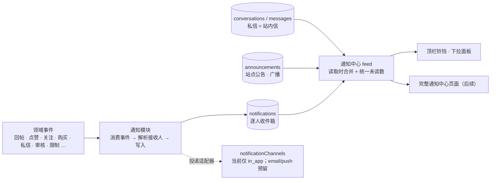

# 通知中心设计

> 状态：2026-10-23 站长确认（设计）；表结构在 M5.5 R2 落地，生成逻辑与铃铛在 M8，审核/公告管理在 M9，私信界面在 M10，
> 完整通知中心页面为后续独立项。参照微博/Twitter 的分类式通知。

## 1. 总体思路：一个入口、几个大分类、按形态分别存储

私信、公告、互动提醒与系统事件的数据形态不同，硬塞进一张表都会别扭。**统一入口和未读数，不统一存储**：

## 2. 分类（Tab）

| 分类 | 含义 | 存储 |
|------|------|------|
| **互动** `interaction` | 回复、@提及、点赞、关注、付费内容被购买 | `notifications` |
| **私信** `message` | 新私信（聚合指针，不复制正文） | 会话模型 + `notifications` 指针 |
| **审核与管理** `moderation` | 内容审核结果、删除/屏蔽/关闭/移动/加精、限制与解除、角色变更 | `notifications` |
| **账号与安全** `account` | 密码变更、积分被调整、获得徽章、欢迎与召回提示 | `notifications` |
| **公告** | 站点广播公告 | `announcements` + `announcement_reads`，读取时合并 |

「全部」Tab = 以上五类按时间合并。公告不逐人写行（全站广播给一万人各写一行没有必要），但在用户看来它就在通知中心里，计入统一未读数。

## 3. 数据模型

### `notifications`

| 列 | 含义 |
|----|------|
| `id` | bigint 自增 |
| `user_id` | 接收人 |
| `category` | `interaction \| message \| moderation \| account` |
| `type` | 命名空间字符串，见 §4；由 `notificationTypes` 注册边界声明 |
| `actor_id` | 触发者（可空，如系统） |
| `target_type` / `target_id` | 指向的对象：`thread \| post \| user \| conversation \| forum \| gate …` |
| `group_key` | 聚合键（可空）：同键的**未读**通知合并成一条 |
| `data` | JSON 快照：标题摘录、积分数、审核理由、聚合计数与最近几位触发者，避免对象被删后通知变空 |
| `read_at` / `created_at` | 已读与时间 |

索引：`(user_id, read_at, id)`、`(user_id, category, id)`、`(user_id, group_key, read_at)`。

### `notification_preferences`

`(user_id, type, channel)` 主键；`channel` 为 `in_app \| email \| push`；`enabled`。
默认：站内全开，其它渠道默认关；标记 `mandatory` 的类型（审核、限制、安全类）**不可关闭**。无记录 = 取注册边界里的默认值。

### `announcements` / `announcement_reads`

| 列 | 含义 |
|----|------|
| `announcements` | `title`、`body_md`、`level(info\|important)`、`audience(all\|members)`、`show_banner`、`starts_at`、`ends_at`（空 = 长期）、`created_by`、`created_at`、`updated_at` |
| `announcement_reads` | `(user_id, announcement_id)` 主键、`read_at` |

有效公告 = 当前时间在 `[starts_at, ends_at]` 内且受众匹配；游客只看到 `audience=all` 的公告，且没有已读状态（用本地存储记忆是否关闭横幅）。

## 4. 类型目录

聚合规则：`group_key` 非空的类型，若接收人已有**同键的未读**通知，则更新该行（`data.count++`、记录最近触发者、刷新 `created_at`），否则新建。已读之后再有新事件则新开一条，不改写历史。

### 互动

| 类型 | 触发 | 接收人 | group_key |
|------|------|--------|-----------|
| `post.replied` | 有人回复你的主题 | 主题作者（非自己） | `thread:{id}:replied` |
| `post.reply_to` | 有人回复你的某一楼 | 该楼作者 | `post:{id}:replied` |
| `post.mentioned` | 被 @ | 被提及者 | — |
| `post.liked` | 你的帖子被赞 | 帖子作者 | `post:{id}:liked` |
| `user.followed` | 有人关注你 | 被关注者 | `user:{id}:followed` |
| `gate.sold` | 你的付费内容被购买 | 作者 | `gate:{id}:sold`（含收益积分数） |

### 私信

| 类型 | 触发 | 接收人 | group_key |
|------|------|--------|-----------|
| `pm.received` | 收到私信 | 收信人 | `conv:{id}:pm`（`data.count` 为未读条数；打开会话即标记已读） |

### 审核与管理（`mandatory`，带理由，不聚合，另标明者除外）

| 类型 | 触发 | 接收人 |
|------|------|--------|
| `review.pending` | 开启审核的版块有新内容待审（**聚合**：`forum:{id}:review_pending`，"3 条待审核"） | 该版块版主（持有 `forum.moderate`） |
| `content.submitted` | 提交后进入待审核 | 作者 |
| `content.approved` / `content.rejected` | 审核通过 / 驳回（驳回带理由） | 作者 |
| `content.removed` / `content.hidden` / `content.restored` | 版主删除 / 屏蔽 / 恢复 | 作者 |
| `thread.locked` / `thread.unlocked` | 主题被关闭 / 重新开启 | 主题作者 |
| `thread.moved` | 主题被移动到其它版块 | 主题作者 |
| `thread.featured` / `thread.pinned` | 被加精 / 置顶（正向，**可关闭**） | 主题作者 |
| `account.restricted` / `account.restriction_lifted` | 被禁言、禁头像、封禁及解除（含类型、时长、理由） | 当事人 |
| `account.role_changed` | 成为版主/团队成员或被撤销 | 当事人 |

### 账号与安全

| 类型 | 触发 | 接收人 | 可关闭 |
|------|------|--------|--------|
| `security.password_changed` | 密码被修改或重置 | 当事人 | 否 |
| `points.adjusted` | 管理员手工调整积分 | 当事人 | 否 |
| `badge.awarded` | 获得徽章 | 当事人 | 是 |
| `system.welcome` / `system.claim_reminder` | 首次登录欢迎 / 老账号认领提示 | 当事人 | 是 |

## 5. 内核注册边界

模块内核边界由八类扩为**十类**，新增：

| 边界 | 作用 |
|------|------|
| `notificationTypes` | 声明通知类型：`key`、`category`、`aggregate`（是否按 group_key 聚合）、`mandatory`、`defaultChannels`、`render`（文案模板，含所需 data 字段） |
| `notificationChannels` | 投递适配器：`key`、`deliver(notification, recipient)`。**当前只实现 `in_app`（写 `notifications`）**；邮件、推送等将来新增渠道 = 新模块注册一个适配器 |

事件到通知的映射由各模块在注册 `events` 消费者时调用 `notify({ type, recipients, actor, target, data })`；
`notify` 负责：查偏好、聚合、写库、分发给已注册渠道。通知写入失败**不得**影响主流程（沿用事件总线的隔离语义）。

## 6. 读取契约（后端，M8）

| 接口 | 语义 |
|------|------|
| `unreadSummary(userId)` | 各分类未读数 + 总数。私信数 = 有未读的会话数；公告数 = 未读的有效公告数 |
| `list({ userId, category?, cursor, limit })` | 游标分页；按时间合并 `notifications` 与有效公告；`category` 缺省 = 全部 |
| `markRead({ ids \| category \| all })` | 批量标记已读；公告写 `announcement_reads`；`pm.received` 联动会话已读 |

刷新策略：面板打开与窗口重新聚焦时拉取，**不做实时推送**。

## 7. 前端（分两层）

- **顶栏铃铛（M8）**：显示总未读数；点击展开下拉面板——各分类未读数 + **最近 10 条聚合后的未读通知**（不展示已读历史），底部「查看全部」。
- **完整通知中心页面（后续独立里程碑）**：分类 Tab（全部 / 互动 / 私信 / 审核与管理 / 账号与安全 / 公告）、已读历史、批量操作、偏好设置入口。

## 8. 与其它设计的关系

- **私信**：消息正文只存在于 `messages`，已读状态只有 `conversation_members.last_read_message_id` 一份；通知只放指针。
- **审核**：状态机与 `review_policy` 见 [DESIGN-MODEL.md](DESIGN-MODEL.md) §4；每次状态变化同时写 `audit_log`（审计）与通知（告知当事人），两者职责不同。
- **门控**：`gate.unlocked` 事件 → `gate.sold` 通知（[GATES.md](GATES.md)）。
- **旧数据**：旧站通知（32,572 条，89% 为任务/勋章/欢迎语噪音）、旧公告（10 条全部过期）、私信均不迁移，新表从空开始。
