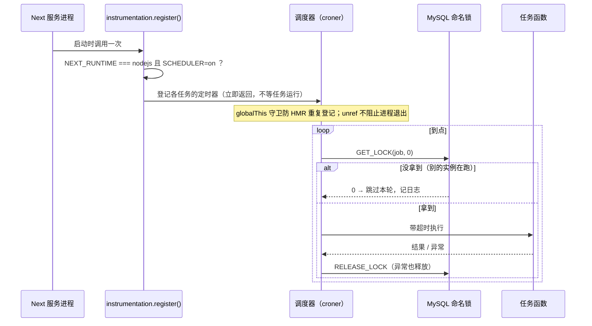

# M11.5 · 进程内定时任务调度器（croner + instrumentation + MySQL 命名锁）

- 阶段：三·完善 ｜ 依赖：[M11.3.1](M11.3.1-registration-cleanup.md)（超期清理服务与脚本）
- 状态：⬜ **设计稿，待站长确认**（未写任何实现代码）
- 与 [M11.4](M11.4-campaign-behavior-effects.md)（行为类 effect）互不依赖，先后顺序由站长定。
- 来源：站长 2026-11-04——站点是 SSR 常驻 Node 进程，没有考虑过进程内的定时任务管理；询问有没有现成的包可用；M11.3.1 的超期清理需要一个定时触发。

> **执行纪律**：同 M11.3——先对齐设计再动代码；每个 Step 回写执行记录；门禁以真实命令输出为准；每个新增测试做变异验证。

## 1. 问题

站内有三个需要周期运行的后台任务，目前全靠**系统 cron / launchd** 调命令行脚本：

| 任务 | 现状 | 备注 |
|---|---|---|
| 账号注销到期处理 | `pnpm account-deletion:drain`，要求系统 cron 周期调用 | 冷静期 30 天，分钟级精度不重要 |
| 超期未验证账号清理 | `pnpm unverified-accounts:purge`（M11.3.1 新增），未接定时 | 每天一次足够 |
| 每日汇总邮件 | `pnpm digest:run`，系统 cron 每小时整点调用，脚本内自带「整点 + 24 小时活跃跳过」判定 | **本期不迁**，见 §5 |

问题有三：上线时漏配 crontab 没有任何提示；每个任务一个独立进程，要各自冷启动、各自连库；M13 的多实例部署下，系统 cron 要配在哪台机器上也是问题。站点本身就是一个常驻的 Node 进程，进程内调度更自然。

## 2. 已核实的事实

| 事实 | 依据 |
|---|---|
| Next 16.4.2 的 `instrumentation.ts` 中 `register()` **在服务实例启动时只调用一次，且必须在服务就绪前返回**；所有运行时都会调用它，须按 `process.env.NEXT_RUNTIME === 'nodejs'` 分流 | 本地 `next/dist/docs/01-app/02-guides/instrumentation.md`、`03-api-reference/.../instrumentation.md` |
| 项目里**已有进程内定时先例**：浏览量计数用 `setInterval` + `unref`，并以 `globalThis.__fwViews` 守卫防 HMR 重复建立 | `apps/web/src/lib/views/record.ts` |
| 当前**没有** `instrumentation.ts`，`next.config.ts` 无相关配置 | 仓库检索 |
| croner 11.0.0：MIT，**零依赖**，自带类型，周下载约 1428 万，2026-11-01 刚发布；支持 IANA 时区（`timezone`）、重叠保护（`protect`）、错误捕获（`catch`）、不阻止进程退出（`unref`）、`stop()`、`nextRun()`、`maxRuns` | npm 注册表元数据与 README（2026-11-04 取得） |
| 候选对比：node-cron 4.6.0（零依赖，有 `noOverlap` 与时区，周下载 655 万）；node-schedule（3 个依赖、无重叠保护）；cron 4.4.0（2 个依赖，无重叠保护）；bree（起 worker 线程，8 个依赖，周下载 4 万，对几个小任务过重）；toad-scheduler（底层就是 croner） | 同上 |
| 数据库连接池只有 8 条，**事务内不得再借第二条连接** | `CLAUDE.md` 积分与门控并发约定 |
| MySQL 8.4 的 `GET_LOCK(name, 0)` 是**连接级**命名锁：拿到返回 1，连接断开时自动释放；锁名上限 64 字符 | MySQL 官方语义（实现时用隔离库实测） |
| 现有任务服务都是**幂等**的：注销处理靠行锁与状态字段，超期清理在事务内重新核对条件 | `account-deletion.ts`、`unverified-cleanup.ts` |
| `account-deletion:drain` 此前不会自行退出（已在 M11.3.1 修复并加进程级测试）；`digest:run` 与 `outbox-drain` 本就有显式 `process.exit` | M11.3.1 §5 |

## 3. 设计

### 3.1 组成

- `lib/scheduler/runner.ts`：包一层「抢锁 → 带超时执行 → 记日志 → 释放锁」。任何异常都被吞掉并记录，**绝不抛进事件循环**。
- `lib/scheduler/jobs.ts`：任务注册表，每项 `{ key, cron, timeoutMs, run }`。`run` 直接调现有的服务函数（`processDueAccountDeletions`、`purgeOverdueUnverifiedAccounts`），命令行脚本改成同一份函数的薄封装，保证手动执行与定时执行是同一份逻辑。
- `lib/scheduler/index.ts`：`startScheduler()`，读环境变量、用 croner 登记定时器，`globalThis` 守卫保证只登记一次。
- `src/instrumentation.ts`：只做 `if (process.env.NEXT_RUNTIME === 'nodejs') { (await import('@/lib/scheduler')).startScheduler(); }`。`register()` 只登记，不 `await` 任务。

### 3.2 默认行为与开关

- **默认关闭，必须显式 `SCHEDULER=on` 才启动**，开发、测试、CI 的 E2E 都不会误启动。理由：开发库连的是真实 SMTP，E2E 的生产构建也是 `next start`，若按 `NODE_ENV=production` 自动开启，E2E 跑 7 分钟期间每 15 分钟一次的注销处理可能踩到正在测试的数据。
- 所有定时表达式一律 `timezone: "Asia/Shanghai"`，与库内「北京墙面时间」的硬约定一致。
- 生产部署清单（M13）新增一项：在且仅在承载定时任务的实例上设 `SCHEDULER=on`；有了命名锁，多个实例同时开也不会重复执行。

### 3.3 首批任务

| 任务 key | 调度（北京时间） | 超时 | 说明 |
|---|---|---|---|
| `account-deletion.drain` | 每 15 分钟 | 5 分钟 | 冷静期 30 天，没有分钟级要求 |
| `unverified-accounts.purge` | 每天 03:30 | 10 分钟 | 7 天期限，默认 `--apply` 语义（定时场景下不是只报告）。**待确认**，见 §6 |

### 3.4 互斥与失败处理

- 锁在**一条专用连接**上持有（从池里借 1 条，任务结束归还）；任务自己的事务另外借连接，且按现有约定一次只借一条。调度器内单进程**串行**执行任务，所以最多额外占 1 条。
- 进程崩溃时 MySQL 自动释放连接级锁，不会死锁。
- 进程重启（发布）会让定时器重置，**错过的触发不补跑**——这些任务都幂等且频繁，下一轮自然补上；每天一次的清理最多晚一天。
- 任务超时只记日志并释放锁，不强杀（不可中断的事务由数据库自己的超时兜底）。

## 4. 边界（明确不做什么）

- **不迁每日汇总邮件。** 它有「整点 + 24 小时活跃跳过」判定，系统 cron 与进程内同时跑可能重复发信，需要单独评估去重语义。
- 不迁 outbox 自愈巡检（`sweepPending` 目前由业务流量捎带驱动，M13-1 另有安排）。
- 不做后台「定时任务」管理页（可用 croner 的 `nextRun()` 做只读状态页，列为后续）。
- 不做持久化的任务运行记录表：本期用结构化日志；破坏性任务（清理）本身已写 `audit_log`。
- 命令行脚本全部保留，供手动执行、只报告与排障。

## 5. 风险

| 风险 | 对策 |
|---|---|
| `instrumentation.ts` 同时被 Edge 运行时编译，误引入 Node 专用代码 | 用 `NEXT_RUNTIME` 分流并**动态 import**；加守卫测试；生产构建实测 |
| `next dev` 热更新重复登记定时器 | `globalThis` 守卫；单测断言重复调用只登记一次 |
| 命名锁连接在池里被回收或超时断开，任务跑到一半锁丢了 | 锁连接专用，任务期间不归还；断开则本轮任务结果照常，下一轮重新抢；集成测试覆盖「持锁方未释放时第二个抢锁者被拒」 |
| 连接池耗尽 | 串行执行 + 专用连接最多额外 1 条；沿用「事务内不借第二条连接」约定 |
| 现有架构守卫（`modules-import-guard`、`server-only-guard`、`architecture-guard`）对新目录不认识 | 开工前先读守卫，按需登记，守卫放宽的理由写进文档 |
| 与系统 cron 双跑 | 迁移后文档明确删除对应 crontab 条目；两者同时存在也安全（任务幂等，命名锁互斥仅限进程内调度，系统 cron 直接起的脚本不抢锁——所以**脚本也应抢同一把锁**，见 Step 3） |

## 6. 待站长确认

1. **库选型**：croner（建议）还是 node-cron？依据见 §2，两者都满足；croner 下载量更大、更新更近、有 `unref` 与 `catch`，node-cron 的 `distributed` 等协调功能我没读透，不想依赖。
2. **互斥机制**：A. MySQL `GET_LOCK`（建议，零表结构变更，进程崩溃自动释放）；B. 租约表（多一张表，可在后台展示最近运行时间与结果，代价是迁移与清理逻辑）。本期建议 A，需要可观测性时再演进。
3. **默认开关**：显式 `SCHEDULER=on` 才启动（建议），还是生产环境自动启动？
4. **清理任务的定时语义**：定时场景直接 `--apply`（建议，否则定时任务没有意义），还是先观察一段时间的只报告日志再放开？
5. **频率**：注销处理每 15 分钟、清理每天 03:30，可以吗？

## 7. Step 分解（确认后执行）

| Step | 内容 | 门禁 |
|---|---|---|
| 0 | 加依赖；环境变量契约（`SCHEDULER`）；守卫盘点 | `pnpm install` 后 lint / tsc |
| 1 | `runner`（抢锁 / 超时 / 异常隔离 / 日志）+ `jobs` 注册表；单测（假时钟、锁冲突、超时、异常不外泄）+ 真实 MySQL 集成测试（两条连接抢同一把锁） | 变异验证：去掉释放锁 / 去掉异常隔离 / 去掉超时，各让对应测试变红 |
| 2 | `startScheduler` + `instrumentation.ts`；`globalThis` 幂等；`NEXT_RUNTIME` 分流；守卫登记；生产构建实测 `SCHEDULER=on` 启动后定时器登记且进程能正常退出 | 进程级测试：起真服务、短周期测试任务确实触发、停服后进程退出 |
| 3 | 命令行脚本改为调同一份任务函数，并抢同一把命名锁；`package.json` 入口保持不变 | 脚本进程级测试沿用 `runWebScript` |
| 4 | 文档：`.env.example`、`CLAUDE.md` 已知坑、M13 上线清单、`docs/` 定时任务汇总表；CHANGELOG | `format:check` |
| 5 | 门禁：`verify:all`、全量 `test:e2e`、`test:visual`、生产构建 `pwa:lighthouse`、CI | 全部读真实退出码 |

## 8. 测试规则

- 单测不用真实时钟：注入调度器工厂与假时钟，断言「到点触发 / 重叠时跳过 / 异常被吞并记日志 / 重复 `start` 只登记一次」。
- 集成测试用真实 MySQL 临时库验证命名锁：A 持锁时 B 抢不到；A 释放（或连接断开）后 B 抢得到。
- 进程级测试用真起进程的方式验证「SCHEDULER 关闭时不启动」「开启时短周期任务触发」「停服后进程退出」。
- 每个新增测试做变异验证。
