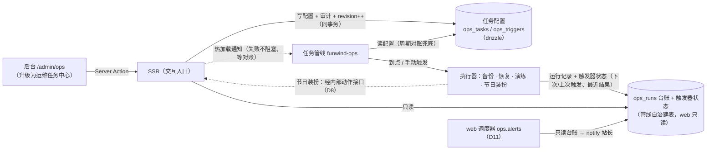

# M14 · 运维任务管线（funwind-backup → funwind-ops）

- 阶段：四·运营与演进 ｜ 依赖：M13（已收口，2026-11-09——上线成功进入观察期，开工前置已解除）
- 状态：🚧 实施中（2026-11-09 立项；**推进计划已获站长批准**——前置探查完成、事实 F1–F26 与决策
  D1–D12 定稿；Step A 文档定稿、E2E 基线修复、Step 1 管线内核重构、Step 2 配置模型与 web 写服务、Step 3 后台运维任务中心、Step 4 节日装扮任务、Step 5 可选批次（自动恢复演练 + 失败告警）、Step 5.5 收口前审查（站长人工评审已通过）、Step 6 部署切换与 24h 核对已完成——**M14 已收口 2026-11-11**）
- 来源：站长 2026-11-09 立项——备份服务升级为独立定时任务管线：不只承载备份，还把**运维类定时器**
  收编进来，任务与触发器在后台配置、元数据入表、管线到点执行并回写状态，「配置和执行解耦」；
  节日自动切换主题一类运营排期定时纳入。业务定时（领域逻辑自带的周期任务）仍留在业务侧。
- 上线口径（站长 2026-11-09 拍板）：**本地灰度 + 测试通过即可发布线上公测**——M14 不碰核心功能，
  对用户影响小，不做长时间观察期。
- 设计基准：[M11.2](M11.2-theme-switching.md)/[M11.4](M11.4-campaign-behavior-effects.md)（排期引擎与
  effect 注册表）、[M11.5](M11.5-scheduler.md)（命名锁与调度器模式）、[M13](M13-launch.md)（备份服务 v1
  与部署拓扑）、[BACKUP.md](../ops/BACKUP.md)、评审规范四条（G-15/16/19/20，CLAUDE.md）。

> **执行纪律**：同 M13——先对齐设计再动代码；每个 Step 单独提交、单独过门禁，完成后回写 §12 并汇报，
> 站长确认后再进下一步；门禁以真实命令输出为准（不套管道），冲突先改文档再动代码。
> §1 记录**已在代码/环境里核实过**的事实（两轮探查 + 官方文档核查），§11 记录决策，二者不要混读。

## 目标

1. `funwind-backup` 升级为**运维任务管线中枢**（更名 `funwind-ops`，D3）：统一承载运维类定时任务——
   任务定义、触发器（cron / 单次 / 手动）、运行台账、互斥、后台展示数据源。
2. **配置与执行解耦**：任务与触发器在后台管理（web 写配置 + 审计，D1），管线读配置执行并回写状态；
   配置热加载（快路径）+ 周期对账（兜底，停机期改动启动后自动追上）。
3. 手动触发**异步化**（返回 run id + 前台轮询），替代现 Server Action 同步等待（现超时 30 分钟）。
4. 首批任务类型：备份 db / 备份 storage（保留份数迁入任务参数）、恢复（仅手动触发）、**节日装扮**
   （运营排期定时：规则生成 campaigns 时间窗，D2）；可选批次按 D12 勾选（自动恢复演练 + 失败告警）。
5. 顺带清账：管线 v1 的安全与正确性问题（§4）、web 侧 ops 欠账（G-15/G-16 与审计）、三处文档漂移（F24）。

## 1. 已核实事实（2026-11-09 两轮探查 + 官方文档核查，行号佐证）

### 1.1 管线与对接现状（v1 基线）

| # | 事实 | 位置 | 对设计的影响 |
|---|---|---|---|
| F1 | 备份服务 ~570 行 Python（FastAPI + APScheduler 3.11 + pymysql）：启动时自治建表 `backup_runs`，APScheduler cron 两条（db 03:10 / storage 03:40），`GET_LOCK` 互斥，mysqldump/tar 子进程 + gzip 完整性校验 + 按份数轮转 | `services/backup/app/main.py:20-34`、`backup.py:69-154`、`metadata.py:6-21` | 管线中枢的雏形已在：改造点是「调度定义外部化 + 台账通用化 + 触发器模型」，执行器（备份/恢复）整体保留 |
| F2 | web 调备份服务：`BACKUP_SERVICE_URL` + `BACKUP_OPS_TOKEN`（`X-OPS-Token` 头），触发超时 30 分钟（同步等待），health 5s；后台两个 Action（`admin.ops.backup` / `admin.ops.policy`）声明 `auth: { admin: "site.admin" }`，`redirect` 回显 `?done=1` / `?err=` | `apps/web/src/lib/ops/backup.ts:53-89`、`app/admin/ops/actions.ts:15-33` | 手动触发异步化需改这条链路；redirect 提示参数已有消费者（G-15 达标），改语义时保持成对交付 |
| F3 | `backup_runs` 由管线自治建表（不进 drizzle schema），web 用原生 SQL 只读；后台另有保留策略写 `site_settings("ops.backup.policy")`，管线每次执行动态读取（clamp 1–90），**不写审计** | `apps/web/src/lib/ops/backup.ts:16-45,121-152`、`backup.py:33-49` | D1 把任务配置迁到 drizzle 表（web 写 + 审计）；保留策略迁入任务 params 后该读写链退役 |
| F4 | 生产拓扑：备份服务在 `funwind-internal` 网络（`BACKUP_DB_HOST=funwind-mysql`），web 也在同网络（`BACKUP_SERVICE_URL=http://funwind-backup:8000`）；app 端口 `127.0.0.1:3311` 仅 loopback；funwind-internal 由 mysql 编排创建；备份卷 `funwind-backup-files` app 只读挂载 | `docker/production/compose.yaml:21-35`、`docker/backup/compose.yaml`、`docker/mysql/compose.yaml:49-51` | 管线与 SSR 的通道现成（内网 + token）；更名只改容器/镜像/项目名，卷名与数据不动（D3） |
| F5 | 排期引擎（campaigns）是**读取时惰性判定**（`starts_at <= NOW() < ends_at`，无 cron），同 effect 按 priority 选优，未知 effect/坏配置 fail-closed 跳过 | `apps/web/src/lib/campaigns/service.ts:11-42`、`M11.2-theme-switching.md:28,33` | 节日装扮（D2）走「管线生成 campaigns 行」而不是「到点直接切」：生效与回退语义零改动，管线停机也不错过节日 |
| F6 | effect 注册表：`theme.pack {pack}`、`site.logo {file: logo-*.png}`、`site.hero {file: hero-*.png}`，schema `.strict()`；写服务范式 = 事务内 FOR UPDATE + revision 乐观锁（冲突不覆盖）+ `writeAudit` 同事务（via 附进 after）+ `withDeadlockRetry` | `apps/web/src/lib/campaigns/effects.ts:65-90`、`admin.ts:44-69,174-219` | 节日装扮生成的目标行与 ops 配置写服务直接复用这套范式 |
| F7 | 站点级运维写库有先例：register.policy 经备份服务 python 通道参数化 SQL 写入（2026-11-09 教训：ssh+mysql -e 引号转义会静默失配） | `CLAUDE.md`「备份服务」节 | D2 拍板：节日装扮的 campaigns 行**经 SSR 内部动作接口**写（复用 effect 校验/审计/revision），不走 python 直写 |
| F8 | APScheduler 3.x `day_of_week` 0 = 周一（非 crontab 的周日），`from_crontab()` 不做转换——官方文档明示「historical mistake」 | [APScheduler cron 文档](https://apscheduler.readthedocs.io/en/stable/modules/triggers/cron.html)、[issue #931](https://github.com/agronholm/apscheduler/issues/931) | cron 一旦后台可编辑，「每周日」会静默变「每周一」——管线统一 cron 写法（星期字段用名称 `mon…sun`），后台「下次运行」预览一律由管线计算（§3.4） |

### 1.2 web 后台模式与约束（探查二）

| # | 事实 | 位置 | 对设计的影响 |
|---|---|---|---|
| F12 | `/admin/ops` **零兜底**：page 一次 `Promise.all([listBackupRuns(50), backupServiceHealth(), getBackupPolicy()])`，无 try/catch；`backup_runs` 表不存在时裸 SQL 抛错 → **整页 500**（零数据安装、本地未部署管线时管理员打开即崩）；「暂无记录」空态只在表存在且为空时渲染 | `apps/web/src/app/admin/ops/page.tsx:37-41,147-150` | Step 3 必修：表缺失/管线未部署降级为「未部署」空态 |
| F13 | `db:verify`「tables:全集一致」：information_schema 与 schema.ts 逐表比对（`__drizzle_migrations` 豁免），**schema 外任何表都判多余而失败** | `packages/db/scripts/verify.ts:97-110`（已亲自复核） | 台账表（管线自治建）会触发——D7 加显式豁免清单，比口头约定「本机别起管线」可靠 |
| F14 | defineAction **不自动写审计**；审计 API = `writeAudit(tx, entry)`（`AuditEntry`/`ConfigActor`），与业务写同事务（回滚则审计一并回滚）；样例：campaigns 写服务脚手架（via 统一附加进 after）、`setSetting`（FOR UPDATE 读旧值、值变才审计） | `lib/audit.ts:17-44`、`lib/campaigns/admin.ts:54-69`、`lib/auth/settings.ts:72-99` | ops 配置写服务的审计模板现成 |
| F15 | 乐观锁全链现成：`updateCampaign(id, expectedRevision)` 事务内 FOR UPDATE → 冲突 `{code:"conflict"}` 不覆盖、回显 `?err=conflict&draft=…`（G-19 全链）；旁路写同样 revision+1（G-20） | `lib/campaigns/admin.ts:174-265`、`app/admin/campaigns/actions.ts:54` | ops 任务/触发器编辑照抄 |
| F16 | 迁移编号至 `0024_m11_3_login_verification.sql`，命名 `NNNN_slug.sql`；bootstrap 种子仿 `theme-pack-seeds`（只补缺 INSERT IGNORE）；install 向导步骤 = `[connection, create-db, bootstrap, site-settings, admin, lock]`，**无逐表硬编码**——新表进 schema.ts 即被安装/零数据路径自动覆盖 | `packages/db/drizzle/`、`bootstrap.ts:224-313`、`lib/install/run-install.ts:36-43` | ops_tasks/ops_triggers 迁移与默认种子按此惯例；向导零改动 |
| F17 | schema-rules 对新表的硬约束：必须有主键；唯一键不得含可空列（豁免白名单另计）；单列整型 id 必须 AUTO_INCREMENT；禁 `raw/content_raw` 列；禁 legacy 表/列/枚举；库无外键是项目原则 | `packages/db/src/schema-rules.ts:24-51,78-129` | ops_tasks/ops_triggers 建表逐条对照；`task_key` 唯一索引不可空 |
| F18 | 通知能力边界：`notify()` 的 type 必须先在模块注册（未注册抛错）；`NOTIFICATION_CATEGORIES` 是 **schema 枚举**（interaction/message/moderation/account）——新增类别要改枚举 + 迁移；无「发给全体 admin」助手 | `lib/notifications/notify.ts:17-31,105-112`、`packages/db/src/schema.ts:56-58` | 失败告警（D11）= web 侧调度器扫描台账 + 新增 `system` 类别迁移 + 模块注册通知类型 |
| F19 | E2E 夹具齐备：`loginAs(USERS.admin=90004)` 直插会话；`campaigns.spec.ts`（serial + `failOnPageErrors` + afterAll 清数据）与 `admin-emojis` 的 `auditExists`（审计落库断言）可参照；**无 admin-ops spec** | `e2e/support/session.ts:10-40`、`e2e/campaigns.spec.ts`、`e2e/admin-emojis.spec.ts:24-31` | Step 3 新建 `admin-ops.spec.ts` 按此模式（G-16） |
| F20 | 守卫登记现状：`lib/ops/**` **零登记**（不在 server-only-guard 清单）；app/api 路由直连 `@funwind/db` 须入 architecture-guard 的 DATABASE_ENTRIES 基线（DB 访问收在 lib/ops 则免登记）；admin 页面首 await 必须 `requireAdmin`（admin-entry-guard 自动扫描）；**route.ts 不在自动扫描范围**须自带 requireAdmin（download/route.ts:13 先例）；导航改动过 admin-nav-guard | `src/test/server-only-guard.test.ts:17-50`、`architecture-guard.test.ts:87-110`、`admin-entry-guard.test.ts` | 各 Step 的守卫登记清单照此执行 |
| F21 | **无轮询先例**：全仓 `router.refresh()` 都是动作后单次刷新，无 `setInterval + router.refresh` | `components/admin/use-theme-request.ts:51` 等 | 运行中任务的自动状态刷新是新造 UI 模式（有 running 行时 5s 轮询、无则清除） |

### 1.3 部署、运行与文档现状（探查三）

| # | 事实 | 位置 | 对设计的影响 |
|---|---|---|---|
| F22 | nginx **全站透传**：`location / { proxy_pass http://127.0.0.1:3311; }`，无路径白名单、无 allow/deny/auth_basic——`/api/internal/**` 若不处理则**公网直达**（应用层鉴权是唯一防线） | `docker/production/nginx/funwind.conf:67-81` | D8 内部接口三保险：nginx 显式封禁 + token + 服务端校验 |
| F23 | 管线启动韧性差：缺 env 在 config **import 期 raise** → uvicorn 退出 → `unless-stopped` **崩溃循环**；DB 不可达时 `ensure_table()` 在 lifespan 抛，同样崩溃循环；healthcheck 探的 `/health` 在 DB 挂时仍返回 200（只探进程活性不探 DB） | `services/backup/app/config.py:4-8`、`main.py:21`、`api.py:15-24`、backup compose healthcheck | 本轮改造：配置缺失/DB 不通降级 unhealthy + 启动重试；`/health` 如实反映 DB；C5/C6 一并清账 |
| F24 | 文档漂移与部署缺口：① BACKUP.md/RUNBOOK 的 `/opt/funwind/backups/backup.log` 是 crontab 时代残留（compose 无宿主机日志挂载，实际只有 docker json-file 5m×3；`backup.log` 全仓零代码写入）；② `docker/production/.env.example` **漏列 `BACKUP_OPS_TOKEN`**（compose 却 `:?` 强制要求）；③ RUNBOOK 目录树缺 `/opt/funwind/backup/`（backup compose 注释里的部署位置） | `docs/ops/BACKUP.md:54`、`docs/ops/LAUNCH-RUNBOOK.md:22,135`、`docker/production/.env.example:23`、`docker/backup/compose.yaml:2` | Step 6 一并勘误；生产 .env 模板补新 env 名 |
| F25 | 改名影响面已盘清：容器/镜像/项目名（backup compose:5,9,12）、锁名默认值 `funwind-backup`（config.py:32）、app 侧 URL（production compose:28）、CLAUDE.md 命令与 9 处文档引用；CI 不覆盖 Python（secret 扫描会扫 services/backup、jscpd 不扫）；部署流 = 本机 build → `docker save | ssh docker load` → compose up | `docker/backup/compose.yaml`、`.github/workflows/ci.yml`、`docs/ops/LAUNCH-RUNBOOK.md:11-31` | D3/D10 的改名清单与 Step 6 部署附录的输入 |
| F26 | 农历库选型：[lunar-python（6tail）](https://github.com/6tail/lunar-python) 零第三方依赖、内置农历节日（春节/元宵/端午/中秋/重阳/除夕等）、多语言同构、活跃维护；备选 [Borax](https://github.com/kinegratii/borax)（轻量、自定义节日规则、更新频率低） | 2026-11-09 检索 | D9：选 lunar_python，版本钉 requirements.txt |

## 2. 边界（明确不做什么）

- **不迁业务定时**（站长拍板）：注销到期处理、超期未验证清理、每日汇总邮件、outbox 补派仍由业务侧
  （web 进程内调度器 / 捎带快路径）承载；管线不回调 SSR 的业务任务端点（编排阶段曾议的「回调执行」
  架构随职责收窄弃用，执行全部在管线进程内；唯一的 web 反向写入口是 D8 白名单接口——节日装扮生成）。
- 不做多实例改造：管线仍单实例（GET_LOCK 语义不变）。
- 不做分布式调度 / 消息队列 / 工作流引擎——任务规模（个位数到十几个）配不上，配置表 + 单进程足够。
- 不做后台 UI 的恢复执行入口（D5）：后台只提供**预览 + 复制 CLI 命令**；真实恢复仍走 CLI（`--yes` 确认）。
- 不做任务依赖编排（DAG / 任务链）；不做重试策略配置（首版只记失败，重试靠幂等重跑或手动触发）。
- 不动备份/恢复的产物格式、保留轮转语义与 `pnpm db:verify` 对账口径（M13 已演练签字的链路）。

## 3. 设计

### 3.1 配置与执行解耦（总体）

- **配置归 web（drizzle，D1）**：任务与触发器是内容实体（要分页/筛选/审计/乐观锁），进 schema 单一
  事实源；管线读它。台账与触发器状态归管线自治建表（web 只读，原生 SQL）——「运维表归服务管」
  原则收窄为：**运行时产出**的运维数据归服务管。
- **双向同步**：后台保存 → 同事务审计 + revision++ → 通知管线热加载（快路径）；管线周期对账（兜底）。
  管线执行后回写触发器状态与运行台账，后台展示一律以台账为准。
- **零表韧性**（M12 原则延续）：配置表不存在时，管线回落内置默认任务集（= 现两条备份 cron 的 env
  语义），日志告警，不停摆；web 端 `/admin/ops` 对台账表缺失/管线未部署同样降级空态（F12 修复）。

### 3.2 元数据模型（含 D7 台账演进）

| 实体 | 归属 | 关键字段 | 说明 |
|---|---|---|---|
| `ops_tasks` | **web**（drizzle，迁移 0025） | `task_key`（唯一，定名不改）、`name`、`executor`（backup.db / backup.storage / drill.restore / campaign.holiday…）、`params`(json，双端校验)、`enabled`、`revision`、审计字段 | 任务定义 + 执行参数；保留策略迁入备份任务 params（键 `keep`）；建表逐条对照 F17 |
| `ops_triggers` | **web**（同上） | `id`、`task_key`、`kind`（cron / once / manual）、`expr`（cron 串或 `YYYY-MM-DD HH:MM:SS`，manual 为空）、`enabled`、`revision` | 一个任务可挂多个触发器；有启用中的 manual 触发器才允许手动触发 |
| `ops_runs` | **管线**（自治建表，web 只读） | 由 `backup_runs` 幂等演进（D7）；增 `task_key` 列（旧行按 kind 回填），`kind` 枚举末尾追加 drill/holiday、`trigger_source` 追加 once | 运行台账：状态、产物、错误、耗时；**id 连续保留**——恢复按 run id 定位备份 |
| `ops_trigger_state` | **管线**（自治建表，web 只读） | `trigger_key`（配置触发器 `t{id}`，内置默认 `default:{任务}:{类型}`）、`task_key`、`next_fire_at`、`last_fired_at`、`last_run_id`、`last_result` | 后台「下次运行」展示的数据源，由管线计算（F8：web 不复算 cron） |

**列契约**（Step 1 定稿）：配置表两张的列名与类型以 `services/ops/tests/contract.py` 的 DDL 为准——
Step 1 时配置表尚未建，管线测试按它自建；Step 2 的 drizzle 迁移必须与之一致，并改由 `db:bootstrap`
建出的真实 schema 跑同一组管线测试（契约测试）。

**D7 台账演进**：管线启动时幂等执行——`backup_runs` 存在且 `ops_runs` 不存在 →
`ALTER TABLE backup_runs RENAME TO ops_runs, ADD COLUMN task_key …`（单语句改名 + 加列，数据与 id
全保）；`ops_runs` 已存在 → 仅确保列齐。配套：`packages/db/scripts/verify.ts` 增 `EXTRA_TABLES`
豁免清单（`ops_runs`、`ops_trigger_state`），注释写明「运维台账归管线管（M14 D1/D7）」。

### 3.3 执行器模型（管线内）

- **执行器注册表**（Python 侧，`app/executors.py`）：`executor` 键 → 参数校验 + 执行函数 + 互斥组 +
  台账类别。Step 1 落地 `backup.db` / `backup.storage`；`campaign.holiday`（Step 4）与 `drill.restore`
  （Step 5）随后登记。**恢复不进注册表**（Step 1 定）：每次都要指定源备份与目标库，不是可调度任务，
  走专用 API（`POST /restore`）与 CLI。
- **互斥**：沿用 `GET_LOCK`（备份/恢复/演练互斥；节日装扮生成是秒级轻操作，用独立锁名分池，避免被
  长备份阻塞）。
- **异步手动触发**：`POST /tasks/{key}/runs` 立即返回 `{run_id}`（插入 running 行 + 后台线程执行）；
  台账轮询取状态。旧 `POST /runs?kind=` 兼容期保留（内部调用方只有 web），Step 6 切换后移除。

### 3.4 cron 语义（F8）

- 配置表里的 cron 表达式统一约定：星期字段一律用名称（`mon…sun`），分钟/小时/日/月可用数字；
  管线解析时对星期数字**拒绝并报错**（不猜语义）。
- 后台展示的「下次运行时间」一律读管线回写的 `ops_trigger_state.next_fire_at`，web 侧不复算 cron。

### 3.5 节日装扮（campaign.holiday，D2/D9）

- **规则**（存任务 params）：公历或农历（lunar_python，D9）每年某月某日、前后偏移天数、持续天数、
  提前生成提前量；**装扮内容**：theme.pack / site.logo / site.hero 列表（复用 effect 注册表的 config
  schema，一个任务可含多项）。
- **触发行为**：管线到点（或手动）执行时，把**下一次**节日的时间窗写为 campaigns 行（幂等键 =
  规则 id + 年份；已存在则更新窗口而非新行），经 **D8 内部动作接口**写入（复用 `/admin/campaigns`
  的写服务：effect 校验、audit_log、revision++ 全部同一条路）。
- **生效与回退语义零改动**：仍是 campaigns 读取时判定（F5）——管线停机也不错过节日；生成后的当年
  方案在 `/admin/campaigns` 可见、可微调（改窗/换包），下一年由管线重新生成。
- 台账记一条「已生成 {年份}{节日} 装扮（campaign id=…）」；农历换算用固定日期单测钉住
  （春节/端午/中秋/除夕 × 近三年 × 闰月年）。

### 3.6 内部动作接口三保险（D8，Step 4 落地）

1. **nginx 封禁**：`location /api/internal/ { return 404; }`——公网不可达（F22 全站透传的前提）。
2. **token 鉴权**：`X-OPS-Token`（与管线 OPS_TOKEN 同值），`hmac.compare_digest` 常量时间比较。
3. **服务端复用写服务**：路由只做转发，校验/审计/revision 全在 campaigns 写服务（坏配置 fail-closed）。
   管线经 funwind-internal 直连 app 容器（`http://funwind-app:3311`，以 compose 实际服务名为准）。

### 3.7 失败告警实现位（D11，Step 5 落地）

- **web 侧调度器**新增 `ops.alerts` 任务：扫描 `ops_runs` 近期 `failed` → `notify()` 站长
  （dedupKey = run_id 幂等，重发不骚扰）；管线不回调 web 的边界不破——告警判定在 web、数据只读自台账。
- 需要：schema 通知类别枚举加 `"system"`（迁移）+ 模块注册通知类型（mandatory）+ 通知中心渲染
  （system 类图标/文案）；`ops.alerts` 进 `lib/scheduler/tasks.ts` 与 [SCHEDULED-JOBS](../SCHEDULED-JOBS.md) 总表。

### 3.8 env 改名迁移（D10）

- web 侧新名 `OPS_SERVICE_URL` + `OPS_API_TOKEN`，读取顺序 = 新名优先、旧名（`BACKUP_SERVICE_URL` /
  `BACKUP_OPS_TOKEN`）兜底一轮，下个里程碑删兜底；`.env.example` 与生产模板同步。
- 管线侧 executor 参数 env（`BACKUP_DB_*` / `BACKUP_KEEP_*` 等）**保持原名**（它们是备份执行器参数，
  不是服务身份）；容器/镜像/项目名 → `funwind-ops`；锁名默认值改 `funwind-ops`（GET_LOCK 换名安全，
  无旧持有者）；卷名 `funwind-backup-files` 不动（D3，app 只读挂载路径不变）。

## 4. 管线 v1 清账表（Step 1 逐项，收口前审查复验）

| # | 问题 | 处置 |
|---|---|---|
| C1 | restore `target_db` 未校验注入面（直拼 shell/SQL，仅靠 token 挡） | 白名单校验（`^[A-Za-z0-9_]+$` + 长度上限 + 保留库名黑名单），执行前断言 |
| C2 | DB 口令进进程参数（`-p…`） | `MYSQL_PWD` 环境变量或 `--defaults-extra-file`（本机容器实测后定，产出写 §12） |
| C3 | token 非常量时间比较（`!=`） | `hmac.compare_digest` |
| C4 | 连接未设会话时区（违反硬约定 4；现无用 `NOW()` 故无害，管线化后要做时间比较） | 每连接 `SET time_zone='+08:00'`，集成测试守护 |
| C5 | 崩溃残留 `running` 记录无回收 | 启动时 + 对账周期：超时（> 执行器超时上限）的 running 标记 `failed`（error=「进程中断推定」） |
| C6 | 全服务零测试 | pytest 单测（配置解析/cron 约定/幂等键/参数 schema/触发器状态机）+ 真实 MySQL 集成（建表与 ALTER 演进/对账/锁/running 回收/恢复 dry-run）；关键分支变异验证 |

## 5. 任务类型清单

**必做（Step 1–4 覆盖）**：

| executor | 触发器 | 参数要点 |
|---|---|---|
| `backup.db` | cron（默认 03:10）+ manual | 保留份数（自 site_settings 迁入，默认 14） |
| `backup.storage` | cron（默认 03:40）+ manual | 保留份数（默认 7） |
| `restore` | 仅 manual | 目标库白名单；后台只预览（D5） |
| `campaign.holiday` | 手动 + （可选）年度自检 cron | 节日规则（公历/农历）+ 装扮内容列表（D2/D9） |

**可选批次（站长 2026-11-09 按 D12 勾选）**：

- [x] **自动恢复演练**（`drill.restore`，Step 5）：每周任务（默认周五 02:00）——最新成功 db 备份 →
  临时 MySQL 容器导入 → 对账（gzip/尾标/表计数，同 BACKUP.md §4 口径）→ 清理，结果入台账。
- [x] **失败告警**（Step 5）：§3.7 的 `ops.alerts` + `system` 通知类别。
- [ ] binlog 清理——**缓**（一条 `binlog_expire_logs_seconds` 配置可手动设，管线化收益低；保持记录）。

## 6. 业务侧附带项（不属管线，独立处理）

- **digest 每日汇总邮件**：生产疑似从未跑（依赖系统 crontab，仓库无安装记录；OBSERVABILITY §4 只把
  「digest 次日到达」列为观察项）。**先核实**（站长回忆是否收到过 / 服务器 `crontab -l`；2026-11-09
  仍未获答复，不阻塞 M14）。若确认未装：迁入 web 进程内调度器（`last_email_digest_at` 幂等，无双线
  风险），**作为独立热修先做，不等 M14**。
- **outbox 周期巡检**：同口径评估迁入进程内调度器（流量捎带保留为快路径）。
- `/admin/settings` 的 digest 文案随核实结果更正。

## 7. Step 分解与测试流程

> 分支 `feat/m14-ops-pipeline`；顺序 A → 1 → 2 → 3 → 4 → 5 → 5.5 → 6。
> 发布口径：本地灰度 + 门禁全绿即可部署生产（站长 2026-11-09 拍板，生产升级动作进 RUNBOOK 附录）。
> 每 Step：单独提交、门禁真实退出码、回写 §12、站长确认后进下一步。

**Step A · 文档定稿** ✅：本文件重写（事实 F1–F26、决策 D1–D12、Step 分解细化、审查流程、回滚口径）。
门禁：`format:check` + `check:secrets` 退出码 0。

**Step 1 · 管线内核重构**（只动 Python，web 零改动；配置表缺失时回落内置默认，§3.1）
- 内容：执行器注册表；配置读取（启动 + 周期对账 + 热加载通知消费）；三类触发器（cron/once/manual，
  一个任务多触发器）；cron 写法统一（§3.4）；台账通用化（D7 ALTER 演进 + `ops_trigger_state`）；
  异步手动触发 API；触发器状态回写；§4 清账 C1–C6；启动韧性（F23：配置缺失/DB 不通降级 unhealthy +
  重试，`/health` 如实反映 DB，不再崩溃循环）。
- 测试：pytest 单测 + 真实 MySQL 集成 + 关键分支变异验证 + 本机 docker 全链路冒烟
  （compose up → health → 两条备份任务实跑 → 手动触发返回 run_id → 台账回写）。
- 门禁：pytest 全绿；docker 冒烟实测记录回写 §12；web 侧零改动（`verify:all` 不受影响）。

**Step 2 · 配置模型与 web 写服务**
- 内容：`ops_tasks`/`ops_triggers` 进 drizzle schema（迁移 0025，对照 F17）；bootstrap 默认任务种子
  （仿 theme-pack-seeds 只补缺：两条备份任务平移，各带 cron + manual 触发器；保留份数从生产现值
  `site_settings("ops.backup.policy")` 迁入 `keep` 参数，无现值用默认）；写服务（F14/F15 范式：
  事务内审计 + revision 乐观锁 + withDeadlockRetry + 冲突回显草稿）；保留策略迁入 params（旧读写链退役）；
  web 触发链改异步（拿 run_id 即返回）；`lib/ops/**` 补 server-only-guard 登记；verify.ts 豁免清单（D7）。
- 测试：db 包单测（schema-rules/种子对账/迁移幂等重跑）+ 真实 MySQL 集成；写服务集成（审计同事务回滚、
  冲突语义、坏配置拒绝）；开发库与临时库各跑一轮迁移幂等。
- 门禁：`verify:all` 退出码 0；`db:verify` 在建了台账表的库上通过（豁免清单生效）。

**Step 3 · 后台运维任务中心（/admin/ops 升级）**
- 内容：任务清单（状态/触发器/下次运行，读 `ops_trigger_state`）、运行台账（分页 + 失败原因）、
  手动触发（异步 + F21 轮询：有 running 行 5s 自动刷新、无则清除）、恢复预览（D5：只读 + 复制 CLI），
  备份下载与策略区迁移；**还账**：F12 零兜底修复（表缺失/未部署降级空态）、旧 Action 补审计、
  过期文案更正（「宿主机 crontab 承担」等）。
- 测试：组件测试（表单/空态/轮询清理）；集成（权限、审计落库 `auditExists` 模式）；E2E 新建
  `admin-ops.spec.ts`（G-16：成功路径 + 错误路径——未授权 404、服务未配置降级、409 busy、失败记录展示、
  触发后台账 running→success）；六档布局矩阵 + `layout:summary`；visual 基线零更新。
- 门禁：`verify:all` + 全量 E2E 不回归；E2E 含错误路径全绿；目视验收（AI 切块代做，
  按 [VISUAL-VERIFICATION](../VISUAL-VERIFICATION.md) 规程）。

**Step 4 · 节日装扮任务（campaign.holiday）**
- 内容：lunar_python 接入（D9）；规则 schema（§3.5）；执行器（生成下一次节日 campaigns 行，幂等键 =
  规则 id + 年份，经 D8 接口）；后台规则管理表单；nginx `/api/internal/` 封禁（D8 第①保险）。
- 测试：农历换算单测（固定日期表 × 近三年 × 闰月年）；生成幂等集成（同规则同年重跑不重复、改窗更新
  而非新行）；坏配置拒绝（fail-closed）；E2E（生成后 /admin/campaigns 可见可改）。
- 门禁：单测/集成/E2E 全绿；真实生成一轮到开发库并在 /admin/campaigns 目视核对。

**Step 5 · 可选批次（D12 勾选：自动恢复演练 + 失败告警）**
- `drill.restore`：每周任务（默认周五 02:00），临时容器演练全链路实测一轮。
- 失败告警：`ops.alerts` + `system` 类别迁移 + 通知中心渲染；集成测试（failed → notify、dedupKey 防重、
  无失败不骚扰）；[SCHEDULED-JOBS](../SCHEDULED-JOBS.md) 总表加行。
- 门禁：同 Step 基线（`verify:all` + 新增测试全绿 + 变异验证）。

**Step 5.5 · 收口前审查**——独立提交，流程与 checklist 见 §9。

**Step 6 · 部署切换与收口**
- 内容：改名落地（D3/D10：容器/镜像/项目名 `funwind-ops`、锁名、web env 新名 + 旧名兜底）；compose 与
  `.env.example` 更新（补 F24-② 缺漏）；nginx conf 增 `/api/internal/` 封禁；RUNBOOK 附录（部署升级步骤 +
  §10 回滚口径）；文档同步（BACKUP.md 勘误 backup.log 与双定时线口径、CLAUDE.md 备份服务段改
  「运维任务管线」、README 命令、SCHEDULED-JOBS、CHANGELOG）；生产部署（公测口径）+ 24h 核对。
- 门禁（里程碑收口）：`verify:all` / 全量 E2E / 安装 E2E / visual 基线零更新 / `layout:summary` /
  lighthouse / `perf:posting` 达标；PR CI 双绿；本机 compose 全链路实测（改名后 up → health → 任务实跑 →
  web 异步触发 → 台账回写）；生产部署后 24h：台账无 failed、两条备份 cron 首跑成功、后台展示与
  CLI `status` 一致。

## 8. 门禁标准（汇总）

| 层级 | 标准 |
|---|---|
| Step 门禁（1–5） | `pnpm verify:all` 退出码 0；本步新增测试全绿（pytest / 单测 / 集成 / E2E）；关键分支变异验证；回归断言零改动；涉及页面过六档布局矩阵 |
| 审查门禁（5.5） | 审查报告 P0 清零、P1 有处置结论；站长评审通过 |
| 里程碑收口（Step 6） | §7 Step 6 门禁全项 + CHANGELOG + 文档同步；生产 24h 核对通过 |
| 分支纪律 | `feat/m14-ops-pipeline` → PR → CI 双作业通过合并 main；不 force push；不碰开发库数据语义与旧库 |

## 9. 收口前审查流程（Step 5.5）

> **AI 自查已完成（2026-11-10）**：报告见
> [docs/reviews/2026-11-10-m14-code-review.md](../reviews/2026-11-10-m14-code-review.md)——
> 无 P0；P1 1 项（CHANGELOG）与 P2 13 项，整改 6 项 / 记录 7 项，复跑门禁全绿。
> **目视验收（AI 切块代做，2026-11-10）**：M12 零数据安装 E2E 4 项全过（`test:e2e:install`）；
> 零数据安装态（种子 4 任务 + 无台账表）运维页 320/768/1440 三档整页切块读图——任务清单 4 行
> （节日装扮停用徽标 + 禁用立即执行）、节日规则卡回显种子规则（农历 1/1 · 7 天 · qy2010）、
> 台账缺表降级文案、无横向溢出，均清楚；通知页「系统」Tab 渲染确认。站长人工评审进行中。

1. **AI 全量自查**（读代码 + 复跑命令，不凭文档勾选），输出
   `docs/reviews/2026-XX-XX-m14-code-review.md`（P0/P1/P2 分级 + 整改记录）。Checklist：
   - **安全**：C1 注入白名单复核、C2 口令传递、C3 常量时间比较、C4 会话时区、D8 三保险（nginx deny +
     token + 服务端校验）、`check:secrets`、admin 权限矩阵（site.admin 边界、越权 404 语义）；
   - **评审规范四条**：G-15 提示参数↔渲染映射成对、G-16 新业务线 E2E 含错误路径、G-19 草稿保留与冲突
     禁覆盖（表单按 ThemePackEditorForm 模式）、G-20 全部写路径 revision+1；
   - **架构**：lib/ops 边界与守卫登记（F20）、台账/配置读写分离（web 只读台账）、管线不反向依赖 web
     业务（D8 白名单接口除外）、零表韧性（F12 修复覆盖全部读取点）、verify 豁免清单最小化；
   - **数据**：迁移幂等（临时库重跑）、ALTER 演进三态行为（有旧表/无旧表/已有新表）、bootstrap 种子
     只补缺；
   - **文档一致性**：本文件 §1 事实与实现零漂移、BACKUP/RUNBOOK/CLAUDE/README/SCHEDULED-JOBS 同步、
     CHANGELOG 完整。
2. **站长人工评审**：按仓库评审规范四条 + 安全清单把关；**P0 未清零不进 Step 6**。
3. **整改后复跑**：全量门禁 + 审查报告标注整改结果，方可进 Step 6 部署。

## 10. 风险与回滚口径（Step 6 写入 RUNBOOK 附录）

- 回滚 = 回退旧镜像（web + 管线）：旧管线启动会 `CREATE IF NOT EXISTS backup_runs`（备份照常跑）；
  旧 web 读不到 `ops_runs` → 任务页降级空态（F12 修复保证不 500）；`ops_runs` 数据保留不删，
  升级回来后管线幂等续用，id 连续性不破坏。
- env 新旧名兼容一轮（D10），回滚后旧 env 名仍有效。
- 节日装扮最坏情况 = 生成失败（台账 failed + 告警），不破坏生效语义（生效仍由 campaigns 读取时判定）。
- 双定时线教训（M13）延续为纪律：**调度定义迁入配置表时，同一 Step 内必须停用等效的旧调度路径**
  （APScheduler 硬编码两条 cron 随 Step 1 移除，改为读配置/默认回落）。

## 11. 决策记录

### 11.1 立项拍板（站长 2026-11-09，全部按推荐）

- **D1 配置归 web** ✅ 任务/触发器进 drizzle schema（web 写 + 审计 + 乐观锁），台账/触发器状态归管线
  自治建表（web 只读）——「运维表归服务管」原则收窄为运行时产出数据。
- **D2 节日装扮写 campaigns 走 SSR 内部动作接口** ✅ 复用 effect 注册表校验/审计/revision 单一事实源；
  否决「python 直写 SQL」（校验双份漂移会让读取侧 fail-closed 静默丢弃装扮，且无审计）。
- **D3 更名 `funwind-backup` → `funwind-ops`** ✅ 备份卷名与数据不动。
- **D4 首批任务类型** ✅ 必做 4 类（§5）；可选按 D12。
- **D5 后台恢复入口 = 预览 + 复制 CLI** ✅ 高危操作不进 Web UI。
- **D6 digest/outbox 先核实、独立热修** ✅ 不等 M14（§6，核实仍欠站长答复）。

### 11.2 推进计划批准新增（站长 2026-11-09 随计划批准）

- **D7 台账演进与 db:verify 豁免** ✅ `backup_runs` → 管线幂等 `RENAME + ADD task_key`（id 连续保留）；
  verify.ts 显式 `EXTRA_TABLES` 豁免（F13）。
- **D8 内部动作接口三保险** ✅ nginx `/api/internal/` 封禁（F22 透传前提下必须）+ token 常量时间比较 +
  服务端复用写服务。
- **D9 农历库 lunar_python** ✅ 零依赖、内置节日、活跃维护（F26）；版本钉 requirements.txt。
- **D10 env 改名迁移** ✅ web 新名 `OPS_SERVICE_URL`/`OPS_API_TOKEN` 优先、旧名兜底一轮；管线 executor
  参数 env 保持原名；锁名随服务更名。
- **D11 失败告警实现位** ✅ web 调度器 `ops.alerts` 扫台账（不破「管线不回调 web」边界）；`system`
  通知类别随迁移新增。
- **D12 可选批次勾选** ✅ 自动恢复演练 + 失败告警做；binlog 清理缓。

## 12. 执行记录

- [x] **Step A 文档定稿（2026-11-09）**：前置探查两轮（web 后台模式与约束 / 部署运行事实）+ 农历库
      检索 + 关键疑点亲自复核（verify 全集一致、nginx 透传、通知类别枚举、临时库助手）；本文件重写为
      执行版（F1–F26、D1–D12、§7 Step 测试流程、§9 审查流程、§10 回滚口径）。先期立项/收口文档已提交
      （`10aedb6`）。`format:check`、`check:secrets` 退出码均 0。
- [x] **Step 1 管线内核重构（2026-11-09）**：只动 Python，web 零改动。
      **交付**：`app/` 重构为 config（缺必需配置不再 import 期崩溃）/ db（每连接 `+08:00`）/ ledger（D7 三态
      演进 + 台账 + 触发器状态 + 残留回收）/ triggers（cron 名称星期约定、once 北京时间）/ tasks（配置表 →
      内置默认回落，逐项校验）/ executors（注册表）/ runtime（后台引导重试、周期对账与热加载、触发器登记、
      异步手动触发、健康）/ api（常量时间鉴权、异步端点、兼容旧端点）/ backup、restore（清账）；CLI 增
      `tasks`/`run`；删 `metadata.py`。原硬编码的两条 `add_job` 改为读配置/默认回落（§10 双定时线纪律）。
      §4 清账 C1–C6 全部落地。列契约定稿（§3.2，`tests/contract.py`）。
      **门禁实测**：宿主机 pytest 105 通过 + 5 跳过（需 MySQL 客户端的真链路项）；**管线镜像内**（Python
      3.12.16 + 官方 mysql 8.4 客户端）110 项全过、覆盖率 93%（ledger/triggers 100%、restore 95%、
      runtime 90%、api 82%）；变异验证 12/12 被抓到（数字星期放行、连接不设时区、旧台账不改名、目标库名
      不校验、口令不比对、手动触发不预检忙碌、空配置表不回落、单次触发器重复登记、收尾覆盖已结束记录、
      option 文件不删、引导不回收残留、轮转误含安全 dump）；`scripts/smoke-docker.sh` 全链路冒烟 13 段全过
      （v1 旧台账演进保 id、真实 mysqldump、异步触发、409/401、site_settings 轮转、CLI 真实恢复假名字节级一致、
      日志无口令、缺配置存活 0 重启 503、库不可达重试并自愈 0 重启）；`pnpm verify:all` 退出码 0
      （web 3931 项等全过，jscpd 1390 ≤ 基线 1400）。
      **实现中发现并更正**：① v1 轮转缺陷——恢复前安全 dump（`db-<库>-pre-restore-…`）命中 `db-<库>-*` 参与
      轮转，`p` 字典序排在数字后被当成「最新」永久保留并挤占份数、真实备份被多删 → 只匹配「前缀+时间戳数字」；
      ② v1 恢复未限定源备份类别（传 storage 的 id 会把 tgz 喂给 mysql）→ 只接受 db 备份；③ 覆盖业务库后
      台账被换回备份时刻版本（旧备份可能是演进前结构）→ 恢复后重新演进并补记记录，覆盖中途失败也补记失败
      记录；④ 目标库不存在时跳过安全 dump（v1 会因 dump 不存在的库而无法恢复到新库）；⑤ storage 源目录缺失
      由「无记录抛错」改为台账 failed（可观测）；⑥ 变异 M8 初版未抓到——过期单次触发器重登后只在补跑宽限内
      再跑一次就自行移除，原断言只查任务列表 → 补「执行次数」断言；⑦ 冒烟脚本两处工程教训：「生产者 |
      grep -q」在 pipefail 下命中反判失败（改为先捕获再匹配），`$VAR` 紧跟全角字符被吞（M13 同坑复现，
      统一 `${VAR}`；且该错误在最后一行时退出码仍为 0，不能只看退出码）。
- [x] **Step 2 配置模型与 web 写服务（2026-11-09）**：
      **交付**：① `ops_tasks` / `ops_triggers` 进 drizzle schema（v2.10，迁移 0025，列契约与
      `tests/contract.py` 逐列一致——`ops-config.int.test.ts` 直接解析管线侧契约 DDL 与真实表逐列逐索引
      比对，任一端漂移变红）；② bootstrap 默认任务种子（`ops-task-seeds.ts`，**按任务键首次写入**：
      记账于 `site_settings("ops.tasks.seeded")`，站长改过/删过的键重跑 bootstrap 不恢复、手工同键行只
      记账不覆盖；保留份数自 v1 `ops.backup.policy` 迁入参数 `keep`，无记录用 14/7）；③ web 执行器注册表
      （`lib/ops/executors.ts`，纯模块：executor 清单/参数 schema/cron 与单次时刻写法校验，与管线由共享
      夹具 `services/ops/tests/fixtures/ops-contract.json` 双端守护——管线收紧 `validate_cron` 为严格
      语法（名称/步长/区间规则，48 个夹具用例），web 同步）；④ 配置写服务（`lib/ops/tasks.ts`：任务与
      触发器的增删改启停，事务内审计 + revision 乐观锁 + withDeadlockRetry + G-20 旁路写；写成功后
      `notifyOpsReload` 热加载，best-effort 失败不影响写入；保留份数读写与 v1 回落、手动触发审计）；
      ⑤ 触发链改异步（`lib/ops/client.ts`：`POST /tasks/{key}/runs` 202 拿 run_id，env 新名
      `OPS_SERVICE_URL`/`OPS_API_TOKEN` 优先、旧名兜底；`/admin/ops` 两个 Action 改异步链，提示参数
      `?queued=<runId>` 成对交付（G-15）；保留策略改写任务参数）；⑥ 台账读取迁 `lib/ops/runs.ts` 并做
      **缺表降级**（F12 修复：`ops_runs` 不存在返回 null → 页面空态，不再整页 500；真故障照常抛）；
      ⑦ `db:verify` 豁免清单（D7：`ops_runs`/`ops_trigger_state`/`backup_runs`）；⑧ server-only 守卫
      登记 client/tasks/runs（F20 还账）。
      **门禁实测**：`pnpm verify:all` 退出码 0（含 jscpd 1397 ≤ 基线 1400——写路径提取 taskTx /
      withLockedTrigger / lockTaskForWrite 后自降）；db 包 124 项（新增种子/契约集成 18 项）、web ops
      132 项（写服务集成 23 + 客户端 15 + 台账 3 + 夹具 91）；变异验证 W1–W7 + 回滚双向 + 缺表降级双向
      全部被抓（其中 W4「审计不进事务」初版未抓到——`getWebDb()` 每次新建包装对象不能按身份比较，改为
      `MySqlTransaction` 实例断言）；开发库连跑两轮 bootstrap 幂等（新增运维任务 2 → 0）、`db:verify`
      21 项全过（清空豁免清单变异 → 立即红）；管线对真实 schema 端到端：镜像内 CLI 读开发库配置表
      `配置来源：config`、服务模式 health 200 + 状态表回写下次运行（t1 03:10 / t3 03:40）、异步触发
      storage 备份 success、改 cron → reload → 下次运行变 05:20、日志零口令。
      **过程更正**：① drizzle journal 被 `git checkout` 误回退导致临时库缺 0025（CI 与 E2E 会红）——
      补回条目后全绿；gen 空迁移目录语义（`No schema changes`）不会补 journal，手工恢复须连 snapshot
      hash 核对。② 保留份数双任务写入先锁满再动笔（事务回调正常返回即提交，「改完第一条才发现第二条
      不在」不会回滚）。③ prettier 重排 `await committed(await withDeadlockRetry(...))` 后语义不变，
      但初版 verify 因格式红过一轮。
      **全量 E2E（2026-11-09 本地）：457 过 / 10 败——定性为既有问题，非本步回归**。根因两类，都与 M14
      改动的文件无交集：①（9 条 + 串行连带未跑 9 条）`ef72eba`「qy2010 移出内置种子」后，`theme-pack`、
      `theme-reset`、`campaigns`（排期选 qy2010）、`responsive-management` 六档（qy2010「重置为内置定义」
      按钮）仍假设 E2E 库里有 qy2010，而种子/夹具已不再写入它；②（1 条）`editor-crud-publish`「改」用例
      h2 光标落到行首（「（改）章节标题」），本地可复现（CI 未见）。处置：立即独立修复（见下一条），
      不混入 M14 Step 2 提交。
- [x] **E2E 基线修复（2026-11-09，先行于 Step 3，独立提交）**：
      **根因与修复**：① qy2010 定稿定义归一到 db 包（`packages/db/src/qy2010-pack.ts`，单一来源：web 集成
      测试夹具、令牌对比度单测、E2E 夹具都读它；旧 JSON 删除）；`db:e2e-fixtures` 写入 qy2010 自定义包
      （与生产同形：启用、非内置、不带素材，重跑整行还原）；theme-reset 与 responsive-management 的
      「内置包重置」场景改指唯一内置包 default；theme-pack 的「自带 LOGO 联动」改为自定义包真实链路
      （主题工作区上传绑定 → 池内两枚切换 → 设默认联动设当前 → 切回 default 不触碰 LOGO）。
      ② editor 光标：`caretAtEndOf` 弃用原生 Selection（ProseMirror 异步同步，忙时被覆盖回行首），改为
      Tiptap 编辑器实例 `setTextSelection(posAtDOM)` 设置 + 150ms 后回读确认，被覆盖自动重放（poll 至稳定）。
      **验证**：受影响 5 个 spec 生产构建 24 项全过（含此前从未跑到的 9 条串行连带用例）；
      editor-crud-publish `--repeat-each=5` 30 项全过；全量 `pnpm test:e2e` 生产 476 + dev 8 全过（退出码 0）、
      `test:visual` 10 项全过且基线零更新、`test:layout` 18 项全过 + `layout:summary` 12 份审计 0 问题、
      主题与令牌对比度单测 388 项全过；`verify:all` 退出码 0。
      **教训**：`ef72eba` 改种子语义时只同步了集成测试（单测侧夹具齐全），漏了 E2E 夹具与用例——
      「改种子 = 检索 e2e/ 目录对该实体的全部假设」，已写入 CLAUDE.md 已知坑。
- [x] **Step 3 后台运维任务中心（2026-11-09）**：
      **交付**：① `/admin/ops` 重构为运维任务中心——任务清单卡（任务名/键/执行器/启停徽标，触发器表达式
      + 管线回写的下次/上次触发与结果，未回写时降级提示；行内「立即执行」（有启用中手动触发器才显示，
      disabled 随任务停用）与「停用/启用」（确认框，写服务审计 + 热加载通知））；② 手动触发通用化：
      `triggerTaskAction`（`admin.ops.run`）按任务键触发，前置 `getManuallyTriggerableTask` 资格校验
      （存在/启用/有手动触发器），受理成功写 `ops.task.run` 审计；③ 运行台账分页（每页 25，
      `listOpsRunPage` 多取一条判 hasMore + 全局 `anyRunning`——轮询判定不依赖当前页）+ 成功备份的
      下载链接（`backupDownloadHref` 只认备份卷相对路径）；④ 恢复预览卡（D5）：最近成功 db 备份的
      可复制 CLI 命令（`CopyCode` 复用，--dry-run/--yes 双行 + 警示文案），不在界面执行恢复；
      ⑤ 轮询组件 `OpsAutoRefresh`（F21 全站首个轮询件：有 running 行每 5s `router.refresh()`，
      结束自动停）；⑥ `listSuccessfulRuns` 泛化速览/恢复点查询、`listOpsTriggerStates` 读取触发器
      状态（缺表降级）；⑦ 展示件拆 `parts/`（page 205 行，软限 400——本轮 verify 曾因 401 行红过）。
      **测试**：轮询组件 4 项（StrictMode/启停/清理）、写服务集成 27 项（新增触发资格 4 项）、台账
      读取集成 6 项（缺表降级/anyRunning/下载链接规则）、E2E 新建 `admin-ops.spec.ts` 9 项（G-16：
      会员 404、游客重定向、清单展示与降级、触发被拒回显成对且无审计、注入行失败原因与下载链接规则、
      恢复命令剪贴板断言、**轮询端到端**——注入 running 行改库为 success 断言自动刷新拿到新状态、
      启停确认 + 审计落库 + 恢复启用、分页第二页）。
      **门禁实测**：`verify:all` 退出码 0（jscpd 1397 ≤ 基线 1400）；全量 `test:e2e` 生产 485 + dev 8
      全过；目视验收（AI 切块代做）：320/768/1440 三档整页截图切块读图，任务清单纵向堆叠、按钮成行、
      表单纵向布局、无横向溢出，空态与降级提示文案清楚。
      **实现修正**：① impure `Date.now()` 在渲染期被 react-hooks/purity 拦下 → 收敛为模块级
      `NOW_MS`（force-dynamic 每请求重算，无过期快照问题）；② 拆分后「任务清单」标题双渲染 → 组件
      只渲染行列表、卡片头归 page；③ 速览卡"距上次成功"在分页下会随当前页漂移 → 改读独立的
      `listSuccessfulRuns`（不随翻页变化）。
- [x] **Step 4 节日装扮任务（2026-11-10）**：
      **交付**：① 管线执行器 `campaign.holiday`（lunar_python 1.4.9 钉版）：规则结构校验（calendar/
      month/day/beforeDays/durationDays/items，农历 day=0 = 月末（除夕）），窗口语义 = 确保「当前或
      下一年」的排期窗口存在（读取侧惰性判定，不需要提前量字段）；逐 effect 调 SSR 内部动作接口
      （create-if-absent：同名同 effect 已存在——含站长微调过的——一律不动，管线绝不覆盖当年方案）；
      台账记「{年} 窗口 …：effect 已生成/已存在（campaign id=N）」。② SSR 内部动作接口
      `POST /api/internal/campaigns/holiday`（D8 三保险：nginx 公网 404 + token 常量时间比较 +
      campaigns 写服务单一路径——effect 校验/引用检查/审计 via=pipeline/revision 与普通排期一致）；
      行为类 effect 与未注册 effect 拒绝（节日装扮只覆盖视觉类）。③ web 执行器注册
      `campaign.holiday`（结构 zod + 语义校验：日历/日组合、注册表视觉类、target 语法 configFromTarget、
      去重）；④ 后台规则表单（holiday-form.tsx，无脚本可用：固定 3 行装扮内容 + 日历/月/日/偏移/
      持续），保存走 updateOpsTask（审计 + 热加载通知），失败整份表单经 draft 参数回填（G-19）；
      任务默认停用（种子：每日 09:00 自检 cron + manual，启用是站长显式动作）。
      **测试**：农历换算固定表 17 项（春节/端午/中秋/除夕/元宵/七夕/重阳/腊八 × 近三年，含跨公历年
      与闰月年）+ 窗口语义 6 项（右开边界/偏移/明年跳转）+ 参数校验 12 项 + 双端夹具 holiday 12 项；
      管线执行器集成 5 项（mock SSR：双 effect 创建、已存在跳过、422 带 SSR 原因、不可达、坏规则零
      台账零请求）；内部路由集成 14 项（token/校验分层 400 路由 zod 与 422 写服务/视觉类限制/
      create-if-absent 不覆盖/审计 via=pipeline）；E2E 节日规则表单 2 项（回显/校验失败草稿保留/
      成功保存审计/版本冲突草稿保留与恢复/默认停用与启用引导）。
      **实现与设计的差异**：①「提前生成提前量」字段移除——ensure 语义下窗口必然提前存在；
      ②「已存在则更新窗口」改为 **create-if-absent 不覆盖**（管线周期触发绝不覆盖站长微调；
      改规则后刷新当年窗口 = 排期页微调或删行重触发）；③ 农历 day=0 约定为「该农历月最后一天」
      （除夕天然支持，闰月年由 lunar_python 处理）；④ 种子默认停用（自动改站外观须站长显式启用）。
      **门禁**：管线 pytest 245+（新增节日 40+）、web ops/契约 103+ 内部路由 14 项全过；
      E2E admin-ops 12 项全过（见下）；verify:all 退出码 0（jscpd 1397 ≤ 基线 1400）；全量 test:e2e 生产 488 + dev 8 全过（退出码 0）；
      admin-ops E2E 12 项全过（含节日规则表单 2 项）；主题/令牌单测 388 项全过（定稿来源切换复核）。

- [x] **Step 5 可选批次（2026-11-10，D12 勾选两项）**：
      **① 自动恢复演练（`drill.restore`，每周五 02:00，默认启用）**：最新成功 db 备份 → **同实例临时库**
      （`ops_drill_时间戳`，白名单内）导入 → 对账（结构对账「源库 ⊆ 演练库」——备份后源库新迁移的表只
      记明细不计失败；反向多出即失败；核心表行数抽样进明细）→ DROP 清理；失败尽力清库（孤儿库可人工
      DROP）。设计差异（记入 §12 差异段）：**同实例临时库而非临时容器**——docker.sock 挂载会给管线
      宿主 root 级权限，安全面不成比例；跨实例恢复仍按 BACKUP.md §4 人工执行。种子默认启用（只写
      临时库不碰生产数据）。
      **② 失败告警（`ops.alerts`，每 15 分钟，默认启用）**：web 调度器扫描台账近 7 天失败 → 给
      admin 角色用户发 `ops.run.failed` 站内通知（dedupKey=`ops-failed:{runId}` 幂等，通知唯一索引
      兜底）；通知类别枚举加 **system**（迁移 0026，notifications.category）+ 内核分类白名单同步 +
      渲染目录注册（mandatory 强制送达，偏好不可关）+ 通知页「系统」Tab + FeedCategory；台账缺表
      （管线未部署）静默跳过；无管理员时跳过并记汇总。SCHEDULED-JOBS 总表加 ops.alerts 行与
      管线周期任务段。
      **测试**：管线——农历表/窗口/参数（40+）与 drill 集成 2 项（镜像内真链路：备份导入、对账通过、
      临时库 DROP；无备份时干净失败）；web——ops.alerts 集成 4 项（告警生成/dedup 幂等/成功与执行中
      不告警/无管理员静默 + 缺表降级）、类型目录 35 项断言更新、契约夹具 drill 用例；种子断言更新
      （4 任务：备份×2 + 节日（停用）+ 演练（启用））。
      **门禁**：管线 pytest 245 项全过；db 包 124 项全过；scheduler 110 项全过；通知 37 项全过；
      ops 单测/集成全绿；verify:all 退出码 0；全量 test:e2e 生产 488 + dev 8 全过（退出码 0）。
      **实现修正**：① drill 临时库名含连字符被 restore 白名单拒绝 → 改下划线时间戳；② 对账初版硬编码
      核心 users/threads 表（测试临时库没有它们）→ 改为「源库 ⊆ 演练库」相对语义；③ 内核 registry 分类白名单漏改导致 harness 进程启动即崩（`分类非法: system`）→ 与
      db 枚举同步（registry 一处 Set）；④ 行数抽样
      的变异验证曾因文件被清空损坏——重写 drill.py 全文后恢复。

- [x] Step 5.5 收口前审查（报告：[2026-11-10-m14-code-review.md](../reviews/2026-11-10-m14-code-review.md)，2026-11-10 完成——站长人工评审通过）
      AI 两路自查：无 P0，P1 R-1 已整改。交互式评审环境预检（生产构建 + 开发库 22 名管理员 + 真实管线
      容器）又实测出 P1 三项并已整改：R-15 告警只送达一名管理员（dedupKey 未含接收人，撞全局唯一索引）、
      R-16 system 类通知读侧未接入（未读汇总/铃铛/流式分页/按类已读，改为 schema 枚举派生的单一来源）、
      R-17 恢复演练对真实全库 dump 必然误报（管线表单侧排除、临时库名无时分秒）。站长交互式评审再发现
      P1 一项：R-20 公历 2/31 等不存在日期可保存（双端真实日历校验 + 闰日拒绝 + 农历小月顺延）。四项均
      补回归测试并做变异验证；根因「夹具比真实环境干净」写入报告 §五。评审环境（3300 服务器、
      funwind-ops-review 容器、三个评审脚本）已按约定清理。
- [x] Step 6 部署切换与收口（2026-11-10 完成部署，24h 核对进行中）
      **编排修复（R-21）**：更名提交曾误把备份卷显式名改成 funwind-ops-files——按该文件部署会挂空卷
      （旧备份不可见、web 与管线读写分离在两个卷），修回 funwind-backup-files（D3 卷名不动）；两端
      compose config 解析实证一致。评审环境与 smoke 均不走 compose 卷声明，故全绿下漏网——补
      **本机 compose 全链路实测**：临时 override 落本机网络/卷，真实 compose 起 → health ok →
      `cli.py backup db` 真实备份 #67 success → 台账回写 → down，全过。
      **门禁（部署前，全部退出码 0）**：verify:all（web 4118 / db 124 / scripts 55，jscpd 1405=基线）；
      全量 E2E 生产 488 + dev 8；安装 E2E；visual 10（基线零更新）；layout 18；perf:posting / perf:lcp；
      管线 pytest 镜像内 266 项；**CI 双绿**（run 42840400910：verify + e2e——E2E 基线修复首次上 CI
      即绿，此前 main 连续两轮红为修复前的旧代码）。
      **生产部署（2026-11-10 23:2x，按 RUNBOOK 附录 §6）**：镜像/conf/compose 上服务器 → nginx 封禁
      reload（公网 /api/internal 404）→ 双 .env 写同值 token（对账一致）→ 隧道 bootstrap（迁移 0025/0026
      幂等 + 种子 4 任务）→ 停旧管线防双调度 → 换 web → 起新管线。
      **部署事故与恢复（教训已写入 RUNBOOK 附录防呆）**：首次换容器 `exec format error` 崩溃循环——
      本机 arm64 裸 build 出 arm 镜像，服务器是 x86_64（RUNBOOK §6.1 命令缺 --platform，M13 构建时
      带了但没写进文档）。约 3 分钟内回滚旧镜像（funwind-web:20261108 + 旧 backup compose）恢复服务，
      随后 --platform linux/amd64 重建重新切换成功。
      **部署后即时核对（全过）**：三容器 healthy、管线 health ok（config 来源、3 调度作业——节日按种子
      默认停用不排）；backup_runs → ops_runs RENAME（旧表消失、历史 9 条 id 连续保留）；触发器状态表
      回写（t1 明 03:10 / t3 明 03:40 / t7 周五 02:00；manual 为 NULL）；公网内部接口 404、管线无 token
      401、app→管线内网 200；生产手动备份 run #10 success（4.7MB 落卷，web 同卷只读可下载）；CLI status
      与配置表同源。**24h 核对**（进行中）：两条备份 cron 首跑、无 failed、后台台账与 CLI 一致、磁盘容量。

      **24h 核对（2026-11-11 上午，发现 1 项失败 → 根因修复 → 复验通过 → 收口）**：容器健康、db 备份
      cron 首跑 success（#11）、触发器回写、CLI 同源、磁盘 50% 全过；告警链路实战首验通过（#12 failed
      于 03:45 精确送达 2 名管理员——R-15 修复后的正确范围）。**失败项**：storage 备份 tar 报
      「file changed as we read it」（定时 #12 + 补跑 #13 各一次）。根因（inotify 内核监听抓实锤，排除
      云安全 Agent 与宿主 crontab 后定位）：web 容器 HEALTHCHECK 每 30s 调 /api/health，其存储可写探针
      （M12 引入）在存储顶层写删 .install-probe-<hex>，顶层 mtime 每 30s 重置，tar 归档期间重 stat
      顶层必撞（约 17%/次，三天成功属概率躲过）。**修复**：探针改写 `.tmp/` 子目录（上传链路既有目录、
      tar --exclude=.tmp 已排除），断言「探针不触碰顶层」+ 变异验证；verify:all 退出码 0 后重建 amd64
      镜像部署，storage 备份复跑 **#14 success**（95.9MB），inotify 复核 60s 顶层零事件。教训归档于
      services/ops/README.md 已知约束。M14 正式收口。

## 遗留事项

- （收口时回写）多实例部署时管线的 HA 口径（现单实例，GET_LOCK 防重）。
- （收口时回写）binlog 清理是否立项（D12 缓）；告警通道若引入 Sentry / 外部拨测的接线记录。
- （收口时回写）env 旧名兜底的删除时点（D10，计划下个里程碑）。
