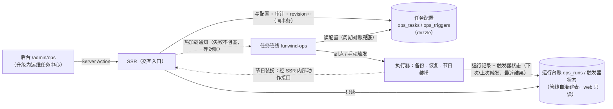

# M14 · 运维任务管线（funwind-backup → funwind-ops）

- 阶段：四·运营与演进 ｜ 依赖：M13（上线完成）；建议 M13 上线门禁（备份恢复演练签字）先收口再动备份服务
- 状态：⬜ 未开始（2026-11-09 立项，站长批准编排与 D1–D6 全部按推荐执行）
- 来源：站长 2026-11-09 立项——备份服务升级为独立定时任务管线：不只承载备份，还把**运维类定时器**
  收编进来，配置在后台管理、元数据入表、触发定时更新任务信息，「配置和执行解耦」；节日自动切换主题
  一类运营排期定时也纳入。业务定时（领域逻辑自带的周期任务）仍留在业务侧。
- 上线口径（站长 2026-11-09 拍板）：**本地灰度 + 测试通过即可发布线上公测**——M14/M15 不碰核心功能，
  对用户影响小，不做长时间观察期。

> **执行纪律**：同 M13——先对齐设计再动代码；每个 Step 单独提交、单独过门禁，完成后回写 §8 并汇报；
> 门禁以真实命令输出为准（不套管道），冲突先改文档再动代码。§1 记录**已在代码/环境里核实过**的事实。

## 目标

1. `funwind-backup` 升级为**运维任务管线中枢**（更名 `funwind-ops`，D3）：统一承载运维类定时任务——
   任务定义、触发器（cron / 单次 / 手动）、运行台账、互斥、后台展示数据源。
2. **配置与执行解耦**：任务与触发器在后台管理（web 写配置 + 审计，D1），管线读配置执行并回写状态；
   配置热加载（快路径）+ 周期对账（兜底，停机期改动启动后自动追上）。
3. 手动触发**异步化**（返回 run id + 前台轮询），替代现 Server Action 同步等待（现超时 30 分钟）。
4. 首批任务类型：备份 db / 备份 storage（保留份数迁入任务参数）、恢复（仅手动触发）、**节日装扮**
   （运营排期定时：规则生成 campaigns 时间窗，D2）；可选批次见 §5。
5. 顺带清账：管线 v1 的安全与正确性问题（§4）、web 侧 ops 欠账（G-15/G-16 与审计）。

## 1. 已核实事实（2026-11-09 探查，行号佐证）

| # | 事实 | 位置 | 对设计的影响 |
|---|---|---|---|
| F1 | 备份服务 ~570 行 Python（FastAPI + APScheduler 3.11 + pymysql）：启动时自治建表 `backup_runs`，APScheduler cron 两条（db 03:10 / storage 03:40），`GET_LOCK` 互斥，mysqldump/tar 子进程 + gzip 完整性校验 + 按份数轮转 | `services/backup/app/main.py:20-34`、`backup.py:69-154`、`metadata.py:6-21` | 管线中枢的雏形已在：要改造的是「调度定义外部化 + 台账通用化 + 触发器模型」，执行器（备份/恢复）整体保留 |
| F2 | web 调备份服务：`BACKUP_SERVICE_URL` + `BACKUP_OPS_TOKEN`（`X-OPS-Token` 头），触发超时 30 分钟（同步等待），health 5s；后台两个 Action（`admin.ops.backup` / `admin.ops.policy`）声明 `auth: { admin: "site.admin" }`，`redirect` 回显 `?done=1` / `?err=` | `apps/web/src/lib/ops/backup.ts:53-84`、`app/admin/ops/actions.ts:15-33` | 手动触发异步化（目标 1.3）需改这条链路；redirect 提示参数已有消费者（G-15 达标），改语义时保持成对交付 |
| F3 | `backup_runs` 由管线自治建表（不进 drizzle schema），web 用原生 SQL 只读（`listBackupRuns`）；后台另有保留策略写 `site_settings("ops.backup.policy")`，管线每次执行动态读取（clamp 1–90） | `apps/web/src/lib/ops/backup.ts:16-45,121-152`、`backup.py:33-49` | D1 把任务配置迁到 drizzle 表（web 侧写+审计）；台账仍归管线管。保留策略从 site_settings 迁入任务参数后，`ops.backup.policy` 读写链退役 |
| F4 | web 侧周期任务三种载体：进程内调度器（croner，`SCHEDULER=on` 才启动，注销 */15min、超期清理 03:30，MySQL 命名锁 `fw:{库名}:{key}`）；系统 cron（digest 每小时整点，仓库无安装记录）；流量捎带（outbox `sweepPending`） | `apps/web/src/lib/scheduler/tasks.ts:38,61`、`lock.ts:32-48`、`outbox.ts:249`、`digest.ts:113-135` | 站长拍板：业务定时留业务侧（D 类决策不变）；digest/outbox 修复与调度器迁入按 §6 处理 |
| F5 | digest 有 `last_email_digest_at` 防重（发前筛选、发后落值），幂等；M11.5 当时不迁进程内调度器的唯一顾虑是「系统 cron 双线重复发信」 | `apps/web/src/lib/notifications/digest.ts:113,125`、`M11.5-scheduler.md:90` | 若核实生产未装 crontab，迁入调度器无重复风险，可作为独立热修先做（§6） |
| F6 | 排期引擎（campaigns）是**读取时惰性判定**（`starts_at <= NOW() < ends_at`，无 cron），同 effect 按 priority 选优，未知 effect/坏配置 fail-closed 跳过；边界接受 ≤30s 缓存延迟 | `apps/web/src/lib/campaigns/service.ts:11-42`、`M11.2-theme-switching.md:28,33` | 节日装扮（D2）走「管线生成 campaigns 行」而不是「到点直接切」：生效与回退语义零改动，管线停机也不错过节日 |
| F7 | 站点级运维写库有先例：register.policy 经备份服务 python 通道参数化 SQL 写入（2026-11-09 教训：ssh+mysql -e 引号转义会静默失配） | `CLAUDE.md`「备份服务」节、`services/backup/README.md:60-61` | D2 拍板：节日装扮的 campaigns 行**经 SSR 内部动作接口**写（复用 effect 注册表校验/审计/revision），不走 python 直写 |
| F8 | `/admin/ops` 欠账：两个后台 Action **不写 audit_log**（`defineAction` 不自动写，全后台均显式写）；整页无单测/E2E；`unconfigured` 文案仍写「定时备份由宿主机 crontab 承担」（已过期） | `apps/web/src/app/admin/ops/actions.ts:15-50`、盘点记录（无 `admin/ops` spec、无 `lib/ops` 测试） | Step 3 按 G-15/G-16/G-19/G-20 交付；文案随管线化一并更正 |
| F9 | APScheduler 3.x `day_of_week` 0 = 周一（非 crontab 的周日），`from_crontab()` 不做转换——官方文档明示「historical mistake」 | [APScheduler cron 文档](https://apscheduler.readthedocs.io/en/stable/modules/triggers/cron.html)、[issue #931](https://github.com/agronholm/apscheduler/issues/931) | cron 一旦后台可编辑，「每周日」会静默变「每周一」——管线统一 cron 写法（星期字段用名称 `mon…sun`），后台「下次运行」预览一律由管线计算，web 不另算（§3.4） |
| F10 | 管线 v1 安全与正确性问题：① restore 的 `target_db` 未校验直接拼 shell/SQL（注入面，仅靠 token 挡）；② DB 口令出现在进程参数（`-p…`）；③ token 非常量时间比较；④ 连接未 `SET time_zone='+08:00'`（硬约定 4；现无用 `NOW()` 故无害，管线化后要做时间比较必须补）；⑤ 崩溃后 `running` 记录无回收；⑥ 全服务零测试 | `services/backup/app/restore.py:56-67`、`backup.py:22`、`api.py:10-12`、`metadata.py:23-33` | Step 1 逐项清账（§4 清账表） |
| F11 | 生产拓扑：备份服务在 `funwind-internal` 网络（`BACKUP_DB_HOST=funwind-mysql`），web 也在同网络（`BACKUP_SERVICE_URL=http://funwind-backup:8000`）；SSR 连宿主 loopback MySQL（D7）；备份卷 `funwind-backup-files` app 只读挂载 | `docker/backup/compose.yaml`、`docs/milestones/M13-launch.md`（D7） | 管线与 SSR 的通道现成（内网 + token）；更名只改容器名/服务名，卷名与数据不动（D3） |

## 2. 边界（明确不做什么）

- **不迁业务定时**（站长拍板）：注销到期处理、超期未验证清理、每日汇总邮件、outbox 补派仍由业务侧
  （web 进程内调度器 / 捎带快路径）承载；管线不回调 SSR 的业务任务端点（M14 提案阶段的「回调执行」
  架构随职责收窄弃用，执行全部在管线进程内）。
- 不做多实例改造：管线仍单实例（GET_LOCK 语义不变）；web 侧多实例前置检查单不受影响。
- 不做分布式调度 / 消息队列 / 工作流引擎——任务规模（个位数到十几个）配不上，配置表 + 单进程足够。
- 不做后台 UI 的恢复执行入口（D5）：后台只提供**预览 + 复制 CLI 命令**；真实恢复仍走 CLI（`--yes` 确认）。
- 不做任务依赖编排（DAG / 任务链）；不做重试策略配置（首版只记失败，重试靠幂等重跑或手动触发）。
- 不动备份/恢复的产物格式、保留轮转语义与 `pnpm db:verify` 对账口径（M13 已演练签字的链路）。

## 3. 设计

### 3.1 配置与执行解耦（总体）

- **配置归 web（drizzle，D1）**：任务与触发器是内容实体（要分页/筛选/审计/乐观锁），进 schema 单一
  事实源；管线读它。台账与触发器状态归管线自治建表（web 只读，原生 SQL）——与 `backup_runs` 同原则。
- **双向同步**：后台保存 → 同事务审计 + revision++ → 通知管线热加载（快路径）；管线周期对账（兜底）。
  管线执行后回写触发器状态与运行台账，后台展示一律以台账为准。
- **零表韧性**（M12 原则延续）：配置表不存在时，管线回落内置默认任务集（= 现两条备份 cron 的 env
  语义），日志告警，不停摆。
- **凭据**（D5 已并入）：SSR ↔ 管线的通道沿用 `OPS_TOKEN`；恢复预览接口与执行同样要求 token（后台
  仅预览，执行走 CLI，§2）。

### 3.2 元数据模型

| 实体 | 归属 | 关键字段 | 说明 |
|---|---|---|---|
| `ops_tasks` | **web**（drizzle，迁移新增） | `key`（唯一，定名不改）、`executor`（备份 db/storage、restore、节日装扮…）、`params`(json，zod 校验)、`enabled`、`name`、`revision`、审计字段 | 任务定义 + 执行参数；保留策略（keepDb/keepStorage）迁入备份任务 params |
| `ops_triggers` | **web**（同上） | `task_key`、`kind`（cron / once / manual）、`expr`（cron 串或时刻）、`enabled`、`revision` | 一个任务可挂多个触发器；恢复任务只配 manual（§2） |
| `ops_runs` | **管线**（自治建表，web 只读） | 由 `backup_runs` **原地演进**（保持 id 连续——恢复按 run id 定位备份，不换表）：增 `task_key` 列，`kind` 语义并入 | 运行台账：状态、产物、错误、耗时 |
| 触发器状态 | **管线**（自治建表） | `trigger_id`、`last_fired_at`、`next_fire_at`、`last_result` | 后台「下次运行」展示的数据源，由管线计算（F9） |

### 3.3 执行器模型（管线内）

- **执行器注册表**（Python 侧）：`executor` 键 → 参数 schema 校验 + 执行函数。首批：
  `backup.db` / `backup.storage`（现逻辑平移，参数读任务配置）、`restore`（manual-only，清账后）、
  `campaign.holiday`（节日装扮，§3.5）。
- **互斥**：沿用 `GET_LOCK`（全局锁，备份/恢复/生成互斥；节日装扮生成是秒级轻操作，可评估单独锁名
  分池——实现时按实测决定，不影响外部语义）。
- **异步手动触发**：`POST /tasks/{key}/runs` 立即返回 `{run_id}`；`GET /tasks/{key}/runs/{id}` 或台账
  轮询取状态。旧 `POST /runs?kind=` 兼容期保留（内部调用方只有 web），Step 6 切换后移除。

### 3.4 cron 语义（F9）

- 配置表里的 cron 表达式统一约定：星期字段一律用名称（`mon…sun`），分钟/小时/日/月可用数字；
  管线解析时对星期数字**拒绝并报错**（不猜语义）。
- 后台展示的「下次运行时间」一律读管线回写的触发器状态，web 侧不复算 cron。

### 3.5 节日装扮（campaign.holiday，D2）

- **规则**（存任务 params）：公历或农历（引入农历换算库）每年某月某日、前后偏移天数、持续天数、
  提前生成提前量；**装扮内容**：theme.pack / site.logo / site.hero（一个任务可含多项，复用 effect
  注册表的 config schema）。
- **触发行为**：管线到点（或手动）执行时，把**下一次**节日的时间窗写为 campaigns 行（幂等键 =
  规则 id + 年份；已存在则跳过/更新），经 **SSR 内部动作接口**写入（复用 `/admin/campaigns` 的写服务：
  effect 校验、audit_log、revision++ 全部同一条路）。
- **生效与回退语义零改动**：仍是 campaigns 读取时判定（F6）——管线停机也不错过节日；生成后的当年
  方案在 `/admin/campaigns` 可见、可微调（改窗/换包），下一年由管线重新生成。
- 台账记一条「已生成 {年份}{节日} 装扮（campaign id=…）」。

## 4. 管线 v1 清账表（F10，Step 1 逐项）

| # | 问题 | 处置 |
|---|---|---|
| C1 | restore `target_db` 未校验注入面 | 白名单校验（`^[A-Za-z0-9_]+$` + 长度上限 + 非保留库名黑名单），执行前断言 |
| C2 | DB 口令进进程参数 | `MYSQL_PWD` 环境变量传递或 `--defaults-extra-file`（本机容器实测后定，产出写 §8） |
| C3 | token 非常量时间比较 | `hmac.compare_digest` |
| C4 | 连接未设会话时区 | 每连接 `SET time_zone='+08:00'`（对齐硬约定 4），集成测试守护 |
| C5 | 崩溃残留 `running` 记录 | 启动时 + 对账周期：超时（> 执行器超时上限）的 running 标记 `failed`（error=「进程中断推定」） |
| C6 | 零测试 | pytest 单测（配置解析/cron 约定/幂等键）+ 真实 MySQL 集成（建表/台账演进/锁/恢复 dry-run），并入 CI 或本地门禁 |

## 5. 任务类型清单（首批）

**必做（Step 1–4 覆盖）**：

| executor | 触发器 | 参数要点 |
|---|---|---|
| `backup.db` | cron（默认 03:10）+ manual | 保留份数（自 site_settings 迁入，默认 14） |
| `backup.storage` | cron（默认 03:40）+ manual | 保留份数（默认 7） |
| `restore` | 仅 manual | 目标库白名单；后台只预览（D5） |
| `campaign.holiday` | 手动 + （可选）年度 cron 自检 | 节日规则 + 装扮内容（D2） |

**可选（站长勾选后列入 Step 4/5）**：

- [ ] 自动恢复演练：每周将最新备份导入临时库 → 对账 → 清理（BACKUP.md「备份必须演练过才算数」的常态化）。
- [ ] binlog 过期清理（`binlog_expire_logs_seconds` 检查/设置，BACKUP.md §3 口径）。
- [ ] 任务失败告警：失败时给站长发站内通知（经通知中心管线）。

## 6. 业务侧附带项（不属管线，独立处理）

- **digest 每日汇总邮件**：生产疑似从未跑（依赖系统 crontab，仓库无安装记录；OBSERVABILITY §4 只把
  「digest 次日到达」列为观察项）。**先核实**（站长回忆是否收到过 / 服务器 `crontab -l`）。若确认未装：
  迁入 web 进程内调度器（`last_email_digest_at` 幂等，F5 无双线风险），**作为独立热修先做，不等 M14**。
- **outbox 周期巡检**：同口径评估迁入进程内调度器（流量捎带保留为快路径）。
- `/admin/settings` 的 digest 文案随核实结果更正。

## 7. Step 分解

> 分支 `feat/m14-ops-pipeline`；Step A → 1 → 2 → 3 → 4 → 6，Step 5（可选勾选项）站长拍板后插入。
> 发布口径：本地灰度 + 门禁全绿即可部署生产（站长 2026-11-09 拍板，生产升级动作进 RUNBOOK 附录）。

- **Step A · 文档先行**：重写本文件（事实/决策/分解/门禁）；ROADMAP、CLAUDE.md、M13 备忘回链
  （已完成于立项日）；`.env.example` / compose 变更预告。
- **Step 1 · 管线内核重构**：执行器注册表 + 配置读取（含对账与热加载）+ 三类触发器 + cron 写法统一
  （F9）+ 台账通用化（`backup_runs` 原地演进 `ops_runs`，F1/F3）+ 异步手动触发 API + §4 清账表 C1–C6；
  pytest 单测 + 真实 MySQL 集成。**只动 Python 侧，web 零改动**（配置表未建时回落默认，§3.1）。
- **Step 2 · 配置模型与 web 写服务**：`ops_tasks` / `ops_triggers` 迁移（drizzle + bootstrap 默认任务
  种子：两条备份 cron 平移）+ 保留策略迁入 params + 审计（G 基线）+ 热加载通知 + 备份服务调用链改造
  （异步触发 + 台账查询切换）。
- **Step 3 · 后台运维任务中心**：任务/触发器/台账/手动触发/恢复预览（复制 CLI 命令）+ `/admin/ops`
  还账（audit_log、E2E 含错误路径 G-16、提示参数消费者 G-15、过期文案 F8）；六档布局矩阵 + 目视验收。
- **Step 4 · 节日装扮任务**：农历换算 + 规则 schema + campaigns 行生成（经 SSR 内部动作接口，D2）+
  后台规则管理 + 生成幂等测试（同规则同年重跑不重复）。
- **Step 5 ·（可选，按 §5 勾选）**：恢复演练 / binlog / 失败告警。
- **Step 6 · 部署切换与收口**：容器更名 `funwind-ops`（D3：卷名与数据不动）+ compose/`.env.example`
  + RUNBOOK 附录（含回滚口径：回退到旧镜像即回到 v1 行为）+ `docs/ops/BACKUP.md`、`SCHEDULED-JOBS.md`
  文档同步 + 全量门禁 + CHANGELOG + 生产部署（公测口径）。

## 8. 门禁标准

| 层级 | 标准 |
|---|---|
| Step 门禁（1–4） | `pnpm verify:all` 退出码 0；Python 新增单测/集成全过；本步涉及页面过六档布局矩阵；回归断言零改动 |
| 里程碑收口（Step 6） | verify:all / 全量 E2E / 安装 E2E / visual 基线零更新 / layout+summary / lighthouse / perf:posting 达标；管线集成测试（真实 MySQL）全过；备份→恢复演练一轮（管线 API 触发）；PR CI 双绿 |
| 生产部署 | RUNBOOK 附录按清单执行；部署后 24h 内台账无 failed、两条备份 cron 首跑成功、后台展示与 CLI `status` 一致 |
| 分支纪律 | `feat/m14-ops-pipeline` → PR → CI 双作业通过合并 main；不 force push；不碰开发库与旧库数据 |

## 9. 决策记录（站长 2026-11-09 全部按推荐拍板）

- **D1 配置归 web** ✅ 任务/触发器进 drizzle schema（web 写 + 审计 + 乐观锁），台账/触发器状态归管线
  自治建表（web 只读）——现有「保留策略存 site_settings、管线读取」模式的推广，不推翻「运维表归
  服务管」原则（后者收窄为：**运行时产出**的运维数据归服务管）。
- **D2 节日装扮写 campaigns 走 SSR 内部动作接口** ✅ 复用 effect 注册表校验/审计/revision 单一事实源；
  否决「python 直写 SQL」（校验规则双份漂移会让读取侧 fail-closed 静默丢弃装扮，且无审计）。
- **D3 更名 `funwind-backup` → `funwind-ops`** ✅ 服务定位从「备份」扩为「运维任务管线」；备份卷名
  `funwind-backup-files` 与数据不动（app 只读挂载路径不变）。
- **D4 首批任务类型** ✅ 必做 4 类（§5）；可选 3 项站长勾选后插入。
- **D5 后台恢复入口 = 预览 + 复制 CLI** ✅ 覆盖生产库的高危操作不进 Web UI；CLI `--yes` 双确认保持。
- **D6 digest/outbox 先核实、独立热修** ✅ 不等 M14；核实途径与处置见 §6。

## 10. 执行记录

- [ ] Step A 文档先行
- [ ] Step 1 管线内核重构
- [ ] Step 2 配置模型与 web 写服务
- [ ] Step 3 后台运维任务中心
- [ ] Step 4 节日装扮任务
- [ ] Step 5（可选，按勾选）
- [ ] Step 6 部署切换与收口

## 遗留事项

- （收口时回写）多实例部署时管线的 HA 口径（现单实例，GET_LOCK 防重）。
- （收口时回写）告警通道若引入 Sentry / 外部拨测的接线记录。
