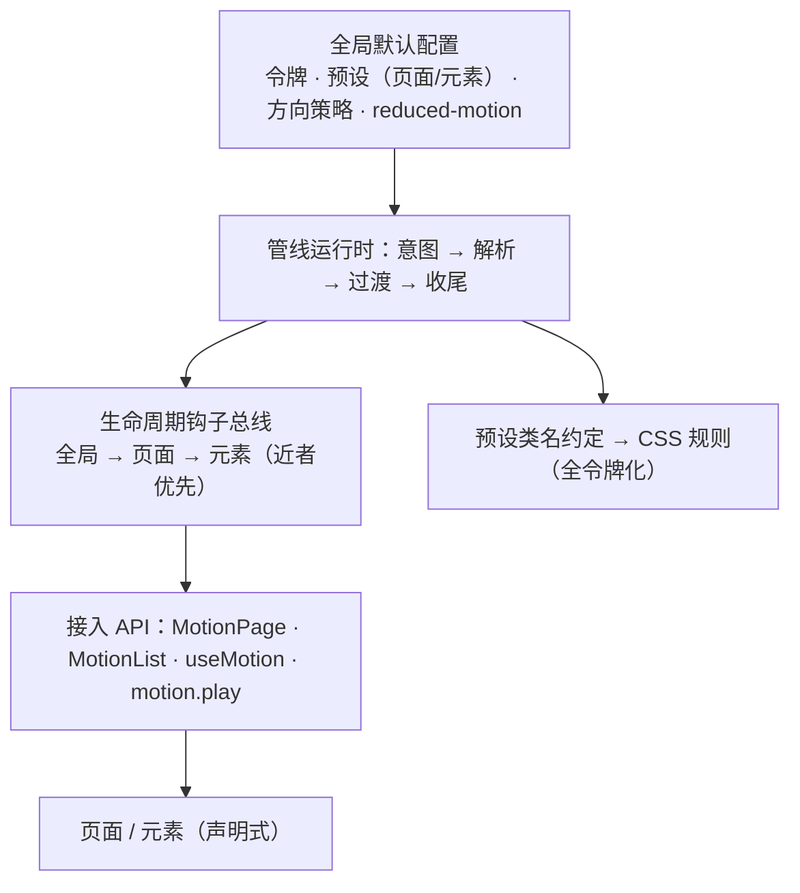

# M15 · 统一动效管线（声明式动效引擎）

- 阶段：四·运营与演进 ｜ 依赖：无（与 M14 相互独立）；设计基准：[M10.5-S4-VISUAL-MOTION](../M10.5-S4-VISUAL-MOTION.md)（四级动效体系与令牌）、M10.7（页面切换与流式动效）、[M13 备忘](M13-launch.md)（立项来源）
- 状态：🚧 执行中（2026-11-09 立项，站长批准编排与 D1–D4；Step A 文档定稿、Step 0 技术验证、Step 1 独立引擎内核已完成，现有导航仍走兼容链；下一步 Step 2 页面层接入与共享段试点）
- 来源：站长 2026-11-09 立项——动效收敛为「全局默认 + 统一管理管线」：动效规则不再散落在路由表、
  CSS 选择器与组件 className 三处；页面 / 元素接入动效应声明式完成；并建立**生命周期钩子**，
  未来页面或元素接入动效可快速挂接。M13 备忘「统一页面切换动效管线」并入本里程碑。
- 上线口径（站长 2026-11-09 拍板）：**本地灰度 + 测试通过即可发布线上公测**；逐段灰度迁移，
  收敛前两套方向语义并存且有一致性测试兜底。

> **执行纪律**：同 M13——先对齐设计再动代码；Step 0 是技术验证（结论回写 §10），任何一步实测
> 与本文冲突时先改文档再动代码；门禁以真实命令输出为准。

## 目标

1. **动效管线引擎**：全局默认配置（令牌 / 预设 / 减弱动效策略）+ 声明式接入 API
   （页面级 `<MotionPage>`、元素级 `<MotionList>` / `useMotion`）替代硬编码动效规则。
2. **共享段导航动效**：`/t/1 → /t/2`、`/a ↔ /a/{id}` 等兄弟页面切换获得过渡（现状静切，M13 实测）。
3. **生命周期钩子**：导航（intent / before-transition / ready / finish-skip）与元素（enter / in-view /
   exit / update）两级钩子，全局 → 页面 → 元素三级注册，近者优先；页面或元素接入动效零散改引擎。
4. **令牌收敛与魔法数清账**：动效时长 / 缓动 / 位移 / stagger 全部走令牌层，裸写由守卫测试拦截；
   清理演示遗留死代码。
5. rank 层级表（`nav-kind.ts`）与 `html[data-nav]` CSS 选择器**灰度退役**，全站 73 页收敛到注册表。

## 1. 已核实事实（2026-11-09 探查 + 官方文档核查，行号佐证）

| # | 事实 | 位置 | 对设计的影响 |
|---|---|---|---|
| F1 | react / react-dom **19.3.1**（stable）、next 16.4.2；`<ViewTransition>` 从 react 的 **stable 导入**（非 unstable），Next 零配置可用；`experimental.viewTransition` 未开启也不需要 | `apps/web/package.json`、`next.config.ts`（无 experimental 段）、`app/template.tsx:2` | 不需要升级 React / 开 canary——引擎建立在 stable 能力上 |
| F2 | 根 template 只在**第一路由段**变化时重挂载；`/t/1 → /t/2` 共享 `/t` 段，根 template 不重挂载 → 无进退场对 → 无过渡。官方解法：在共享段加**段级 template**（其 key 随子段变化会重挂载）；Next 另提供 `<Link transitionTypes>` 显式声明方向 | [Next template 文档](https://nextjs.org/docs/app/api-reference/file-conventions/template)（remount 逐例）、[view transitions 指南](https://nextjs.org/docs/app/guides/view-transitions)（transitionTypes / 同路由 crossfade 模式） | 共享段过渡走「段级 template + 带 key 的 ViewTransition」官方路径，**不走** M13 备忘猜测的手动 `startViewTransition + flushSync`（Step 0-1 验证双包裹共存） |
| F3 | 现行页面切换链路：NavigationGuard 捕获点击 → `resolveNavKind` 由 rank 正则表判方向并写 `<html data-nav>` + 扩散圆心 CSS 变量 → 根 template 的 `<ViewTransition enter="fw-page-in" exit="fw-page-out">` → globals.css 按 data-nav 选择器播动画 → 等 `finished` 再清除 | `lib/motion/nav-kind.ts:30-48(rank),76-85(kindBetween),211-264(resolve)`、`components/site/navigation-guard.tsx:6,99`、`app/template.tsx:21`、`app/globals.css:274-423` | 方向判定 = 硬编码正则 + 全局属性 + CSS 选择器**三处分散**；引擎要把三处收敛为注册表单一事实源 |
| F4 | rank=null 静默退化 fade；新页面必须手动登记正则——`/a` 就是 M13 补录的（`d4bc890`）；同层跨模块只能 fade（`/f/3 → /u/9`）；Tab 另开 TAB_ORDER 特例表（9 个根） | `nav-kind.ts:30-48,55-68,83` | 「新页面零配置继承」是引擎的验收标准之一；跨模块同层方向交给 `transitionTypes` 声明 |
| F5 | 动效令牌基线已有：时长 4 档（fast150/base250/slow400/spring500）+ 缓动 4 种，注释明令「业务组件禁止裸写」；但魔法数绕过令牌层散落：进场 stagger `index*50ms` 内联 8 处（上限 10 条）、慢网进度条 12s（keyframes fw-nav-grow）、位移 28/14px 与 tab 96/56px 写死在 `:root`、`fw-float-up` 时长 `×1.75`、`vt-push-in` 为演示遗留（含死选择器 `[style*="vt-push-in"]`） | `styles/tokens/primitives.css:98-105`、`globals.css:190,205-214,250-252,262-269`、`app/page.tsx:216`、`f/[fid]:200`、`notifications:118`、`messages:146`、`follows:169`、`u/[uid]:223,255`、`points:98` | Step 3 令牌清账清单直接照此表执行；新增守卫测试（裸写时长/缓动/位移即红） |
| F6 | 26 个 keyframes 全在 globals.css；reduced-motion 三处降级（微交互/进场、全部 VT 置 none、主题 Surface）；VT 动画规则约 20 条按 `html[data-nav=…]` 属性选择器组织 | `globals.css:138-156,176-211,326-423,453-484`、`:222-256,493-499,847-851` | 引擎的 CSS 由「预设类名约定」生成，属性选择器退役；reduced-motion 统一收进引擎全局默认 |
| F7 | 主题包语义令牌层（M11.6）**不含动效槽**：token-schema 只有 colors/radius/shadows/font/surface | `lib/theme/token-schema.ts:86-92` | D2：本期不加主题动效槽，但令牌层按「可被主题覆盖」设计（后续可选） |
| F8 | 双轨现状：路由级 = stable `<ViewTransition>`（根 template 一处）；同文档状态级 = 手动 `document.startViewTransition` 封装（`withViewTransition`，仅 /design/motion 演示页用）；无第三方动效库（弹层走 tw-animate-css + Radix） | `app/template.tsx:2,21`、`lib/motion/view-transition.ts:31-62`、`design/motion/motion-demo.tsx:120,142` | 引擎收编手动 VT 助手；第三方库继续不引入（保持零依赖动效栈） |
| F9 | 元素级入场现状：触底追加 `fw-fade-in`（stream-list 哨兵 IntersectionObserver）；首屏错落 = 8 个页面内联 `animationDelay: index*50ms`；微交互（点赞 pop/roll/float-up、Button active:scale、关注、FeedCard hover）各组件自管 | `components/stream/stream-list.tsx:9`、F5 的 8 处、`interact/like-toggle.tsx:85-111`、`follow-toggle.tsx:61,69` | 元素层 API（`<MotionList>` / `useMotion`）的迁移清单；微交互本期只收口到预设，不改行为 |
| F10 | 测试基线：`nav-kind.test.ts` ~45 例、`nav-guard.test.ts` ~28 例、`view-transition.test.ts` 7 例；E2E 有 VT 打桩（`e2e/support/vt.ts` 拦截 startViewTransition + rAF 采样）、page-transition 18 例、micro-interactions 15 例；禁动效手段 = `page.emulateMedia({ reducedMotion: "reduce" })`；visual 配置 `animations: "disabled"` | `lib/motion/*.test.ts`、`e2e/support/vt.ts`、`e2e/page-transition.spec.ts:399,414`、`playwright.visual.config.ts:24` | 灰度期一致性测试直接建在 nav-kind 测试上（两套判定对全路由矩阵比对）；E2E 打桩设施复用 |
| F11 | popstate 限制：React 文档明确「从 legacy popstate 启动的 transition 必须同步完成，动画会被跳过」，除非路由升级 Navigation API；M10.7 §5.7 遗留「浏览器返回键缓存命中无动画」；nav-guard 已有 Navigation API 接入（拦截 Next 整页回退兜底） | [React ViewTransition](https://react.dev/reference/react/ViewTransition)（popstate 节）、`M10.7-streaming-motion.md:144-145`、`lib/motion/nav-guard.ts:267-289` | Step 0-3 验证经 Navigation API 的返回键能否带出过渡；不能则该场景维持「无动画」并在规范里写明（诚实降级） |

## 1.1 增量复核（2026-11-11，M14 收口后二次探查——F1–F11 无实质漂移，仅行号/计数刷新）

| # | 复核项 | 结论 |
|---|---|---|
| R1 | F1 版本基线 | ✓ react 19.3.1 / next 16.4.2 未变，stable `<ViewTransition>` 路线成立 |
| R2 | 页面总数 | ✓ 仍 73 页（M14 升级 /admin/ops 既有页，未新增路由） |
| R3 | stagger 内联 | ✓ 仍 8 处 `index*50ms`，M14 未新增 |
| R4 | rank 表 | ✓ `/a` 已登记；admin 兜底正则覆盖全部子页——M14 重构的 /admin/ops 自动被兜底，无登记缺口 |
| R5 | 测试基线 | ✓ nav-kind 33 声明（~45 例）/ nav-guard 27 / view-transition 7；E2E 18+15；vt.ts 打桩完好可复用 |
| R6 | M14 增量 | /admin/ops 与 OpsAutoRefresh 零动效使用（后台克制维持）；globals.css 行号漂移已刷新（fw-nav-grow→209、vt-push-in→250、fw-page-in→288、reduced-motion→222/493/847）——以符号检索为准 |
| R7 | 手动 VT 收编目标 | ✓ 仅 /design/motion 两处（expand/fade） |
| R8 | 元素级 class | fw 系列动效类共 11 个文件使用——Step 3 迁移清单 |
| R9 | reduced-motion | ✓ 三块降级与 F6 一致 |

**结论**：§1–§3 维持定稿；D1–D4 不变。**动效规范已定稿：[docs/motion-spec.md](../motion-spec.md)**（Step A 产物——预设表 / 钩子契约 / 灰度与退役 / 守卫验收，实现冲突时先改规范再改代码）。

## 2. 边界（明确不做什么）

- 不引入 framer-motion 等第三方动效库（零依赖动效栈延续，F8）。
- 不做主题包动效槽（D2）——主题换动效不在本期；令牌「可被主题覆盖」留接口不实现。
- 不做 JS 物理动画 / 手势驱动动效（拖拽跟手、弹簧物理）——页面切换与元素动效用 CSS + VT 足够。
- 不动 Radix / tw-animate-css 的弹层动画体系（已对齐令牌，重写无收益）。
- 不改流式加载与慢网兜底的行为语义（Step 0-4 只验证互不干扰）。
- 不做后台 31 页的逐页动效设计——后台整体走路由组默认（fade 微动），保持克制。

## 3. 设计

### 3.1 引擎分层



- **配置层**：全局默认 = 预设表（页面预设：detail / list / form / admin…；元素预设：enter / stagger /
  pop…）+ 方向策略 + reduced-motion 策略。本期落代码注册表（常量 + 类型），不落库、不进主题包。
- **运行时**：导航意图捕获（现 NavigationGuard 升级）→ 方向解析（注册表 + transitionTypes）→
  ViewTransition 包裹（根 template 默认 + 页面级带 key 边界）→ 钩子总线 → 清理。
- **接入 API**（页面 / 元素声明式，站长核心诉求）：

  ```tsx
  // 页面：一行声明；motionKey 让共享段导航（/t/1 → /t/2）也触发过渡（F2 段级 template 机制）
  <MotionPage preset="detail" motionKey={tid}>…</MotionPage>

  // 元素：列表首屏错落 + 触底追加入场，时长/间隔全部来自全局令牌（替代 8 处 index*50ms 内联）
  <MotionList preset="list.enter">{items.map(renderCard)}</MotionList>

  // 钩子：页面级生命周期（导航 onIntent/onBeforeTransition/onReady/onFinish/onSkip）
  useMotionLifecycle({ onFinish: () => focusFirstUnread() });
  ```

### 3.2 生命周期钩子

| 层级 | 钩子 | 典型用途（现存实现归类） |
|---|---|---|
| 导航 | `onIntent` | 捕获导航意图（链接 / 编程式 / 返回键 / 底部 Tab），可改写本次预设——现 NavigationGuard + NavKindCapture 归此 |
| 导航 | `onBeforeTransition` | 旧页快照前：测量触点、写 CSS 变量——现触点扩散圆心计算归此 |
| 导航 | `onReady` | 过渡伪元素就绪：CSS 写不出的动画用 Web Animations API 兜（手动 VT 助手收编处，F8） |
| 导航 | `onFinish` / `onSkip` | 收尾（焦点/滚动/清理）；跳过时附带原因（reduced-motion / 无 API / 被新导航打断）——现 `releaseNavKind` 等待 `finished` 归此 |
| 元素 | `onEnter` / `onInView` | 挂载与触底追加入场、滚入视口显现（stream-list 哨兵收编） |
| 元素 | `onExit` / `onUpdate` | 退场（VT 快照语义）；布局变化 FLIP（可选，后期） |

- 三级注册：全局配置 → 页面 → 元素，**越靠近元素优先级越高**；执行顺序与可取消语义在 Step A 规范定稿。
- 钩子签名要求纯客户端、可重入（StrictMode 双执行安全）、失败不阻塞导航（异常吞掉并上报日志）。

### 3.3 共享段过渡与方向策略

- 页面级 `<MotionPage motionKey>` 借段级 template remount（F2）形成进退场对；方向由注册表解析：
  现行 rank 层级语义迁入注册表（层级差 → push/pop），跨模块同层与返回键走 `transitionTypes` 显式
  声明（`<Link transitionTypes>` / `router.push(…, { transitionTypes })`）。
- **灰度并存（D3）**：注册表逐段接管；未接管路由由现 nav-kind 兜底。一致性测试 = 两套方向判定对全
  路由矩阵（现有 73 页清单）比对一致，收敛完成后 rank 表与 `data-nav` 选择器整体退役。

### 3.4 引擎形态与边界（D1）

- 按**独立包的边界设计**：唯一公开入口（barrel），内部模块不对引擎外导出；架构守卫（F10 同级测试）
  新增「引擎不得反向 import 业务代码（app/**、components/** 业务域）」断言。物理位置先在
  `apps/web/src/lib/motion/`（升级现有目录），未来出现第二个前端再抽 `packages/motion`。
- 引擎不得持有业务状态；钩子是唯一的业务挂点（依赖倒置）。

## 4. Step 分解

> 分支 `feat/m15-motion-pipeline`；Step A → 0 → 1 → 2 → 3 → 4 → 5。
> 发布口径：本地灰度 + 门禁全绿即可部署生产（站长 2026-11-09 拍板）。

- **Step A · 文档先行**：本文件重写定稿 + **动效规范**（收拢 S4 口径：四级体系、预设表、钩子契约、
  reduced-motion 策略、裸写禁令）——规范是后续守卫与验收的依据。
- **Step 0 · 技术验证**（结论回写 §10，逐条含最小复现仓库内 demo）：
  1. 页面级带 key 的 `<ViewTransition>` 与根 template 共存是否**双重过渡**（F2）；
  2. 方向可否「延迟解析」（目标页在提交阶段声明角色）——决定页面声明能否只写在页面组件里；
     做不到则页面声明退化为「构建期生成路由清单」；
  3. 返回键经 Navigation API 能否带出过渡（F11）；不能则写明诚实降级口径；
  4. 与流式加载 / 慢网兜底 / 滚动恢复的相互干扰排查；
  5. Safari / Firefox 降级表现（VT 类型与 `view-transition-class` 支持面）。
- **Step 1 · 引擎内核**：配置/令牌/预设表 + 方向解析器 + 钩子总线 + 接入 API 骨架；纯逻辑（解析、
  优先级、预设选择）单测达覆盖率门槛；架构守卫断言（§3.4）。
- **Step 2 · 页面层接入**：`<MotionPage>` + 共享段过渡试点（`/t/*`、`/a/*`）+ transitionTypes 接线 +
  灰度一致性测试上线；根 template 保持兜底。
- **Step 3 · 元素层接入与魔法数清账**：`<MotionList>` / `useMotion` 收编 8 处 stagger 与 stream-list
  入场；令牌清账（F5 清单逐项）；守卫测试：引擎外裸写时长/缓动/位移即红；死代码清理
  （`vt-push-in`、死选择器）。
- **Step 4 · 全站收敛**：73 页按注册表接管（后台 31 页整体路由组默认）；rank 表与 `data-nav`
  选择器退役；nav-kind 测试迁移为注册表测试。
- **Step 5 · 收口**：全量门禁（§6）+ 文档回写（S4 规范并入或指针）+ CHANGELOG + 生产部署（公测口径）。

## 5. 测试规则

- 纯逻辑（解析器 / 预设选择 / 钩子优先级）：单测 ≥90% 行覆盖（全局基线下限），假时钟不用——动效
  时序断言用 VT 打桩（F10 设施）而非真实等待。
- 一致性（灰度期）：nav-kind 与注册表对全路由矩阵方向判定一致（参数化测试，新增路由自动纳入）。
- E2E：page-transition 用例扩展共享段场景（`/t/1 → /t/2` 有过渡断言、reduced-motion 下无动画断言）；
  既有 18 + 15 例零改动迁移。
- visual：`animations: "disabled"` 下基线**零更新**；引擎不得改变静态渲染结果。
- 每个新增守卫测试做变异验证（守卫按文本匹配的坑见 CLAUDE.md 已知坑）。

## 6. 门禁标准

| 层级 | 标准 |
|---|---|
| Step 门禁（1–4） | `pnpm verify:all` 退出码 0；本步新增单测/E2E 全过；灰度一致性测试全绿；visual 基线零更新 |
| 里程碑收口（Step 5） | verify:all / 全量 E2E / 安装 E2E / layout+summary / lighthouse / perf:posting 达标；page-transition 扩展用例全绿；六档布局矩阵零问题；PR CI 双绿；站长目视验收（共享段切换、列表入场、reduced-motion） |
| 体验红线 | 既有动效行为回归零删减（push/pop/fade/tab/expand/collapse、触点扩散、慢网兜底）；LCP 预算不回退（动效不得阻塞渲染） |
| 分支纪律 | `feat/m15-motion-pipeline` → PR → CI 双作业通过合并 main；不 force push |

## 7. 决策记录（站长 2026-11-09 全部按推荐拍板）

- **D1 引擎形态** ✅ 按独立包边界设计（唯一公开入口 + 架构守卫禁止反向依赖），物理上先在
  `apps/web/src/lib/motion/`；未来第二个前端出现再抽 `packages/motion`（接口不返工）。
- **D2 主题动效槽** ✅ 本期不做；令牌层按可被主题覆盖设计留接口（后续可选里程碑）。
- **D3 迁移方式** ✅ 灰度并存、逐段接管、一致性测试兜底；收敛完成 rank 表退役。
- **D4 上线口径** ✅ 本地灰度 + 测试通过即发布线上公测（2026-11-09，与 M14 同口径）。

## 8. 与既有设计的关系

- [M10.5-S4-VISUAL-MOTION](../M10.5-S4-VISUAL-MOTION.md)：四级动效体系（L1 微交互 150 / L2 页面方向
  400 / L3 触点扩散 500 / L4 进场 250×stagger50）与令牌表**继续有效**，M15 把它升级为引擎规范（Step A）。
- [M10.7](M10.7-streaming-motion.md)：页面切换管线与慢网兜底由引擎收编；§5.7 遗留「返回键无动画」
  归 Step 0-3 处置。
- [M13 备忘](M13-launch.md)「统一页面切换动效管线」：并入本里程碑；其「手动 startViewTransition +
  flushSync」路线按 F2 更正为官方路径（段级 template + transitionTypes）。

## 9. 执行记录

- [x] Step A 文档先行（2026-11-11：增量复核 R1–R9 回写 + [动效规范](../motion-spec.md) 定稿 + S4 头部指针）
- [x] Step 0 技术验证（实验代码与 5 项结论见 §10；267d402 已推送）
- [x] Step 1 引擎内核（2026-11-11，范围、复核整改与门禁见 §11；不接管现有导航）
- [ ] Step 2 页面层接入与共享段过渡
- [ ] Step 3 元素层接入与魔法数清账
- [ ] Step 4 全站收敛（rank 表退役）
- [ ] Step 5 收口

## 10. Step 0 技术验证结论（2026-11-11，实验路由 /motion-lab + e2e/vt-lab.spec.ts 实测）

| # | 验证项 | 结论 | 实测证据 |
|---|---|---|---|
| 1 | 双包裹（F2） | ✅ **官方路径成立**：同段兄弟切换与跨段进入都只有一次 startViewTransition、根组动画（vt-page-*）不出现 | vt-lab 验证 1a/1b（starts=1、animations 仅 vt-lab-*） |
| 2 | 方向延迟解析 | ✅ **可行（超出预期，窗口比预想更宽）**：目标页声明的覆写窗口覆盖 **commit（useLayoutEffect）与 paint（useEffect）两阶段**——两版都实测生效（新层动画选目标页声明的方向，「Guard 先写 fade、目标页覆写」双写模式工作正常）；**页面声明可以只写在页面组件里，不需要构建期路由清单**。红线 = **覆写次数**：每次覆写重启动画（fade-in 首帧被覆盖；多次写会产生可见跳变）→ 引擎约定每次导航只允许一次方向定稿 | vt-lab 验证 2a（useLayoutEffect → in-right 出现）/ 2b（useEffect → in-right 出现且 fade-in 不出现） |
| 3 | 返回键（F11） | ✅ 诚实降级成立：goBack 后 starts=[]（无任何过渡）。返回键无动画维持现状，规范写明；Navigation API 优化空间留未来 | vt-lab 验证 3（starts=[]） |
| 4 | 流式互扰 | ⚠️ **新互扰实锤**：Suspense fallback→content resolve（约 400ms，晚于导航过渡结束与 data-nav 清理）会触发**第二次 startViewTransition**（starts=["fade", null]），lab 组按默认 fade 再动一次 = 流式页导航后内容到达时闪一下。此现象与 M15 无关、生产现状即存在（任何 RSC streaming 页）。处置候选进 Step 1/2 设计吸收：Suspense resolve 包 startTransition 抑制 / 引擎钩子抑制 / 接受轻微闪变 | vt-lab 验证 4（固化断言 ["fade", null]） |
| 5 | 支持面 | webkit（Safari 27.2 引擎）实测三项全支持；Firefox 本机 Playwright 启动失败（juggler profile 环境问题），按 caniuse/MDN：VT 同文档 = Firefox 144+ / Safari 18.0+（全球 93.17%），view-transition-class = Chrome 125+ / Firefox 144+ / Safari 18.2+（90.32%），types 参数 = Baseline 2025 Newly available（2025-10；Firefox 精确版本未经真机复核）。**引擎红线成立**：不支持环境必须同步可用（探测红线断言过） | e2e/vt-support.spec.ts + caniuse |

- [x] Step 0 技术验证（5 项结论如上；实验路由位于 **`app/motion-lab/`**（顶层，脱离 /design 的 dev-only 守卫范围——VT 结论须在 prod 构建下验证），noindex 无入口链接，**生产公测期短暂可达，Step 4 清账时整体移除**；vt-lab spec 在 prod E2E 持续回归，vt-support 仅 Step 0 一次性探测）
      **实验教训**：VT 采样必须在上一段过渡真正播完后 reset（页面过渡 slow 400ms，URL 变更早于动画
      结束——过早 reset 会让上一段的采样混入新观察，首轮 2a/2b 结论因此被污染反噬）；spec 已加
      settleTransitions 辅助。

### 10.1 Step 1 复核后的结论边界

- 验证 2 只证明目标页覆写会影响新层 CSS 动画，不能据此断言旧页快照前测量、尚未挂载的目标页钩子或流式晚到声明都可延迟。注册表是可选的提前声明来源，目标页仍可在本次动效定稿时覆盖；不要求构建期生成路由清单，但也不直接退役所有提前策略。
- Step 1 定稿使用实例级导航编号，`begin → commit → ready → finish/skip`；一次定稿后拒绝重复 commit 与过期回调。commit 指驱动开始前的动效定稿，不等同 React DOM commit，真实 React 接线时点仍在 Step 2 验证。
- Suspense resolve 不应从新内核创建第二个导航会话，但 React 自发的二次 VT 是否可抑制仍未解决。Step 1 只给出隔离边界，不提前宣称消除流式互扰。

## 11. Step 1 独立引擎内核（2026-11-11）

- **范围**：新增 `lib/motion/engine/`（配置、预设、纯解析器、生命周期、运行时与更新入队），唯一公开入口为 `lib/motion/index.ts`。旧 nav-kind / nav-guard / view-transition、根 template、全局 CSS 与全部页面消费者零改动；注册表迁入层级与 Tab 比较算法，业务路由清单在 Step 2 才注入。
- **公开契约**：`createMotionEngine` 生成独立实例；`begin/commit/ready/finish/skip` 按导航编号隔离，一次定稿，过期回调无效；`register` 按全局→匹配页面→匹配元素级联，近者覆盖，false 只取消动效；`play` 通过显式适配器驱动，减少动态效果/无 API/禁用/取消/history/同 pathname 均直接更新并通知 skip。`MotionPageProps/MotionListProps` 是类型骨架，实际组件、hook 和原生 VT 驱动分别留在 Step 2/3，不导出无效果的占位组件。
- **并发与错误**：驱动同步失败、ready/finished 拒绝、超时、快速连点均不重放业务更新；业务错误继续向调用方抛出。更新按 play 调用顺序预留并入队，不串行等待整个业务 Promise，避免更新内部嵌套 play 死锁；异步业务自己的结果失效/取消仍由调用方负责，内核不持有其状态。
- **独立复核整改**：发现 4 项 P2 并修复——旧更新晚于新更新、重入终止后仍分发非终态钩子、元素事件缺少快照、解析异常后残留预约会在后续 play 中执行。首轮先补 7 条失败回归再修复，另补第三笔重入、异步嵌套与 begin/commit 失败清理，最终并发/重入 11 项 + 预约契约 3 项通过；非终态逐回调检查会话有效，终态完整广播，元素上下文复制冻结（不冻结 DOM 节点），异常退出丢弃未入队预约且晚到请求明确拒绝。
- **预设对账**：修正文档早期归纳偏差，不改现有效果：pop 实际为 spring 500ms（不是 fast 150ms）；float-up 为 slow × 1.75（不是 base）；collapse 动的是旧层而非新层；reduce 下维持现有 pop/roll/switch/float-up 禁用口径。
- **测试**：内核与公开 API 119 项 + 旧动效 76 项 + 架构守卫 158 项，共 353 项定向测试通过；新内核可执行代码行/分支/函数/语句覆盖率均 100%。守卫复用 AST 依赖解析，检查静态/类型/转发/字面量动态导入及 require，禁止内核反向业务依赖与外部深导内部实现，旧入口暂保留。
- **变异验证**：隔离副本内分别移除导航归属保护、倒置作用域优先级、绕过 reduce、重放业务更新，四项均被回归测试拦截；另临时向真实引擎注入业务依赖，架构守卫立即失败，探针已清理。
- **最终门禁**：`pnpm verify:all` 退出码 0（web 4395 / db 124 / content 55 / migration 278；脚本测试 18 项；构建成功），jscpd 1405 行 / 159 克隆与基线持平，未放宽门禁；`pnpm test:visual` 10 项通过，截图基线零更新。独立复核已验证上述 4 项 P2 全部消除，无未处置 P1/P2；本步未新增页面 E2E，也未重跑全量 E2E，页面接入阶段再跑导航与共享段回归。
- **后续边界**：本步不解决 React 自发的流式二次 VT，不迁移 73 个业务页面，不退役 rank、不升格 CSS 魔法数、不部署生产；这些保持 Step 2/3/4 的既定分工。

## 遗留事项

- （收口时回写）主题包动效槽（D2 预留接口）。
- （收口时回写）FLIP 布局动画（`onUpdate`）是否立项。
- （收口时回写）手动 VT 助手（`withViewTransition`）收编进度与 /design/motion 演示页更新。
