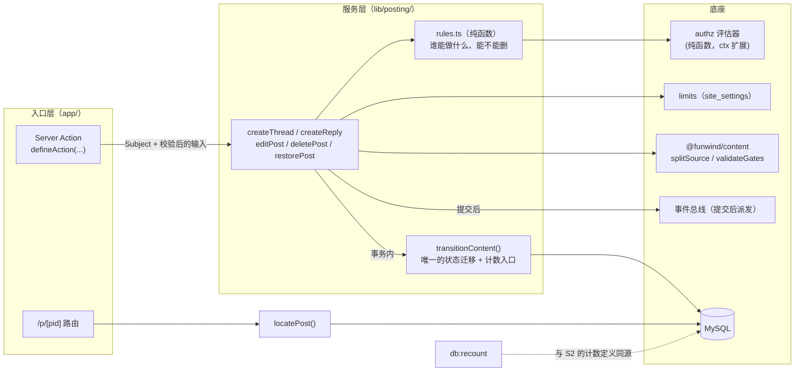
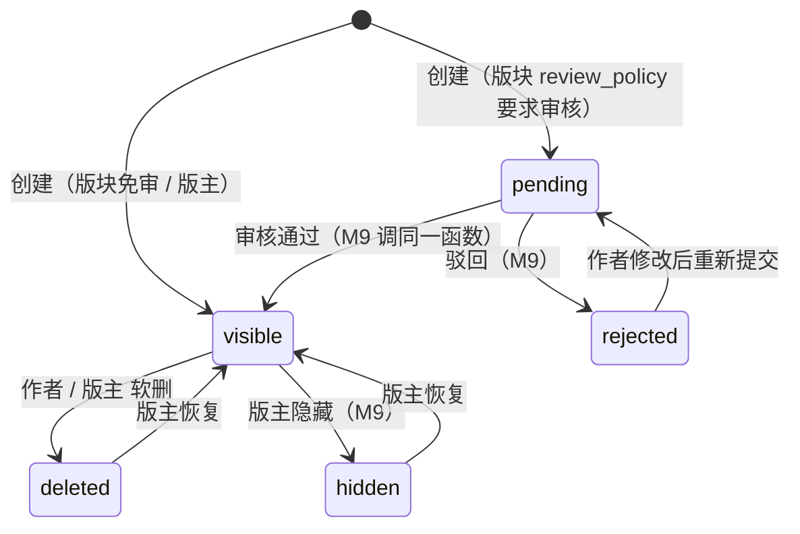
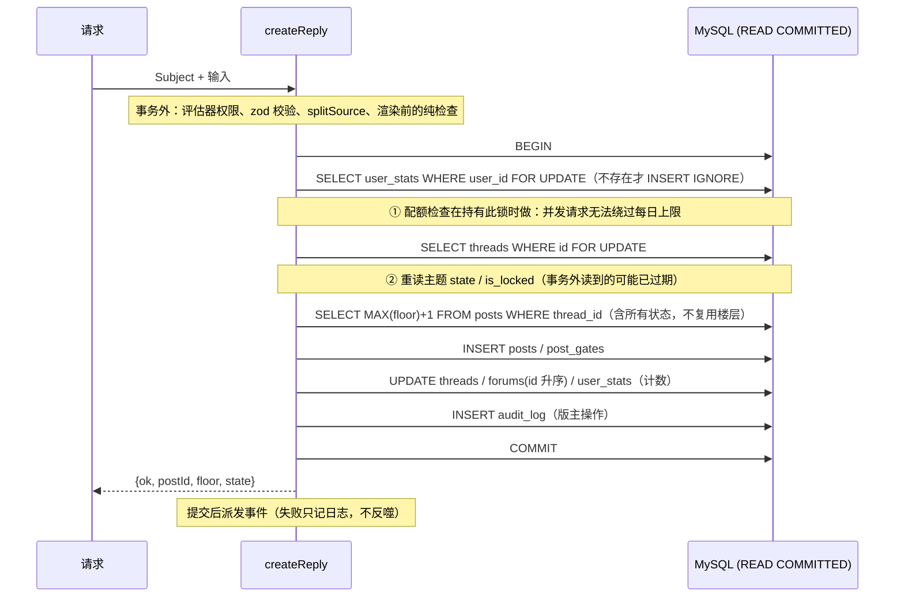

# M6.1 · 写路径底座（无 UI）

> 状态：**设计已于 2026-10-24 确认**（§10 的 8 点全部按推荐）。进度：第 1 步（`zod` + `defineAction`）✅ → 第 2 步（评估器 / 门控条件 / 用户名 / limits / schema）✅ → 第 3 步：任务 1–3（纯函数、门控写入器、状态迁移）✅，任务 4（`createThread` / `createReply`）✅ → 第 5 步（编辑 / 删除 / 恢复 + 事件契约 + 编辑时限）已实现待提交 → 第 6 步。上游：[M6](M6-posting.md)（总目标）、[M5.6](M5.6-prelaunch-hardening.md)（前置加固，已完成）。
> 本文回答：写路径的**不变量是什么、并发怎么保证、计数怎么不漂移、边界在哪**。UI 在 M6.2 以后，本里程碑只交付服务、数据库迁移、对账工具与测试。

## 1. 为什么单列、要交付什么

现在站点完全只读：运行时没有创建主题 / 回帖 / 编辑 / 删除的代码，所有缓存计数（`threads.reply_count`、`forums.*_count`、`user_stats.*`）运行时无人写。
写路径一旦开放，并发回帖会撞楼层、计数会漂移、权限边界（分区 / 归档 / 锁定 / 所有权）会被绕过——这些必须在**有 UI 之前**用测试钉死，否则 UI 做完再返工代价更大。

| 交付物 | 位置 |
|---|---|
| `defineAction` 骨架 + zod，现有 Server Action 迁上去 | `lib/actions/` |
| 评估器上下文扩展（分区 / 归档 / 锁定）+ 删除 `gateConditions` 边界 + 用户名校验 + 限制配置 | `lib/authz/`、`lib/auth/`、`lib/limits/`、`modules/kernel/` |
| 写路径服务：`createThread` / `createReply` / `editPost` / `deletePost` / `restorePost` + 统一的内容状态迁移 | `lib/posting/` |
| `locatePost` 取代 `pageOfFloor` + `/p/{pid}` 路由 | `lib/queries/posts.ts`、`app/p/[pid]/` |
| `db:recount`（幂等重算全部缓存计数）+ `db:verify` 新检查 + 预言机并发测试 | `packages/db/` |
| schema：索引 `(author_id, created_at)`；注册时建 `user_stats` 行 | `schema.ts` + 迁移 SQL |

**明确不做**：任何页面 / 表单（M6.2）、编辑器（M6.3）、上传与图片（M6.4）、审核队列界面与 approve / reject 的对外入口（M9）、置顶 / 精华 / 锁定 / 移动等主题级版主操作（M9）、`view_count`（M6.5）、积分奖励（M7）。

## 2. 总体结构



**分层约定**：入口只做「取主体 + 校验输入 + 频控 + 调服务 + 把结果映射成跳转 / 错误」，不写业务规则；服务返回**判别联合**（`{ok:true,…}` / `{ok:false, code}`），预期内的失败不抛异常（与现有 `unlockGate` 一致）；纯规则（`rules.ts`）无 IO，可穷举单测。

## 3. 内容状态与计数规则（本里程碑最重要的一节）

### 3.1 计数的权威定义

不另起炉灶：**直接采用迁移 `countersStep` 已经在用的 SQL 定义**（它已通过 110 项对账），并把它抽成 `packages/db` 里的共享函数 `recountAll()`，迁移与 `db:recount` 都调它——**定义只有一份**。

| 缓存列 | 定义（只数 `state = 'visible'`） |
|---|---|
| `threads.reply_count` | 该主题 `floor > 1` 的可见帖数 |
| `threads.last_post_id / last_poster_id / last_posted_at` | 该主题**可见帖里楼层最大者**（含首帖）；没有则回落到 `created_at` |
| `forums.thread_count` | 该版块可见主题数 |
| `forums.post_count` | 该版块可见主题下的可见帖数（含首帖） |
| `forums.last_post_id / last_posted_at` | 该版块可见主题里 `last_posted_at` 最大者（并列取 `id` 大者）的 `last_post_*` |
| `user_stats.thread_count` / `featured_count` | 作者名下可见主题数 / 其中精华数 |
| `user_stats.post_count / last_post_at` | 作者名下**可见帖**数（含首帖）/ 最近一帖时间 |

> 注意一处不对称：`user_stats.post_count` 只看帖子自己的状态，**不看所属主题**；`forums.post_count` 则要求主题也可见。所以删一个主题时，回帖作者的 `post_count` 不变，版块的 `post_count` 要减去该主题的全部可见帖。这是现有定义，不改（改了就要同时改迁移与对账）。

### 3.2 唯一的状态迁移函数

所有状态变化（发布、审核通过、驳回、隐藏、软删、恢复）都走 `transitionContent(tx, target, toState, actor)`，**同一个事务内**完成：改状态 → 按「迁移前后各自是否可见」算计数增量 → 必要时回查「最后一帖」指针 → 写审计。



计数增量由一个**纯函数** `counterDelta(before, after, ctx)` 算出（输入：迁移前后的帖子 / 主题状态、是否首帖、该主题当前可见帖数）。它只关心「可见 ↔ 不可见」的跨越：

| 迁移 | 效果 |
|---|---|
| 回帖 不可见→可见 | 主题 `reply_count+1`；版块 `post_count+1`；作者 `post_count+1`、`last_post_at`；主题 / 版块「最后一帖」指针前移 |
| 回帖 可见→不可见 | 上述反向；若它正是主题的最后一帖，**回查剩余可见帖里楼层最大者**；若主题又正是版块的最后活跃主题，再回查版块 |
| 主题（首帖）不可见→可见 | 版块 `thread_count+1`、`post_count+该主题当前可见帖数`；作者 `thread_count+1`、`post_count+1` |
| 主题 可见→不可见 | 反向；版块 `post_count` 减去该主题全部可见帖；**回帖作者的 `post_count` 不变**（见上面的不对称） |
| 可见→可见（编辑） | 不动计数；只更新 `edited_at` |

**主题与首帖同事务同步状态**（DESIGN-MODEL §4 的约定）：对主题的审核 / 隐藏 / 删除，同事务把首帖状态一起改，两者通常一致；读取侧本来就按「更严的一方」处理，不依赖这点。

### 3.3 为什么用「增量 + 重算」双轨

热路径用增量（O(1)，不扫表）；`db:recount` 用明细重算，二者靠**预言机测试**对齐：随机生成几千步操作（发 / 回 / 编辑 / 删 / 恢复 / 审核，多个用户多个版块），每步之后断言「增量结果 == recount 结果」；并发版本在多连接下做同样断言。这是防计数漂移的唯一可靠办法。

## 4. 并发：楼层与加锁



| 约定 | 内容 |
|---|---|
| 隔离级别 | **`READ COMMITTED`**（沿用 `POINTS_TX_OPTIONS`，M5.6 前实测过间隙锁死锁）。 |
| 全局加锁顺序 | `user_stats` → `threads` → `forums`（按 id 升序）→ 积分账户。写进文档并由测试里的「混跑无死锁」守住。与既有「门控行 → 账户行」不冲突（发帖不碰门控行与账户行）。 |
| 楼层 | 锁住**主题行**后 `MAX(floor)+1`，`MAX` 覆盖所有状态（含 `deleted`），**不复用楼层**；`uq_posts_thread_floor` 兜底，撞键时整体重试一次（`withDeadlockRetry`）。 |
| 事务内不借第二条连接 | 权限、渠道解析、`splitSource` 等一律在开事务前完成（连接池仅 8 条）。 |
| 幂等（双击 / 刷新） | 同作者、同主题、**正文完全相同**、60 秒内 → 返回已有的帖子而不是再建一条。建主题同理（同作者、同版块、同标题 + 同正文）。不新增列：在持锁后与作者最近一条比对即可。 |
| 编辑冲突 | 编辑带 `expectedEditedAt`（页面渲染时的 `edited_at`）；不符返回 `conflict`，不静默覆盖。 |
| 提交后派发事件 | 与 `unlockGate` 一致：提交成功后 `emit`，失败只记日志。已知局限：崩溃间隙可能丢事件，M6 的 demo 消费者可接受；M8 通知上线前须决定 outbox（记入遗留事项）。 |

## 5. 权限：评估器扩展与规则层

### 5.1 评估器（`EvalContext` 增加两项）

```ts
interface EvalContext {
  forumId?: number;
  /** 回帖目标主题是否被锁定：为 true 时，forum.write 还需要 thread.replyLocked */
  threadLocked?: boolean;
}
```

分区与归档**不需要新字段**——版块树节点本来就带 `kind` 与 `isArchived`，评估器自己查：

| 情形 | 判定 |
|---|---|
| `forum.write` 目标是 `kind = section` | **一律拒绝**（含 admin）：分区是容器，不可发帖 |
| `forum.write` 目标版块（或祖先）`isArchived` | **一律拒绝**（含 admin）：归档即冻结；要写先取消归档 |
| `forum.write` 回帖且 `threadLocked` | 需同时持有 `thread.replyLocked`（admin 本就持有） |
| 版主操作（`forum.moderate`） | 不受归档影响（版主可以处理归档版块里的内容） |

> 这两条检查放在 admin 短路**之前**：否则 admin 能往分区里发帖，产生没有版块页可展示的孤儿内容。

### 5.2 规则层 `rules.ts`（纯函数，不依赖评估器之外的任何东西）

「所有权」不进评估器（评估器只回答 RBAC 问题），而在规则层组合：

| 动作 | 允许条件 |
|---|---|
| 发主题 / 回帖 | 评估器 `forum.write`（带 `threadLocked`）通过；回帖目标主题与目标帖对作者可见且状态为 `visible`；`replyToPostId` 必须属于同一主题 |
| 编辑自己的帖 | 作者本人 **且** `forum.write` 仍通过（被禁言 / 封禁 / 版块归档后不能再改）；帖子状态为 `visible` 或 `rejected`（驳回后可改了重新提交）；`pending` 可改 |
| 编辑别人的帖 | 持有 `forum.moderate`；**必须填理由**，写审计 |
| 删除自己的回帖 | 作者本人，且 `forum.write` 仍通过 |
| 删除自己的主题 | 作者本人，**且该主题没有其他人的可见回帖**（站长已确认：只能删「无人回复的主题」） |
| 版主删除 / 恢复任何内容 | 持有 `forum.moderate`；**必须填理由**，写 `audit_log`；恢复只有版主能做 |
| 作者恢复自己删的 | **不允许**（避免绕过版主的删除决定） |

## 6. 限制配置（`site_settings`）

> **第 2 步已落地**：默认值 `DEFAULT_LIMITS` 在 `packages/db/src/authz-vocab.ts`（bootstrap 写入缺失的键），web 侧 `lib/limits/`（zod 校验、`resolveLimits` 纯函数、`limitsFor(subject, forumId?)`）。与下文的差异：**间隔取最小**（越短越宽松），额度取最大且 0 胜过任何正数；角色项必须写全三个字段（缺一个整体无效，因为缺省补 0 会变成不限）；没有任何角色匹配时回落到 member 项，绝不变成不限；版块作用域的角色绑定只在该版块子树内参与取值。

不新建表：`site_settings` 的 `limits` 键，zod 校验，解析失败回落默认值并告警。

```jsonc
{
  "titleMax": 100,                 // 字符数；迁移数据最大 100
  "bodyMax": 50000,                // 字符数；迁移数据最大 26503
  "roles": {
    "member": { "postIntervalSec": 5, "threadsPerDay": 100, "uploadsPerDay": 20 },
    "admin":  { "postIntervalSec": 0, "threadsPerDay": 0,   "uploadsPerDay": 0 }   // 0 = 不限
  }
}
```

- 主体有多个角色时取**每项里最宽松的值**，`0 = 不限`显式处理（避免被 `Math.max` 误吞）。
- 计数从 `threads` / `posts` 实时查，时间统一用库端 `NOW()`；配额检查在持有 `user_stats` 行锁时做（§4）。
- 默认值参考旧站实测（`post_pertime` 会员 3~15 秒；`threads_perday` 会员 50~300）。`post_url_num` 旧站全为 0，**首版不实现**。
- 标题按字符计长，trim、折叠连续空白、去控制 / 零宽 / RTL 字符；正文长度只限制 `body_md`+隐藏正文合计。
- `uploadsPerDay` 本里程碑只定义配置形状，计数在 M6.4。

## 7. 门控 / 事件 / 查询 / 其余

### 7.1 `gateConditions` 内核边界删除

> **第 2 步已落地**：类型、注册校验、`BUILTIN_GATE_CONDITION_TYPES`、测试已删除，边界由十类变九类；`GATES.md` §3 重写。顺带修复一个真问题：`all` 模式下混有未知条件的门控，旧 `unlockGate` 会扣款但永远开不了门，现在拒绝且不扣费。

站长已定：删除内核注册边界，**内置 `points` / `reply` 两种条件**；读到未知 `type` 一律 fail-closed（视为锁定）。同步 `docs/GATES.md`（去掉 `paramsSchema` / `stateful` / `createPermission` 的承诺）与 `docs/MODULES.md`。

### 7.2 事件契约（改 `kernel/types.ts` 并同步 `MODULES.md`，硬约定 9）

| 事件 | 载荷（只放 id 与标题，**绝不放正文**——`event_log` 会持久化） |
|---|---|
| `thread.created` | `threadId, postId, forumId, authorId, title` |
| `thread.replied` | `threadId, postId, forumId, authorId, threadAuthorId, replyToPostId?, replyToAuthorId?` |
| `thread.edited` / `post.edited`（新） | `…, editorId`；`thread.edited` 是首帖 / 标题，`post.edited` 是回帖 |
| `thread.deleted` / `post.deleted`（新） | `…, operatorId, authorId, byModerator`（理由在 `audit_log`，不进事件） |
| `content.submitted` | `postId, threadId, authorId, forumId, isThread` ——**待审内容只发它**；审核通过才发 `thread.created / replied`（M9 调同一迁移函数） |

自动扫描测试：每个生产者的载荷序列化后不得包含测试里放的唯一正文标记串。

### 7.3 `locatePost` 与 `/p/{pid}`

`pageOfFloor` 假定楼层连续，而分页是按**观众可见行**偏移——一旦有不可见 / 被删的帖，页码就错。`locatePost(viewer, pid)` 按「楼层 ≤ 目标的**对该观众可见**的回帖数」算页码；观众看不到该帖返回 `null`（404）。
新增 `GET /p/{pid}` → 302 到 `/t/{tid}?page=N#p{pid}`。所有「跳到某帖」的链接（回复引用、门控购买后的返回地址）改用它，页码由点击时的服务端计算，不再在渲染期猜。`/t/{tid}`、`?page=`、`#p{pid}` 的冻结 URL 不变（只是多一个入口）。

### 7.4 用户名校验

现状已比评审时好：`registerAction` 用 `^[a-zA-Z0-9_\u4e00-\u9fa5]{2,20}$`，已经挡住控制字符、零宽、RTL、西里尔等同形字符。剩余缺口只有**保留名**。
**第 2 步已落地**（`lib/auth/username.ts` 的 `checkUsername`）：ASCII 保留词（22 个，含 `admin`、`root`、`system`、`moderator`、`official` 等）精确匹配，比较前先 `normalizeKey`，并**忽略夹带的数字与下划线**（`admin2`、`_root_`、`ad_min`）；中文词（`管理员` `版主` `站长` `客服` `官方` `系统` `已注销用户`）按"包含"拦截。只作用于新注册；检查在 Action 里（唯一公开入口），在核销邀请码之前，被拒不烧邀请码。已知取舍：含"系统"二字的正常昵称会被误拦。另：现有格式不允许日文假名，是原有限制，未改。

### 7.5 schema 与注册

- `threads`、`posts` 的 `idx_*_author(author_id)` 换成 `(author_id, created_at)`（配额与间隔查询用；是旧索引的超集）。**第 2 步已落地**：迁移 `0002_author_created_index.sql`，开发库已用 `db:bootstrap` 应用，`db:verify` 13 项与 `verify:migration` 110 项仍全过。
- `registerUser` 在同事务建 `user_stats` 行（**第 2 步已落地**；迁移用户已有行）。服务层仍用 `INSERT IGNORE` 兜底更早注册的、没有这一行的用户（第 3 步）。

## 8. `defineAction` 设计（M6.1 第 1 步）

```ts
export const createReplyAction = defineAction({
  name: "post.reply",
  auth: "user",                                   // "guest" | "user" | "admin"
  input: z.object({ threadId: id, body: z.string().min(1) /* … */ }),
  rateLimit: [{ key: (c) => `reply:${c.userId}`, max: 30, windowMs: 60_000 }],
  async run(ctx, input) { /* 返回 { redirect } 或 { error: code } */ },
});
```

它统一做：**求值模块注册表**（`import "@/modules"`）、取 `Subject`、登录 / 管理员要求（`admin` 先于任何取数）、频控、zod 校验与错误码映射、`revalidatePath` + `redirect`；并正确**重新抛出** Next 的控制流异常（`redirect()` / `notFound()` 用 `unstable_rethrow`）。

- **守卫测试要跟着改**：`modules-import-guard`（入口须能传递到 `@/modules`——`defineAction` 自己导入它，所以经 `defineAction` 的入口天然满足，守卫改为「到达 `@/modules` 即可」）；`admin-entry-guard`（`/admin/**` 里的 `defineAction` 必须声明 `auth: "admin"`；仍保留对手写函数「首个 await 是 `requireAdmin`」的检查）。
- **风险**：`"use server"` 文件的导出必须是异步函数，而 `defineAction(...)` 是工厂返回值，Next 16.4.2 是否接受要**先用一个真实的 `next build` + 一条 E2E 验证**（第 1 步的第一件事，失败则退回「函数声明包一层」的写法）。
- 迁移范围见 §10 决策 3。**第 1 步已落地**：`gates.ts`（1）、`auth.ts`（9）、`admin/actions.ts`（4）共 14 个 Action 全部迁移，业务逻辑与跳转逐字保留；`next build` 实测接受工厂导出。

## 9. 步骤、测试与门禁

| 步 | 内容 | 关键测试 |
|---|---|---|
| 1 | zod + `defineAction`；迁移现有 Server Action；守卫测试改造 | `next build` 可行性；守卫对合成样例 + 对现有文件；E2E 登录 / 购买仍通过 |
| 2 | 评估器扩展；删 `gateConditions` 边界；用户名保留名；`limits` 配置；索引与 `user_stats` 建行 | 评估器穷举表（分区 / 归档 / 锁定 × 角色）；未知条件 fail-closed；limits 解析失败回落；迁移 SQL + `db:verify` |
| 3 | `lib/posting/*` 服务 + `transitionContent` + `counterDelta`；`locatePost` + `/p/{pid}`；事件契约 | 纯函数穷举；真实 MySQL 集成（见下）；`/p/{pid}` 在有 / 无不可见帖时页码正确（与旧 `pageOfFloor` 对照）；事件载荷不含正文 |
| 4 | `recountAll()` 抽共享 + `db:recount`；`db:verify` 新检查（孤儿 / 计数 / 楼层唯一 / `first_post_id` 一致）；预言机并发测试 | 随机操作序列后增量 == recount；幂等；变异 |

**并发专项（第 3、4 步）**：N 个并行回帖（N > 连接池 8）→ 楼层连续无重复、`reply_count` 精确、`last_post_id` = 最大可见楼层；回帖 / 软删 / 恢复 / 审批 / 解锁混跑无死锁；双击只产生一条；配额并发不超限。
**变异验证**：去掉主题行 `FOR UPDATE`、`READ COMMITTED` 改回默认、`MAX` 加上 state 过滤、去掉幂等比对、去掉配额锁——各有测试变红。
**门禁**：沿用 `pnpm verify:all`、`pnpm test:e2e`、`pnpm check:secrets`（提交前先 `git add` 新文件）；每步完成后汇报、你说「提交」才提交。

## 10. 决策点（站长 2026-10-24 全部按推荐确认）

| # | 决策 | 选项 | 推荐 |
|---|---|---|---|
| 1 | **门控在 M6.1 写路径里怎么处理** | **A（精简版）**：服务接受含 `:::gate` 的源码，做权限（`gate.points` / `gate.reply`）+ `validateGates` 语法 + 价格上下界校验，并强制「**不得删除或改动已有解锁记录的门控**」这条安全底线；M6.5 再做改价提示、「内容更新于」标记、与附件归属联动。<br>B：M6.1 一律拒绝含门控的源码，M6.5 才开放。 | **A**。M6.3 编辑器要有真实保存才能验收门控块；底线规则放进来不多，而且越早有泄露测试越好。B 会让编辑器里的门控块长期「能编辑、存不了」。 |
| 2 | **基线授权版本机制（复查 B4）要不要放进 M6.1** | 现在做 / 推迟到第一个需要新增基线权限点的里程碑 | **推迟**。已核实：迁移库里 `member` 与各团队角色**已经有** `forum.write` / `attachment.upload` / `gate.*`，M6.1 不新增任何权限点，机制现在没有使用者。把触发条件写进遗留事项：「新增任何基线权限点之前必须先做」。 |
| 3 | **`defineAction` 迁移范围** | 全部三个文件（`auth.ts`、`gates.ts`、`admin/actions.ts`）/ 只迁 `auth.ts` + `gates.ts` | **全部**。守卫要同时改，所以一次性统一，免得以后有两套写法。 |
| 4 | **分区与归档版块对 admin 也禁止发帖** | 是 / admin 例外 | **是**（§5.1 的理由：避免产生无处展示的孤儿内容；归档想写先取消归档）。 |
| 5 | **删除 / 恢复规则**（§5.2 表） | 按表 / 调整 | **按表**。其中「作者不能恢复自己删的内容」「版主动作必须填理由」是新增的约束，请确认。 |
| 6 | **默认限制值** | `titleMax 100`、`bodyMax 50000`、会员 `postIntervalSec 5`、`threadsPerDay 100`、`uploadsPerDay 20`，admin 全部不限 | **按表**（数据最大值分别是 100 / 26503，留余量；其余参考旧站实测）。 |
| 7 | **幂等窗口** | 60 秒、正文完全相同 | **按表**。 |
| 8 | **`content.submitted` 载荷去掉 `pending` 布尔**（待审才会发，恒为真，保留无意义） | 去掉 / 保留 | **去掉**（契约尚无消费者）。 |

## 11. 遗留事项（先记下，不在本里程碑）

- 事件「提交后派发」在进程崩溃的间隙可能丢事件；M8 通知中心上线前须决定 outbox。
- `user_stats.post_count` 与 `forums.post_count` 的口径不对称（§3.1）是现有定义，若要统一须同时改迁移、`recountAll()` 与对账。
- 基线授权版本机制（决策 2）：触发条件为「新增任何基线权限点」。
- 登录不销毁旧会话（M5.6 遗留）：与写路径无关，按归属并入后续里程碑。
