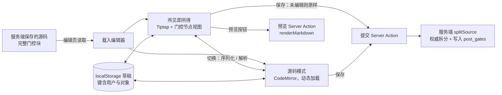

# M6.3 编辑器（设计说明与实施记录）

> 状态：**已完成**（2026-10-25，真机清单通过；§10 的决策点已按推荐执行）。上游：[M6-posting](M6-posting.md)（范围第 1、3 条）、
> [M6.1](M6.1-write-path.md)（写路径）、M6.2（textarea 薄切片，已完成）。
> 选型依据：[E0 编辑器选型记录](../spikes/E0-editor-selection.md)（结论：Tiptap v3 所见即所得 + CodeMirror 6 源码模式）。

## 1. 目标与边界

把 M6.2 的 textarea 换成编辑器：**所见即所得为默认，一键切到 Markdown 源码**；门控块做成可视块；服务端预览；
草稿自动保存；旧帖的往返保护。

**不做**：图片 / 附件上传与裁剪（M6.4，编辑器只留插入口的占位）；emoji 面板（旧表情已在迁移期展开为静态图，直接输入 Unicode）；
协同编辑；服务端 Markdown 实时渲染（预览按需请求）。

## 2. 结构

文件（拟）：`components/editor/` 下 `rich-editor.tsx`（所见即所得）、`source-editor.tsx`（源码，动态加载）、
`editor-shell.tsx`（模式切换与保存、草稿、预览）、`toolbar.tsx`、`gate-node.tsx`、`markdown/`（分词器与序列化，纯函数，无 DOM）。
E0 原型里 `editors/tiptap.ts` 的门控分词器、序列化器与节点视图可以作为起点，但要按生产标准重写（见 §4、§5）。

## 3. 往返保护（站长决定的底线）

| 情形 | 行为 |
|---|---|
| 新建内容 | 所见即所得，保存时序列化 |
| 旧帖，**未编辑** | 保存时**原样提交原源码**，不经过编辑器的序列化（零改写风险） |
| 旧帖，编辑过 | 序列化后提交；提交前在界面上提示「本帖以编辑器格式保存」，可切到源码核对 |
| 旧帖，**载入时往返不等价** | 强制进入源码模式，并在顶部说明原因（不让作者在编辑器里改坏内容） |

「往返等价」的判定（**第 1 步实测后定，站长 2026-10-25 按推荐确认**）：

- 口径：**渲染等价**。原文与「载入 → 取回」的结果，分别经站点渲染器（`renderMarkdown` + `splitSource`）渲染，公开部分的 HTML 相同，且每个门控的条件、匹配模式与隐藏正文渲染结果相同。
- 实测（389 条抽样，本地迁移库，只读）：逐字相同 62.7%，渲染等价 86.6%（门控帖 68 条：逐字 21、渲染等价 43）。逐字口径过低，因此采用兜底：
  - 未编辑的旧帖原样保存原文，不经过编辑器的序列化；
  - 编辑页加载器在**服务端**运行一次往返并比较渲染结果（无头编辑器在 Node 环境可运行，结论权威且不依赖浏览器）；不等价即强制源码模式；
  - 编辑过且渲染等价的帖子以编辑器格式保存：文本可能不同（如单个 `~` 被转义为 `\~`），渲染结果一致。
- 渲染不等价的主要原因（样例归类）：原始 HTML（``、`<u>`、`<a>`、``、` `）、`----` 与 `- -` 等边界、`<strong>` 包住多段内容、门控里的同类问题。这些都经源码模式处理，不做节点支持。

## 4. 门控块

- 语法权威仍是服务端 `splitSource`；编辑器内的 `:::gate{key unlock price match}` 只是编辑体验。
- 节点视图：头部下拉（付费 / 回复可见）、价格输入（付费时）、锁图标；正文区是**嵌套的块级内容**，可以在块内打字与插入段落、列表。
- 外层围栏长度 ≥ 4 个冒号（内嵌指令）是 E0 留下的边角问题：分词器必须支持同长度闭合，并补用例。
- 保存前用 `validateGates` 做实时提示（红框 + 文案），最终以服务端结果为准。
- 价格与条件的上下界校验沿用 `packages/content`（M6.5 再补「已购买门控改价提示」）。

## 5. 预览

- 按钮触发 Server Action（`defineAction`，只读，不写库），内部调用 `renderMarkdown` 与门控拆分，返回净化后的 HTML。
- 预览里门控块显示为锁卡片占位，**不显示隐藏正文**：预览的入参只来自作者自己的输入，不读任何库内隐藏内容，因此不构成泄露；但它也不替代发布后的真实样子。
- 界面标注「近似预览」，并说明以发布后为准（E0 §5.1）。
- 一致性测试：编辑器能产出的典型文档，序列化后经站点渲染，结构与编辑器显示一致。

## 6. 草稿

- 键：`funwind:draft:<userId>:<kind>:<id>`（kind = thread / reply / edit；id 为版块号或主题号或帖子号）。
- 写入时机：内容每次变化即写入（localStorage 写入廉价，**不做防抖**；正文上限 200k 字符）。载入时若存在与原文不同的草稿，提示「发现一份未发送的草稿」，给出「恢复草稿 / 丢弃」，而不是静默覆盖。草稿经 `useSyncExternalStore` 在挂载后读取（服务端快照为空），避免服务端渲染与客户端首次渲染不一致而水合失败。
- 提交即暂存（`stageDraft`）：表单 `submit` 时草稿从主键移到暂存键 `…:sent`，主键清空。服务端校验失败跳回时，从暂存键恢复正文并写回主键；成功后主键为空，**不会残留「未发送的草稿」提示**。暂存键只在失败跳回时读取，过期即清理（见下方整改说明）；登出时一并清除。
- 已知取舍：提交遇到网络层失败（页面未跳转）时，正文仍在编辑器里，但主键已清空；若此时刷新页面，这次未发出的正文会丢失。服务端校验失败（绝大多数情况）不受影响。
- 清理：**登出时删除全部草稿键**（登出是表单提交，在提交前同步清理，见 `LogoutForm`）。
- **代码审查整改（2026-10-25）**：暂存键只在失败跳回时读取；进入页面时若不是失败跳回，过期的暂存键即被清理（原先会残留到登出）。编辑冲突跳回时，正文以「发现一份未发送的草稿」提示、附件以「发现一份未保存的附件修改」提示交给作者选择恢复或丢弃，不自动覆盖最新版本。
- 存储不可用（隐私模式）时静默降级，编辑器照常工作。

## 7. 依赖

| 包 | 用途 | 加载方式 |
|---|---|---|
| `@tiptap/react`、`@tiptap/pm`、`@tiptap/core`、`@tiptap/starter-kit`、`@tiptap/markdown`，以及 `@tiptap/extension-table`、`@tiptap/extension-image`、`@tiptap/extension-hard-break`、`marked` | 所见即所得与 Markdown 语法 | 编辑器挂载时动态加载 |
| `@codemirror/state`、`@codemirror/view`、`@codemirror/commands`、`@codemirror/language`、`@codemirror/lang-markdown` | 源码模式 | 切换到源码时动态加载 |

版本钉死（精确版本号，**按两周规则选择**）：Tiptap 系列 3.31.4（发布于 09-30；E0 的 3.32.0 发布于 10-13，不满足两周）；
CodeMirror `view` 6.43.14（10-07；E0 的 6.43.15 发布于 10-19，不满足两周），其余 CodeMirror 包与 E0 相同。
第 1 步另外加入：`@tiptap/extension-table`、`@tiptap/extension-image`、`@tiptap/extension-hard-break`（同为 3.31.4，表格 / 图片 / 段落内换行需要），以及 `marked@17.0.6`（与 `@tiptap/markdown` 所用版本一致）。
依赖变更须在 CHANGELOG 记录。
`react-image-crop` 属于 M6.4，本里程碑不引入。**需要确认**（§10 决策 5）。

## 8. 移动端与输入法

- 所有自定义的 Enter / 快捷键处理先检查 `isComposing`，组合输入期间不拦截。
- 工具栏在窄屏下横向滚动而不换行溢出；按钮触控区 ≥ 44px。
- 真机清单（站长手测，见 M6.3 验收）：拼音 / 手写 / 语音输入的上屏；段落与门控块内的组合输入；长文粘贴；撤销；切换模式后内容保持。
- 桌面自动化只能模拟组合输入（E0 的 CDP 脚本），不能代替真机。

## 9. 测试与门禁

- **往返单测**（`packages/content` 与 `components/editor/markdown`）：语料只用仓库里的合成样例与夹具，**不把迁移语料提交进仓库**（语料含真实帖子）；迁移库的抽样实测只在本地执行并记录数字。
- **组件测试**（jsdom + Testing Library）：工具栏插入、门控块增删与切换、模式切换保持内容、草稿恢复与清理、预览按钮的状态。
- **覆盖率**：`components/editor` 纳入 vitest 统计，阈值 ≥ 90%（站长既定；见 M6-posting 测试规则）。
- **E2E**（chromium + mobile）：发主题 / 回帖 / 编辑 经编辑器完成；门控块的增删与发布后的锁卡片；预览；草稿恢复；登出清草稿。
- **泄露**：预览与编辑页的源码不含未授权的隐藏正文（沿用 M6.2 的泄露专项）。
- 门禁：`verify:all`、`test:e2e`、`check:secrets`；真机清单已由站长于 2026-10-25 实测通过（iOS / Android）。

## 10. 子步骤与决策点

子步骤（每步完成后汇报，经确认再进下一步）：

1. **依赖与往返纯层**（✅ 已完成，见 §3 的实测与口径）：依赖；Markdown 分词与序列化（纯函数）；固定往返用例 12 项。
2. **所见即所得与源码模式组件**（✅ `RichEditor` / `SourceEditor` / `EditorShell` 与工具栏；组件测试）。
3. **门控节点视图**（✅ 下拉、价格、块内编辑、外层 ≥ 4 冒号；节点视图的事件归属与更新分支单测）。
4. **预览**（✅ 实现为 Route Handler `POST /api/preview`，**偏离原设计的 Server Action**：`defineAction` 的返回值约定是 void，而预览要返回 HTML；同源检查、限流与零库访问照常。门控在结果里只显示占位；泄露专项已纳入五视角扫描）。
5. **接入发主题 / 回帖 / 编辑**（✅ 三处 composer；草稿恢复与丢弃提示；提交即暂存；登出清理；往返保护的界面提示）。
6. **移动端适配**、E2E、覆盖率阈值、泄露复核（✅ 工具栏按钮移动端触控目标 44px、桌面 36px；`components/editor` 覆盖率：语句 94.76% / 分支 90% / 函数 91.07% / 行 96.45%；E2E 桌面 + 移动 131 项、生产冒烟 10 项；泄露专项新增预览接口五视角扫描；真机清单待站长签字后勾选验收）。

决策（站长已按推荐确认）：

1. **接入范围**：发主题、回帖、编辑三处都换成编辑器（推荐）。回帖用精简工具栏。
2. **预览**：点击「预览」才请求服务端（推荐），不做逐键预览。
3. **往返保护的口径**：先用实测定阈值；若逐字等价比例过低，改用「未编辑保留源码 + 保存前展示差异」兜底（推荐，需要站长再确认）。
4. **草稿**：localStorage，键含用户与对象；登出时清除该用户全部草稿键（推荐）。
5. **依赖**：引入 Tiptap 3.32.0 与 CodeMirror 6 系列的精确版本（推荐）；裁剪库留到 M6.4。
6. **图片插入**：M6.3 只保留占位按钮，上传与裁剪在 M6.4 接入（推荐）。
7. **覆盖率**：`components/editor` 纳入统计，阈值 90%（推荐，与站长既定一致）。

## 11. 不在本里程碑

- 上传、图片裁剪（M6.4）。
- 已购买门控的改价提示与「内容更新于」标记（M6.5）。
- 协同编辑、服务端实时渲染。
