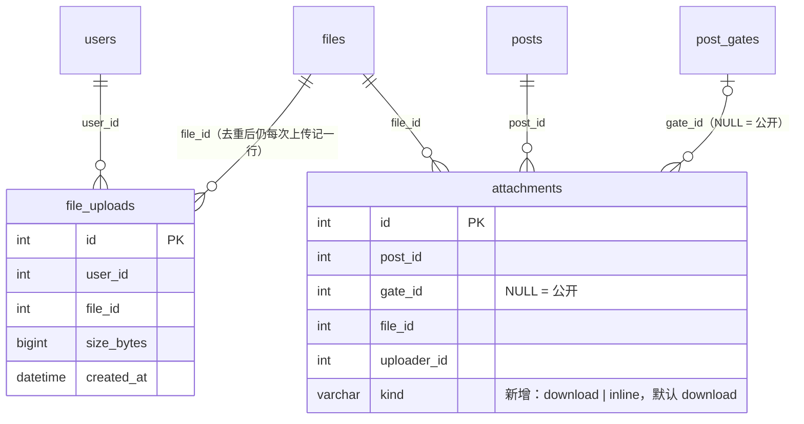
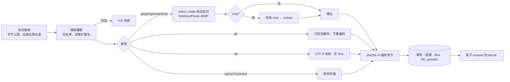

# M6.4 上传、图片与裁剪（设计说明与实施记录）

> 状态：**实施完成（M6.4a–d3）**。站长已确认 D1–D14（按推荐方案执行）。本文 §9 的决策保留原文；实施中的偏差与结果见 §14。
> 真机验收：站长已于 2026-10-25 在 iOS / Android 实测（裁剪手柄、粘贴、拼音输入等），结论为通过。

## 1. 目标与边界

**做**：编辑器里上传正文图片（可选裁剪、粘贴截图可选）；上传非图片附件并为每个附件选择「公开 / 归属某个门控」；头像上传（强制 1:1 裁剪）；`/files` 按需缩略图；上传配额计数；图片可见性按所属帖子鉴权；门控内图片的归属在保存时登记；只报告、不删除的孤儿文件巡检。

**不做**：视频与转码；附件级单独定价（见 ATTACHMENT-GATES §10）；对象存储与 CDN 签名（M13）；旋转 / 缩放手势的裁剪（首版不做旋转）；GIF 裁剪；附件的断点续传与进度条（首版用 `fetch`，无进度）。

## 2. 现状（已核实）

| 项 | 现状 | 对 M6.4 的含义 |
|---|---|---|
| `files` 表 | 已有：`sha256`（唯一）、`storage_key`（唯一）、`size_bytes`、`mime`、`width`、`height` | 直接复用，不改表结构 |
| `attachments` 表 | 已有 `gate_id`（NULL = 公开）、`uploader_id`、`downloads` | 增加 `kind`（见 §4） |
| `user_profiles.avatar_file_id` | 已有字段 | 头像直接写它 |
| `/files/<key>` | 已有鉴权（`lib/file-serving.ts`）：图片公开长缓存；非图片经附件反查 | 增加缩略图与新的图片可见性规则（§5） |
| 权限点 `attachment.upload` | 已在 `authz-vocab.ts` 定义，未被任何代码检查 | 上传的版块级鉴权直接用它 |
| 配额 `uploadsPerDay` | 已在 `lib/limits` 定义：会员 20、管理员 0（不限） | 计数落地（§6） |
| `no_avatar` 限制 | 已在 `user_restrictions` 枚举中 | 头像上传前检查 |
| 图片处理库 | `sharp@0.35.5` 仅为 next 的传递依赖（`pnpm-workspace.yaml` 已放行构建）；发布于 2026-09-27，超过两周 | 升为 web 的直接依赖（精确版本） |
| 裁剪库 | 未安装；`react-image-crop@11.1.2`（2026-06-21 发布，ISC，零依赖） | 安装并通过 `next/dynamic` 按需加载 |
| 上传代码 | 无 | 全部新写 |
| 个人设置页 | 无（只有个人主页 `/u/[uid]`） | 头像上传需要一个最小设置页（需要确认，§9 D14） |

**旧站数据（只读 SELECT 实测）**：

- `db_upload`：头像 `120×120` 像素、`3072` KB（3 MB）。这是旧站唯一显式的大小配置。
- `db_uploadfiletype`：允许的扩展名仅 `gif png zip rar jpg txt torrent` 七种。新站白名单在此基础上增加 `jpeg webp bmp 7z`，**不增加** svg / html / js 等可脚本化类型。
- 附件数据规模见 `docs/ATTACHMENT-GATES.md` §1.1：门控附件 130 个（图片 88、非图片 42），其中 24 个不在任何正文里引用。
- 旧站 `pw_attachs.size` 的单位无法从库内确定（最大值 77，单位推测为 KB），**不据此定附件上限**，见 D2。

## 3. 上传接口

- **`POST /api/upload`**（Route Handler，multipart）。不走 Server Action：它的请求体上限是 1 MB，且返回值需要是 JSON（与 `/api/preview` 同理）。
- 查询参数：`purpose`（`inline` | `attachment` | `avatar`）；`forumId`（`inline` / `attachment` 必填，版块 ID）。表单字段：`file`（文件）、`crop`（可选，JSON 字符串 `{x,y,width,height}`，单位为**自然像素**，即浏览器显示的已旋转图的尺寸）。版块放在查询参数里，是为了让权限判定先于读取请求体（见 §14.4）。
- 鉴权顺序：同源检查（同 `/api/preview`，跨站 403）→ 登录（未登录 401）→ 限流（全局桶 + 每用户桶，不依赖可信 IP）→ 同一账号并发上限（3，超出 429）→ 版块鉴权或头像检查（`checkPermission(subject, "attachment.upload", forumId)`，越权 404，与硬约定 7 一致；头像额外检查 `no_avatar`）→ 字节上限（流式计数，超出 413）→ 嗅探与准入 → 配额预检 → 图片处理 → 存储。
- 成功返回：`{ fileId, storageKey, url: "/files/<key>", mime, width, height, sizeBytes }`。
- **字节上限与内存**：请求体在权限判定之后才读取，超限在流式读取时即中止。上限按 §9 D2 设定，单请求内存峰值 ≈ 上限 × 2（缓冲 + sharp）；同一账号同时进行中的上传最多 3 个，因此单账号的内存峰值有界。

## 4. 数据模型变更



- **新表 `file_uploads`**：只用于配额计数与归属判定（谁上传过这个文件）。索引 `(user_id, created_at)`。**不挂帖子**：去重文件可被多帖引用，挂帖子会失真。
- **`attachments.kind`**：新增 `ENUM('download','inline') NOT NULL DEFAULT 'download'`。迁移产出的行保持默认值，迁移程序不需要改。`inline` = 正文里内联引用的图片；`download` = 帖子末尾的附件列表。
- 迁移走 `drizzle-kit generate`，并更新 `db:verify`：新增「`inline` 行的 `gate_id` 指向的门控属于同一帖子」「`inline` 行引用的文件存在」两项孤儿检查。`schema-rules.ts` 不需要新断言（没有新的唯一作用域）。
- 不新增 `files` 列；`uploader_id` 不放在 `files` 上（同一文件可能被多人上传）。

## 5. 可见性判定（`/files/<key>`）

**原则**：能力 URL（`storage_key` 由 SHA-256 派生，不可枚举）保留；图片是否公开，由**引用它的帖子**决定，而不是由文件本身决定。

```text
rows = attachments WHERE file_id = F

1. rows 为空                                  → 公开长缓存（头像、徽章、未引用的上传）
2. 存在 row：kind = inline ∧ gate_id IS NULL
   ∧ 所属帖子对游客可见                        → 公开长缓存（正文里的公开图）
3. 否则（图片或非图片）：
   存在 row 满足
     · 所属帖子对观众可见
     · gate_id 为空，或该门控对观众开放（与读取隐藏正文同一判定）
     · 非图片：版块持有 attachment.download
   → 放行，响应 private, no-store（计数 downloads，仅 download 行）
   否则 → 404
```

**与现状的差异**（需要确认，§9 D5）：

- 现状：所有图片公开。改后：**只被受限 / 待审 / 已删帖子引用的图片**不再公开。
- 已迁移的图片（无 row）仍然公开，迁移数据的可见性不变。
- 公开图片的快路径保留：规则 1 与规则 2 都不额外查库之外的内容。

**留意的漏洞场景（已纳入 §6 的写入校验）**：如果攻击者能把别人门控里的图片引用到自己的公开帖子里，规则 2 就会让它变公开。因此写入侧必须校验归属（D6）。

## 6. 写入侧（保存帖子的同一事务内）

以下校验与 `createThread` / `createReply` / `editPost` 同事务完成，失败则整体回滚并给出错误码。

1. **引用解析**：从保存的源码中抽取 `/files/<key>`（Markdown 图片与链接语法），区分公开部分与各门控块（沿用 `splitSource` 的切段结果）。
2. **存在性**：引用的 `storage_key` 必须对应 `files` 行，否则拒绝（「图片已失效，请重新上传」）。
3. **归属**：引用的文件，作者必须有 `file_uploads` 记录（即自己上传过）。**例外**：该引用在旧正文中已存在（编辑时的未改动部分），不重新校验，仅登记 `inline` 行。这样迁移来的旧图片在作者编辑时不会被误拒。
4. **附件**：提交的附件列表 `[{fileId, gateKey|null}]`，每一项同样要求作者上传过该文件；`gateKey` 必须是本帖存在的门控（保存后的 `post_gates` 行）。
5. **门控删除**：若某门控下仍有 `download` 附件，拒绝保存（ATTACHMENT-GATES §4.1）。若该门控下有 `inline` 行，随门控一起删除（D7）。
6. **登记**：删除本帖旧的 `inline` 行，按上面结果重新插入；`download` 行按附件列表增删改（只改 `gate_id` 与增删，不改 `downloads`）。
7. 所有 `attachments` 读写仍只经 `lib/gates/attachments.ts`（硬约定 3d）。登记与校验放在该模块的新函数里，守卫测试扩展。

## 7. 图片处理管线



- **自动定向**：先 `rotate()`（按 EXIF 方向旋转）再 `extract`。浏览器显示的是已定向的图，`crop` 坐标必须基于同一个坐标系，否则裁剪位置错位。
- **去元数据**：sharp 默认输出不带 EXIF / GPS（不调用 `withMetadata`）。测试断言输出不含 EXIF。
- **格式**：jpeg / png / webp 保持原格式重编码（jpeg 质量 90）；GIF 不重编码（保留动画），但去除注释块、纯文本块与非动画的应用扩展（如 XMP），循环信息与图形控制原样保留（`stripGifAncillary`，结构异常拒绝）；bmp 当前构建无法解码，入口即拒绝（415）。
- **像素炸弹**：`limitInputPixels` 限制解码前的像素数，超限拒绝（413 语义，给出「图片尺寸过大」）。
- **裁剪校验**（纯函数，属性测试）：`x,y,width,height` 必须为整数；`x,y ≥ 0`；`width,height ≥ 最小边长（32）`；`x+width ≤ W`、`y+height ≤ H`；`NaN`、负数、超大一律拒绝；头像要求 `width === height`。
- **GIF 不裁剪**：传入 `crop` 且类型为 GIF 时拒绝（400）。头像用 GIF 时取首帧，输出 webp（需要确认，§9 D10）。
- **sha256 在最终字节上计算**：去重基于存储的字节，与原文件是否重编码无关。

## 8. 缩略图、GC 与头像

- **缩略图**：`/files/<key>?w=320|800|1600`，白名单宽度，其它值忽略（返回原图），只对图片生效。sharp 缩放（`fit: inside`，不放大），输出与原图同格式，缓存到 `STORAGE_DIR/.cache/thumbs/<sha>-<w>.<ext>`，先写临时文件再 rename。**鉴权与原图完全一致**（§5 同一判定，缓存头一致）。缓存目录可随时清空，不入库。
- **孤儿巡检**：`pnpm --filter @funwind/web db:gc-files --dry-run`（只报告）。列出 `files` 中**没有任何 `attachments` 行、没有 `user_profiles.avatar_file_id` 引用、没有徽章引用、且创建超过 24 小时**的文件。不提供物理删除命令（M6 不删除任何文件，删除留待 M13 前的运维决定）。
- **头像**：`purpose=avatar` 强制 `crop` 且 `width === height`，输出 240×240 webp（旧站 120 的 2 倍，兼顾高分屏）。写 `user_profiles.avatar_file_id`（同事务；profile 行不存在则插入）。头像无 `attachments` 行，按规则 1 公开。

## 9. 需要确认的决策（推荐方案在前）

| # | 问题 | 推荐 | 备选 |
|---|---|---|---|
| D1 | 上传走哪种接口 | **Route Handler `POST /api/upload`**（不受 1 MB 限制，返回 JSON） | Server Action（受 1 MB 限制，不可行） |
| D2 | 大小上限 | **图片 10 MB、附件 50 MB、头像 5 MB**；像素上限 40 MP。理由：旧站头像 3 MB 偏小，附件无显式配置，50 MB 覆盖字幕包与压缩包常见大小 | 更小的附件上限（需要站长给出数字） |
| D3 | 图片是否重编码 | **是**（jpeg/png/webp 重编码，去元数据、定向）；GIF 不重编码 | 只去 EXIF 不重编码（拿不到 sharp 的解码保证） |
| D4 | 配额计数口径 | **每次成功上传都计数，包括去重命中**（防止靠重复上传刷存储与计数绕过） | 只计新文件（会让去重成为绕过手段） |
| D5 | 图片可见性规则变更（§5） | **接受**：只被受限 / 待审 / 已删帖子引用的图片改为鉴权 + `no-store`；无引用与公开引用的图片不变 | 保持所有图片公开（则受限帖子的图片可被能力 URL 直接取得，与「隐藏内容零泄露」冲突） |
| D6 | 引用归属 | **新增引用必须是作者自己上传的文件**；旧正文里已有的引用不重新校验 | 不校验（攻击者可把他人门控图片引用到自己的公开帖子，直接解锁） |
| D7 | 删除门控块时其中的内联图 | **随门控删除 `inline` 行**；这些图不再被引用，按规则 1 变为公开。它们的 URL 只在购买者的页面里出现过，暴露面不增加 | 保留悬空行（按 fail-closed 锁定），但 `db:verify` 会报孤儿 |
| D8 | 附件的门控归属交互 | **每个附件下拉选择「公开 / 门控 N」，默认公开**；未保存的附件在提交时校验 | 统一归属到第一个门控（与 ATTACHMENT-GATES Q3 的最严规则不一致，不推荐） |
| D9 | 缩略图宽度与格式 | **320 / 800 / 1600，同原图格式，`fit: inside`，不放大** | webp 统一输出（会改变动图格式，不推荐） |
| D10 | 头像规格与 GIF 头像 | **240×240 webp，强制 1:1；GIF 取首帧** | 允许 GIF 动图头像（首版不做，避免动图体积问题） |
| D11 | 粘贴截图 | **M6.4d 内包含**：粘贴图片走同一上传接口、直接插入（不裁剪） | 首版不做粘贴，留到 M6.5 |
| D12 | 允许的类型 | **旧站 7 种 ∪ {jpeg, webp, bmp, 7z}**；txt 要求 UTF-8 有效且无 NUL；svg / html / js 等一律拒绝 | 仅旧站 7 种（不含 webp，与现代浏览器与截图格式不匹配） |
| D13 | 上传限流 | **全局 600 次 / 分钟 + 每用户 30 次 / 分钟** | 更宽松或更严（需要站长给数字） |
| D14 | 头像上传入口 | **新增最小设置页 `/settings/avatar`**（登录后可用，展示当前头像、选择并裁剪、保存） | 首版只允许管理员上传（不推荐） |

## 10. 步骤拆分（每步单独汇报、单独提交）

- **M6.4a 数据与纯管线**（无 UI，无路由）：迁移（`file_uploads`、`attachments.kind`）+ `db:verify` 扩展；`sharp` 升为直接依赖；`lib/uploads/` 的嗅探、处理、裁剪校验（属性测试）；单测覆盖：魔数伪装、超大、像素炸弹、EXIF 剥离、定向、GIF 拒绝裁剪、txt 编码。
- **M6.4b 上传接口与配额**：`POST /api/upload`（鉴权顺序见 §3）；配额在事务内、持 `user_stats` 行锁时检查；去重与并发上传测试（N 路并发、限额恰好通过 limit 次）；限流测试。
- **M6.4c 可见性与缩略图**：`lib/file-serving.ts` 改为 §5 的规则；缩略图与缓存；守卫测试更新；`ATTACHMENT-GATES.md` 同步（Q5 结论、§5 规则、§4 `kind`）；可见性矩阵（公开 / 受限 / 待审 / 已删 × 游客 / 会员 / 作者 / 版主）。
- **M6.4d 写入侧与界面**：保存时的登记与校验（§6）接入 `createThread` / `createReply` / `editPost`；编辑器工具栏图片按钮（富文本与源码两种模式）、裁剪对话框（`react-image-crop`，`next/dynamic`）、粘贴；附件面板与门控归属；`/settings/avatar`；`db:gc-files --dry-run`；E2E（上传、裁剪、附件归属、跨用户引用被拒、泄露矩阵）；文档与 CHANGELOG。

每一步的门禁：`verify:all`、`test:e2e`、`check:secrets`、`format:check` 真实通过；E2E 不引用迁移数据（沿用 `support/fixtures.ts`）。

## 11. 测试与安全矩阵

| 场景 | 断言 |
|---|---|
| 魔数伪装（PHP 内容命名为 `.jpg`） | 415，文件不落盘 |
| 超大请求（分块、无 Content-Length） | 413，不解析 |
| 像素炸弹（超过 40 MP） | 拒绝，内存不随尺寸增长 |
| EXIF / GPS | 输出不含 EXIF、不含 GPS |
| 定向 | EXIF 方向为 6 的图，输出尺寸与像素方向正确 |
| 裁剪 | 属性测试：输出尺寸 == 裁剪尺寸；越界、负数、NaN、非整数、头像非 1:1 全部拒绝 |
| 重复上传 | 同字节两人上传 → 一个 `files` 行、两条 `file_uploads` 行 |
| 配额并发 | N 路并发上传，成功数恰好等于剩余额度 |
| 图片可见性矩阵 | 见 §5，四类帖子 × 四类观众；受限 / 待审 / 已删帖子的图片对游客 404 |
| 跨用户引用 | B 在公开帖里引用 A 的门控图片 → 保存被拒，且 A 的图片仍对游客 404 |
| 缩略图鉴权 | `?w=` 与原图的放行结果完全一致；缓存头一致 |
| 门控附件 | 锁定项不含文件名、大小、存储键（沿用 ATTACHMENT-GATES §5.2） |
| 泄露专项 | 门控内图片的存储键与文件名，在游客 / 会员 / 作者 / 版主视角下的 HTML、RSC、上传响应、`event_log`、`audit_log` 中只按规则出现 |

## 12. 风险

| 风险 | 对策 |
|---|---|
| 去元数据与定向引入的解码差异 | 同一 sharp 版本的测试样本，固定 fixtures；不在测试中依赖外部图片 |
| 图片可见性变更影响公开帖子的缓存 | 只有受限 / 待审 / 已删帖子引用的图片改为 `no-store`；公开图片的缓存头不变，E2E 断言 |
| 内存峰值 | 字节上限 + `limitInputPixels`；M13 部署时 nginx 的 `client_max_body_size` 必须与应用上限一致（记入上线核对项） |
| 孤儿文件累积 | 只报告不删除；24 小时缓冲；M13 前决定删除策略 |
| 去重导致的归属错觉 | 归属只看 `file_uploads`，不看 `files`；测试覆盖重复上传 |
| 编辑旧帖时旧引用被误拒 | §6 第 3 条的例外规则，有专门的迁移样本用例 |

## 13. 文档同步（每步随代码一起）

`DESIGN-MODEL.md` §5（文件与 `/files`）、`ATTACHMENT-GATES.md`（Q5 结论、§4 `kind`、§5 规则、§6 代码结构）、`CLAUDE.md` 硬约定 3d（登记行也经 `lib/gates/attachments.ts`）与 `/files` 相关的已知坑、`CHANGELOG.md`、`docs/reviews/2026-10-24-post-m5.5-review.md` 中相关条目的处置状态。

## 14. 实施记录（M6.4a–d3）

按 §10 的四步实施，每步单独提交（`fd51019`、`7bc9ef2`、`3804cec`、`6f2f84c`、`fa43362` 及随后的 d3 提交）。门禁结果以各提交说明中的真实输出为准。

### 14.1 相对设计稿的偏差（均已在代码与测试中固定）

| 项 | 设计稿 | 实际 | 原因 |
|---|---|---|---|
| 上传用途 | 表单字段 | 查询参数 `?purpose=` | 读取请求体之前就要按用途设定字节上限，否则 50 MB 的附件要先整包读进内存 |
| 附件项 | `{fileId, gateKey}` | `{fileId, gateKey, name}` | `files` 不存原始文件名，附件行的展示名必须由客户端提交并清洗 |
| 字段缺失 | 未说明 | `undefined` 不改动已有附件；`[]` 明确清空 | 旧版本表单编辑不能清空附件 |
| 旧引用例外 | 旧正文的引用免检 | 只豁免「该文件的附件行都不属于别人的帖子」的文件 | 购买者可把别人门控图的链接写进自己的旧正文，编辑时借「旧引用」登记为公开（安全审查指出） |
| 新增归属 | 只查 `file_uploads` | 同时要求 `attachment.upload`（事务外用授权快照算出 `canUpload`） | 写类权限须先过版块读判定；上传权限在版块作用域判定（安全审查指出） |
| BMP | 白名单含 bmp | 嗅探识别后入口即 415 `unsupported_type`（审查整改后） | 当前 sharp 构建无法解码 BMP，不能放行未经解码的字节；入口拒绝比处理阶段才以 400 失败更清楚 |
| 头像 GIF | 取首帧 | 取首帧并居中裁成正方形，不接受手动裁剪 | 头像强制 1:1；GIF 不提供裁剪界面 |
| 孤儿巡检 | 无引用的文件 | 另计入「公开正文中的 /files 链接」 | 迁移导入的内联图没有附件行，只在 `body_md` 中出现；按设计判定会全部误报（开发库 31 个，全部在正文中） |
| 同源判定 | 沿用 request.url | 按 Host 头（协议取 X-Forwarded-Proto）比较 | Next 按绑定的主机名构造 request.url（本地为 localhost），浏览器的 Origin 是 127.0.0.1，原判定误拒所有浏览器上传（E2E 实测发现） |
| 缩略图生成失败 | 未说明 | 回退原图，错误不暴露给观众 | 鉴权结论不受影响 |
| GIF 元数据 | 不重编码，原样存储 | 不重编码，去除注释与非动画扩展块（审查整改后） | 注释块与 XMP 可能携带作者信息；循环信息与动画时序保留 |
| 版块参数位置 | 表单字段 | 查询参数 `forumId` | 权限须在读取请求体之前判定（审查整改后，见 §14.4） |

### 14.2 验证结果（实施完成时）

- `verify:all`：web 单测 1162 项（覆盖率达标：`components/editor` 语句 96.12 / 分支 89.62 / 函数 93.67 / 行 98.15；`components/upload` 语句 97.17 / 分支 89.56 / 函数 93.02 / 行 97.38；`lib/gates` 语句 96.96）、db 65、content 50、migration 251；构建通过。
- `test:e2e`：桌面 + 移动 138 项（含插图、门控附件的泄露检查、裁剪、头像、375px 版式），生产冒烟 10 项，水合错误 0。
- `db:verify` 19 项全部通过；`verify:migration` 110 项全部通过（开发库）；`db:gc-files --dry-run`：0 个孤儿。
- 泄露专项：门控附件的文件名对游客不出现（`e2e/upload.spec.ts`）；门控图片的可见性矩阵（`file-serving.int.test.ts`）；预览接口五视角扫描（`leak-sweep.spec.ts`）。

### 14.3 遗留与边界

- 真机清单（iOS / Android）：裁剪手柄的触控、粘贴截图、拼音输入中的插入延后（`compositionend`）。站长已于 2026-10-25 实测通过。
- 未被任何帖子引用、也没有上传记录之外引用的文件，按能力 URL 规则仍然公开（它们的 URL 只有上传者知道）。
- 删除门控块后，其中的内联图按「无引用」变为公开（URL 只在购买者页面出现过，暴露面不增加）。
- `db:gc-files` 只报告，不删除；报告两类：库内无引用的文件，以及磁盘有、库里无的孤儿（事务失败或崩溃留下，审查整改后新增）。物理删除留待 M13 前的运维决定。
- 多实例部署：上传限流与全局桶仍是进程内实现（与 M4 的频控相同，M13 替换）。
- 部署要求：nginx 等反向代理的 `client_max_body_size` 必须不小于附件上限（50 MB + 表单余量），记入上线核对项。

### 14.4 代码审查整改（2026-10-25）

完整记录见 [M6 代码审查与整改记录](../reviews/2026-10-25-m6-code-review.md)。与本文相关的行为变化：

- **版块参数改为查询参数**（`forumId`）：权限在读取请求体之前判定，越权直接 404，不再先读入最多 50 MB 的内容。旧格式（表单里带 `forumId`）返回 400。
- **同一账号并发上限 3**：超出即 429，在读体之前占用；内存峰值有界。
- **配额预检前移**到图片处理之前（非权威，权威检查仍在存储事务内）。
- **BMP 入口拒绝**（415）；**GIF 去除注释与非动画扩展块**（见 §14.3 的格式规则）。
- **缩略图同一目标并发生成共享一次**。

