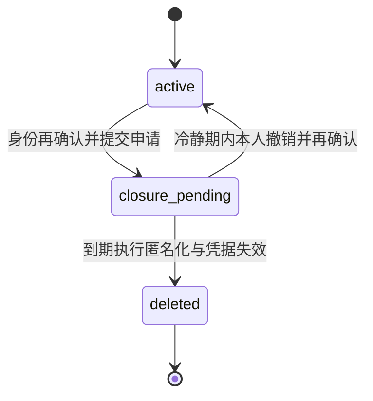

# M9.6 用户治理体系

> **状态：核心产品规则已确认（2026-10-29）；实施中。Step 0–3 已完成；当前 Step 4：邮箱验证、team role/badge 同步与通知。**
>
> 目标不是只补「用户自助注销」，而是把社区门户中的账号生命周期、权限身份、用户限制、徽章展示、前后台治理操作及各场景可见性放在同一套规则下审视。自助注销是其中一条生命周期，不代表本里程碑的全部范围。

## 1. 目标与设计边界

M9.6 要回答并落实一件事：**一个用户在不同账号状态、凭据状态、权限角色和限制条件下，能够登录、阅读、发布、互动、联系他人、管理内容，以及被他人看到什么；前后台每个入口的行为是否一致且可审计。**

用户治理不应再做成互相覆盖的单一「用户状态」。账号是否有效、邮箱是否验证、是否需要认领/强制换密、拥有什么权限、受到什么限制、展示什么身份，是相互独立的维度；在每个入口按统一策略求出最终行为。

**范围**：账号生命周期与账号安全；邮件验证和凭据状态对可用能力的影响；全站/板块限制语义；RBAC 与旧特殊组映射；徽章身份展示及其与角色的边界；用户在前台与后台的查找、可见性和操作；审计、通知、用户申诉/撤销的策略；自助注销。

**边界**：不重做 M9.5 已交付的内容状态机与内容管理队列；本里程碑定义用户状态如何影响内容作者、版主、管理员和其他读者。M7 的积分/荣誉功能、M9 的权限内核、M10.6 的账号设置和 M10.9 的徽章体系为既有能力，本里程碑盘点其治理边界并补齐不一致，不默认重建这些模块。

## 2. 已有决策和当前实现基线

### 2.1 账号与凭据

- `users.state` 当前只有 `active | deleted`。已注销账号保留用户行及稳定 UID，清除个人信息，用户名替换为「已注销用户#uid」；内容作者引用不删除。依据：`docs/DESIGN-MODEL.md:11,24-30`。
- `deleted` 目前由迁移管线为有历史内容引用、但旧用户记录不存在的 UID 创建占位行；Web 应用没有普通用户自助注销或管理员注销的运行时写入入口。依据：`migration/src/transform/users.ts:222-261`、`docs/milestones/M9.5-admin-ux.md:366-399`。
- 邮箱验证状态、密码是否存在、旧密码是否待强制更新、会话有效性不是 `users.state` 的子状态，应继续分开建模。当前设置有改密、改邮箱、资料和通知偏好，但没有注销流程。账号设置见 `docs/milestones/M10.6-feature-completion.md:37-46`。
- 登录会话目前按 30 天绝对期限有效；全站封禁会使请求中的会话视为无效，但封禁解除后原会话可能恢复有效。身份与会话实现见 `apps/web/src/lib/auth/session.ts:24-78,115-142`。

### 2.2 权限、限制与徽章

- RBAC 以角色/权限授权为准；绑定与授权可有全局或板块作用域。身份限制另存于 `user_restrictions`，内容状态由 M9.5 的内容状态机管理。不要用徽章、用户等级或“特殊组”代替权限判定。依据：`packages/db/src/schema.ts:67-186,810-865`、`apps/web/src/lib/authz/evaluator.ts:75-126`。
- 徽章字典和用户持有关系（`badges` / `user_badges`）用于展示，schema 明确为零权限语义。当前徽章有 `team` / `honor` 两类；撤回会删持有行、发通知和写审计，但不保存一份可查询的完整授予/撤回生命周期。依据：`packages/db/src/schema.ts:751-777`、`apps/web/src/lib/badges/service.ts:81-209`。
- 旧系统概念已经被拆分，而非整体搬入新用户表：六个团队特殊组映成自定义团队角色，同时派生团队徽章；旧 LV1–LV12 等级组并入 `member`，不再有等级权限/升级机制；旧「禁止发言」转成 `mute` 限制。映射依据：`migration/src/mapping/legacy-roles.ts:6-34`、`migration/src/transform/authz.ts:173-265`、`migration/src/transform/badges.ts:89-145`、`migration/src/transform/restrictions.ts:71-135`。

### 2.3 盘点发现的治理不一致

以下是需要纳入设计与验收的现状问题，不代表全部都必须以同一方式修复：

1. `/admin/users` 主要围绕活跃用户和限制操作；详情页未完整呈现邮箱验证、无密码/旧密码待改、账号 `state` 等身份状态；限制表单没有作用域，角色表单也没有期限字段。参见 `apps/web/src/app/admin/users/page.tsx`、`apps/web/src/app/admin/users/[uid]/page.tsx`、`apps/web/src/app/admin/users/actions.ts`。
2. 全站 `ban` 在会话读取层阻断，但会话行没有同步撤销；解除/到期后旧会话可能恢复。角色撤销通常改变后续授权判断，不等于主动撤销用户会话。参见 `apps/web/src/lib/auth/session.ts:54-78`、`apps/web/src/lib/authz/admin.ts:258-356`。
3. `no_signature` 在权限评估器有分支，但资料保存/个人页展示没有一致接入；`no_avatar` 会挡上传，但既有头像仍展示；后台界面不能创建带板块作用域的限制。参见 `apps/web/src/lib/authz/evaluator.ts:94-114`、`apps/web/src/app/settings/actions.ts:152-188`、`apps/web/src/app/u/[uid]/page.tsx:94-110,168-174`。
4. 板块作用域角色在后台可用于权限判定，但名片显示自定义角色时不标注作用域，容易把局部身份误读为全站身份。参见 `apps/web/src/components/content/user-hover-card.tsx:37-51,77-87`。
5. 已注销身份在帖子作者行会规范化为「已注销」，但通知和部分后台列表可能直接呈现用户表里的占位用户名；关注、私信和举报等入口也需按统一用户可交互策略复核。参见 `apps/web/src/components/content/user-badge.tsx:24-45`、`apps/web/src/lib/notifications/queries.ts:125-167`、`apps/web/src/lib/pm/service.ts:46-109`。
6. 管理员、版主和限制用户的绕过关系分散在 evaluator、session 与具体业务动作中；缺少一张被所有写入口共用的治理矩阵。后台也尚无“最后一位站点管理员”保护。
7. 改邮箱会清空邮箱验证时间，但邮箱更换、重新验证和令牌绑定关系需一起核查；密码重置/会话吊销行为也要在用户治理策略中明确，不能只在设置页孤立处理。
8. 迁移管线假设 `deleted` 主要是占位用户。未来若 `deleted` 也代表真实用户注销，重跑用户/内容迁移时不得把真实注销状态还原成 `active` 或误删对应用户行。相关迁移路径见 `migration/src/transform/users.ts`、`migration/src/steps.ts`、`migration/src/steps-content.ts`。
9. `disabled` 内容的查询谓词允许作者看到自己的封禁主题，但纯权限辅助函数 `contentVisibleTo` 当前只对作者放行 `pending/rejected`；这两处策略不一致，现有状态矩阵测试也没有 disabled 的作者视角。参见 `apps/web/src/lib/queries/visibility.ts:40-60`、`apps/web/src/lib/authz/evaluator.ts:187-208`、`apps/web/src/lib/authz/evaluator.test.ts:314-350`。
10. 全站封禁个人页当前会向公众渲染封禁原因；私信集成测试还明确允许给全站封禁用户发送新私信。这些行为必须纳入 persona/interaction 矩阵拍板，不能把“封禁理由仅目标和治理人员可见”当作现状。参见 `apps/web/src/app/u/[uid]/page.tsx:111-160`、`apps/web/src/lib/pm/pm.int.test.ts:150-180`。

## 3. 统一治理模型：分维度、同策略决策

### 3.1 用户治理维度

| 维度 | 当前/目标权威来源 | 表达内容 | 不应混用为 |
|---|---|---|---|
| 账号生命周期 | `users.state`；可增加单独的注销申请记录 | active、注销申请中、已注销 | 封禁、邮箱未验证、角色 |
| 认证凭据 | password hash、claim/reset/email token、legacy password 标记 | 是否可登录、是否只能认领/改密 | 账号是否已注销 |
| 邮箱可信度 | `emailVerifiedAt` + 明确的站点验证策略 | 能否执行需验证的写操作 | 普通用户角色 |
| 权限身份 | RBAC 角色绑定、权限授予及作用域 | 能做什么、在哪些板块做 | 展示徽章 |
| 行为限制 | `user_restrictions` | 全站封禁、板块禁言/禁入、头像/签名限制等 | 账号永久注销 |
| 社区身份展示 | `badges` / `user_badges` 与可公开显示的角色 | 团队成员、荣誉、社区身份 | 权限来源 |
| 内容自身状态 | M9.5 内容状态机 | 主题/回帖的审核、隐藏、封禁、删除 | 作者账号状态 |
| 社交关系与偏好 | follow、私信策略、通知偏好等业务数据 | 用户愿不愿意互动及关系状态 | 管理员权限 |

每一项用户行为按目标对象和业务上下文决策：`account lifecycle` → `credential gate` → `site/account restrictions` → `permission + scope` → `content/resource policy`。展示层消费同一份身份解释，不得自行用“按钮是否隐藏”充当鉴权。

### 3.2 账号生命周期建议

推荐保留 `users.state=active|deleted` 作为最终账号状态，不立即把“注销申请中”塞入现有 `state` 枚举。注销申请单独保存请求时间、计划完成时间、申请验证方式、撤销/完成时间和执行结果；运行时将有效申请解释为 `closure_pending`。这样 `deleted` 继续表示不可逆的最终结果，避免把所有只识别 `active` 的现有查询静默改变语义。

已确认的注销流程：

1. 用户在账号设置中阅读影响说明并重新验证身份；有密码的账号确认当前密码，无密码账号使用已验证邮箱的 claim/recovery 级验证，不能仅凭现有长时会话发起注销。
2. 提交后进入 **30 天私密冷静期**。既有完整权限 session 全部撤销；本人重新认证后只能查看申请状态/生效日期和撤销申请，不能发主题、回帖、私信、关注或修改资料。其他用户看不到“待注销”状态，既有公开身份和内容维持原样。
3. 本人在冷静期内撤销时，需重新认证；撤销受限 session 并新建正常 session，旧 session 不恢复。未过期角色、限制和徽章按它们各自的真实状态决定，不因撤销注销申请而重建已撤销的授权。
4. 冷静期届满后由可重试、幂等任务完成注销：保留 users 行和 UID，置 `state=deleted`；撤销 sessions、邮件令牌、邀请码及权限绑定；清除邮箱、密码、旧密码材料、个人资料、头像/签名和可识别个人信息。
5. 公开主题/回帖与私信历史保留并改为统一匿名身份；清理关注关系与个人偏好；徽章停止展示；保留积分账本和治理审计作为不可变历史，但对外只呈现匿名 UID。注销完成是终态，不能重激活。
6. 注销任务失败可以重试，不得恢复 PII 或造成作者引用孤儿；每次申请、撤销和完成均写审计并通过站内通知告知本人。数据导出不纳入 M9.6。

### 3.3 凭据与验证状态

把以下状态做成可判定、可测试的认证子状态，不添加“角色”来表达：

- 正常凭据：允许常规登录。
- 无密码/迁移待认领：不允许密码猜测或空口令登录；只可通过 claim/recovery 安全流程建立新凭据。
- 旧密码待强制换新：登录后只放行换密、登出及必要安全页面；判定必须来自服务端持久状态，而非仅依赖一小时 cookie。
- 邮箱未验证：保留读取能力；所有注册模式使用同一稳定验证门，不允许通过 open/invite 模式切换改变既有用户的写权限。改绑邮箱必须由新地址的专属令牌重新验证。
- 更换邮箱：新邮箱只有在令牌绑定到该邮箱且验证成功后才作为已验证地址；未验证地址不能被当作账号恢复渠道。

### 3.4 限制类型和作用域

已确认的限制语义彼此分离：

- **全站账号封禁（`ban`）**：禁止建立/恢复登录会话，并在创建时撤销所有现有会话。个人页保留“已封禁”通用标记，但不公开理由或期限；本人通过再次验证身份后的专用受限页面看到理由、期限和基础申诉入口，授权治理人员可见完整记录。解封/到期后旧 cookie 不复活，只允许重新认证。
- **板块禁入（`forum_ban`）**：独立于全站 ban，作用于指定板块及其子树，阻止目标用户读取和写入该范围；板块外不受影响。被禁入用户不能看到该范围内自己的既有内容，其他用户仍按原内容状态读取；授权版主/站点管理员能进入治理视角。
- **禁言（`mute`）**：可全站或板块作用域，只拒绝对应范围内的写入，不阻止登录和读取；无板块上下文的私信、关注、举报等动作不被隐式影响。
- **禁止头像/签名（`no_avatar` / `no_signature`）**：限制生效时隐藏既有头像/签名并拒绝新增或修改；底层资料暂存，解除或到期后恢复展示。
- 所有限制均记录操作者、原因、起止时间、目标作用域和审计；创建/解除均确认；对象必须是允许受治理的账号。开始时间、结束时间、scope 与服务端行为使用同一有效性判断；并发重复限制需有服务层/数据库幂等保护。
- 文件访问也复核当前登录主体：`forum_ban` 用户不能通过直链读取被禁版块引用的公开图片；`no_avatar` 生效时纯头像资源的已知 storage key 返回 404。若同一内容寻址文件同时被可读的公开正文引用，正文仍按公开内容规则可读；匿名访客仍按公开板块策略访问，已经交付并缓存的旧副本无法远程撤回。
- 站点管理员不隐式绕过全站 ban、注销申请、凭据强制换密等账号级安全门；管理员也不绕过已确认适用的行为限制。异常恢复必须由另一位有效管理员执行显式解除或经审计的紧急恢复。

## 4. 角色、旧特殊组与徽章的治理关系

### 4.1 权限与展示分离

1. **角色/授权是唯一权限来源。** RBAC 负责操作权限及全局/板块作用域；徽章只是公开或半公开的身份装饰，不得被权限评估器引用。
2. **旧等级不复活。** LV1–LV12 已合并为 `member`，不再依据旧 points 门槛恢复隐式权限；如未来需要等级/声望，需作为新产品能力单独定义可解释的晋级规则。
3. **六个旧团队组分成两种语义：**团队成员的工作权限由自定义角色授予；社区展示身份由对应团队徽章表示。旧 `gid=6` 禁言由限制记录表示，不是用户组。
4. **团队身份同步已确认：**对固定的团队成员角色与 `kind=team` 徽章建立显式映射；统一 team-membership 服务事务化同步角色和对应徽章，权限始终以角色为准，徽章不参与授权；两者的到期时间一致。team 徽章不能通过普通荣誉徽章入口单独授撤；普通 `honor` 徽章仍可独立管理。
5. **公开身份规则已确认：**前台只显示明确允许公开的身份；公开的板块角色标明作用范围，后台管理角色默认不公开。团队徽章为公开身份；角色是否公开用显式白名单/标记，不根据“拥有权限”自动推断。

### 4.2 管理员与权限安全基线

- 用户角色授予必须有过期/永久选择、作用域选择、理由；撤销时展示受影响能力和持有人。角色删除应展示受影响用户并记录可检索审计。
- 防止删除/撤销最后一位可用的 `site.admin` 站点管理员；设置紧急恢复流程并有审计。
- 将“管理用户、管理角色、管理限制、管理徽章、吊销会话”按权限点与页面入口分开保护；后台同页面的不同操作不能只依赖访问页面时的一次鉴权。
- 有效权限变更立即影响后续请求；对撤权、全站封禁和密码重置要定义哪些会话立即失效、哪些仅权限重新计算。

## 5. 状态 × 行为 × 可见范围矩阵（设计基线）

下表是当前行为与目标规则的设计对照。板块读取权限、内容状态和目标资源规则仍是额外前置条件；“允许”不代表绕过 RBAC。

| 用户情形 | 登录/会话 | 阅读公开内容 | 写入/互动 | 私信/关注/举报 | 公共作者展示 | 后台治理 |
|---|---|---|---|---|---|---|
| `active`，凭据正常、无限制 | 允许 | 按板块 read policy | 按权限与内容规则 | 按权限、收件策略和业务规则 | 正常头像/姓名；仅展示允许公开的徽章/角色 | 用户管理页可查；执行独立权限控制的管理操作 |
| 邮箱未验证 | 允许 | 允许 | 禁止普通写操作；不因 open/invite 注册模式切换改变 | 按固定写权限矩阵拒绝私信等写操作；读、举报等非写操作按各自权限判定 | 正常显示；本人明确看到验证待办 | 详情显示验证状态和重发/修复入口，不泄漏验证令牌 |
| 无密码/claim 待完成 | 不允许普通密码登录；只允许安全 claim/recovery | 游客视角 | 不允许 | 不允许以该身份执行登录后操作 | 公开内容仍按作者身份展示 | 管理员可确认状态，不可见哈希/令牌 |
| 旧凭据待强制换密 | 仅受限认证/换密路径；cookie 过期不能解除限制 | 必要安全页，不访问普通已登录功能 | 不允许 | 不允许 | 不改变其他读者看到的内容 | 管理员能看到待换密状态；不能代替用户输入密码 |
| 注销申请中 | 撤销全部完整会话；本人重新认证后只获状态/撤销专用受限访问 | 本人可读注销状态；其他用户按普通 active 身份读取既有公开内容 | 禁止发帖、回帖、私信、关注和资料修改 | 禁止新建互动 | 申请状态不公开；既有身份/内容保持原样 | 授权治理人员可见申请时间、到期时间和审计；未经本人重新认证不得取消 |
| `deleted` | 拒绝登录，吊销全部会话/令牌且不可复活 | 公开主题/回帖与私信历史按匿名身份保留 | 不允许 | 清除关注等活跃关系；不允许新私信/互动 | 统一“已注销”，不链接个人页，不暴露旧邮箱/占位 UID 名 | 历史只读；角色/限制撤销、徽章停止展示；禁止授角色、加限制或重激活；积分和审计仅匿名保留 |
| 全站 ban | 登录拒绝并立即吊销全部会话；解封后旧 cookie 不复活 | 本人通过身份再确认后的受限说明页读取；其他人按原公开内容规则 | 拒绝 | 禁止新私信；既有会话只读；其他交互按全站封禁策略拒绝 | 个人页保留“已封禁”通用标记；理由/期限不公开，公开内容不被自动隐藏 | 本人和授权治理人员可见理由、期限、历史；无权限人员不见敏感原因 |
| 板块 mute | 登录正常 | 按板块 read policy | 仅目标板块的写入类操作拒绝 | 无板块上下文的私信/关注/举报不应被默默影响 | 默认不公开标记 | 管理员/所辖版主看范围、原因、期限 |
| 板块 `forum_ban` | 登录及板块外会话保持 | 指定板块及子树内拒绝读取；板块外按原权限 | 指定板块及子树内拒绝写入 | 仅按明确的目标状态策略允许/拒绝 | 默认不公开标记或理由；被限制本人可在受限说明页查看 | 版主/管理员按授权范围仍可治理该板块内容 |
| `no_avatar` / `no_signature` | 登录正常且 session 保留 | 其他内容照常读取 | 对应上传/资料保存被阻止 | 不影响无关操作 | 限制期间隐藏既有头像/签名；解除/到期恢复原值 | 本人及授权治理人员按权限查看限制原因/期限；写入和解除均审计 |
| 站点管理员 / 版主 / 团队角色 | 仍受有效账号与认证状态约束 | 可见范围由角色权限和内容状态决定 | 只允许授权范围内操作 | 仅明确授予对应权限 | 按可公开策略显示；板块角色需标清范围 | 版主只管所辖；站点管理职责按 `site.admin` 与细分权限分层 |

**硬约束：**该矩阵必须拆解到 Server Action/API、页面读取和组件入口逐项验证。隐藏 UI 不是授权；页面能看到也不代表有修改权；作者能看自己的内容不代表能看其他用户的待审内容。

## 6. 前台展示与交互规范

### 6.1 统一身份解析

建议在用户展示层形成统一的身份投影/查询辅助，避免每个业务模块自行拼用户名、状态和链接。它至少返回：公开显示名、头像/首字符、是否可链接到个人页、是否可发私信/关注/举报、徽章集合、明确允许公开的角色名及作用域。通知、私信、帖子、搜索和后台列表分别提供合适的上下文，不把数据库占位名直接透出。

### 6.2 各场景规则

| 场景 | 规则基线 | 需要设计落实的交互 |
|---|---|---|
| 主题、回帖、首页和搜索结果 | 内容作者引用保留；删除账号显示统一占位身份；内容是否可见仍由 M9.5 内容状态机及板块权限决定 | 作者链接是否关闭；匿名占位文本；不以作者被封禁而自动隐藏公共内容 |
| 个人页、作者名片、用户菜单 | 仅 active 用户可进入个人页；全站封禁公开显示通用“已封禁”标记但不显示理由/期限；待注销状态不公开 | 团队徽章可公开；角色按显式公开规则展示并标明板块范围；后台角色不公开；本人通过安全受限页查看限制理由、期限和申诉入口 |
| 通知与活动动态 | 已注销触发者按统一身份投影脱敏；收件人只能读取自己的通知 | 保留治理审计所需历史；普通通知不泄漏封禁/限制理由，注销用户自身偏好和收件箱按最终数据清理清单处理 |
| 私信 | active 且符合收件设置才可新建对话；注销后历史会话和消息保留并匿名化 | 禁止向全站封禁、注销申请中或已注销用户新建私信；封禁期间既有会话双方只读，界面不显示可发送输入框；解除封禁后按新状态恢复 |
| 关注/粉丝列表 | 账号生命周期与关系记录分开判定；注销申请期阻止新建关系，最终注销清理双向关注关系 | 活跃用户正常互动；注销目标不泄露旧占位用户名/UID，服务端对关系清理和重复请求保持幂等 |
| 举报/互动 | 只有允许的内容状态、可读版块及非本人内容可举报 | 服务端复核当前对象及版块可读性，UI 隐藏不能代替动作校验 |
| 内容审核/用户后台 | 仅所辖版块版主或具备相应站点权限的管理员查看受限个人信息 | 受限作者的 badge/role/ban 信息按最小权限显示；审核理由与用户理由分权 |

## 7. 后台用户治理设计

### 7.1 用户列表和详情

`/admin/users` 继续作为定位和治理入口，不承担权限定义本身。建议：

- 列表按账号生命周期筛选：活跃、注销申请中、已注销；另以独立筛选展示邮箱待验证、凭据待认领/强制换密、受限用户。默认仍为最近注册的活跃用户，避免全库重查询。
- 搜索用户名/UID/邮箱按隐私和管理员权限分层；列表不公开完整邮箱；注销申请与封禁理由不出现在无权人员的表格/导出中。
- 用户详情按「身份与凭据」「限制」「角色与作用域」「徽章」「会话」「积分/关系」「审计历史」组织；明确展示数据来自哪个维度、当前是否生效、何时到期。
- 为被注销/申请注销用户提供只读历史页；禁止新增角色、限制或徽章，禁止用普通资料编辑动作重新激活。

### 7.2 后台操作契约

- 每个动作由服务端检查 actor 权限、target 生命周期和作用域；版主操作范围限所属板块，站点管理按细分权限区分；不以客户端的 disabled 状态作为安全边界。
- 危险动作显示目标、影响面、期限；授予/封禁/禁言/撤销账号时要求理由；撤销、取消、注销操作确认不同，不用同一泛化“删除”按钮。
- 每次治理动作记录 actor、target、动作、作用域、理由、前后值、执行时间、关联对象；敏感理由只对目标本人和授权治理人员可见。
- 授予/撤销角色或限制、封禁、注销申请/完成必须定义对现有会话的处理；权限变更即时生效，安全处置按策略撤销相应 session/token。
- 目标用户收到明确状态通知：原因、范围、到期/生效时间、可以采取的步骤（如申诉/撤销）。不向其余普通用户泄露治理理由。
- 防止最后一个站点管理员失去 `site.admin`；保护保留账号、测试夹具和已注销占位用户免受误操作。

## 8. 旧系统概念的保留与拒绝继承

| 旧站概念 | 当前 v2 转译 | M9.6 设计原则 |
|---|---|---|
| guest / 普通会员 / 管理组 | 隐式 `guest` / `member`、站点 `admin` 权限 | 继续按权限表达，不当作公开荣誉 |
| 字幕制作、技术分流、策划、资源、美工、实习等六个团队特殊组 | 六个自定义团队角色，迁移时另建团队徽章 | 角色管工作权限、team 徽章管展示；运行时通过统一 membership 服务原子同步授撤及期限，徽章不作为权限来源 |
| LV1–LV12 积分等级组 | 合并为 `member`，旧等级规则不再运行 | 不复活旧等级权限；是否另做声望/等级属于独立产品决策 |
| 禁止发言组/记录 | `mute` restriction | 用有理由、有范围、有期限的限制表达，避免伪装成角色 |
| 旧 ban 类型 | 迁移时主要转为禁言、禁头像、禁签名限制；不存在可直接沿用的新系统“禁止登录”语义 | 全站封禁与内容治理的 `disabled` 终态完全分开 |
| 旧勋章、荣誉和自动颁发规则 | `honor/team` 展示徽章；自动颁发规则不迁 | 徽章不赋权；历史获得与撤回策略需在新系统显式建立 |
| 旧用户 status 位、未知 gid、旧版块 manager | 不作为运行时权限/状态基础 | 语义不明的不重新引入；如需新能力，写清新契约与迁移映射 |

## 9. 实施步骤（核心规则已确认）

| Step | 范围 | 预期交付 |
|---|---|---|
| 0 | 冻结本稿已确认策略，记录当前实现/测试基线；更新 ROADMAP 状态 | 决策矩阵、状态图、会话与可见性矩阵成为实施真源 |
| 1 | 注销申请记录（完成记录即真实注销 tombstone）、`forum_ban`、邮箱令牌签发地址快照；占位行按“`deleted` 且无已完成注销记录”识别，不新增迁移标记列/表 | schema 迁移和迁移重跑不会复活账号或删除真实用户引用 |
| 2 | 统一生命周期/凭据门、session 创建与吊销；Ban 即时吊销，解封旧 cookie 不复活 | 跨设备 session 状态转换集成测试；DB-backed 强制换密门覆盖页面/API/Action |
| 3 | restriction kind/scope/expiry 语义、`forum_ban` 板块子树、资料临时隐藏、last-admin 防护 | 后台表单、服务层和有效性判断一致；权限越权与并发保护测试 |
| 4 | 改邮箱重新验证、token 绑定邮箱；team role + team badge 原子同步；角色公开范围与通知 | 真实 MySQL 事务/回滚、到期同步、通知 outbox 和展示策略覆盖 |
| 5 | 统一公开身份投影、PM/follow/notification/report/内容作者及后台用户治理视图 | 前台状态 × persona E2E 与服务端直接调用负向对照 |
| 6 | 30 天私密注销申请、受限查看/撤销、幂等到期匿名化与关联数据清理 | 多设备撤销、撤销后新 session、到期不复活、内容/PM 保留匿名、数据对账 |
| 7 | 全状态矩阵收口、迁移重跑演练、桌面/平板/手机验收、required CI | `verify:all`、生产全量 E2E、dev-only 冒烟、临时库迁移与手工清单全绿 |

实施按 Step 顺序推进；每一步先汇报改动和真实门禁结果，再进入下一步。生产/旧源数据不在本里程碑演练中写入；不包含 commit/push，除非站长另行要求。

## 10. 已确认决策记录（2026-10-29）

下列产品规则已由站长通过交互式选项确认，属于 M9.6 的实现基线；实现细节不得反向改变这些语义。

| # | 决策 | 已确认规则 |
|---|---|---|
| 1 | 自助注销生命周期 | 冷静期 30 天；申请状态对外保密；申请时撤销全部现有完整 session；本人重新认证后仅可查看申请状态/撤销；到期幂等完成；撤销后发新 session，旧 session 不恢复 |
| 2 | 公开内容和私信历史 | 已发布主题/回帖和私信历史保留并匿名化，作者显示统一“已注销”身份；不物理删除作者引用 |
| 3 | 其他关联数据 | 清理关注等活跃关系及个人偏好；撤销角色/限制、停止徽章展示；积分账本和治理审计保留为匿名只读历史 |
| 4 | 全站封禁 | `ban` 立即撤销全部 session；解封/到期后旧 cookie 不复活；封禁用户不能作为新私信收件人，既有会话在封禁期双方只读 |
| 5 | 全站封禁的公开展示 | 公开个人页保留通用“已封禁”标记；不向公众显示理由或期限；本人通过身份再确认的受限说明页、授权治理人员可见理由和期限 |
| 6 | 板块限制 | 新增 `forum_ban`，作用于指定板块及其子树，禁止目标用户读取/写入；全站 ban 只负责全站登录封禁；`mute` 负责全站/局部禁写 |
| 7 | 管理员权限边界 | 管理员不隐式绕过账号级限制/强制换密/注销申请；保护最后一位有效站点管理员；必要恢复由另一位有效管理员显式操作并审计 |
| 8 | 头像/签名限制 | `no_avatar` / `no_signature` 生效时隐藏并禁止修改既有资料；保留原值，解除/到期恢复 |
| 9 | 邮箱验证 | 改绑的新邮箱必须重新验证；令牌绑定签发地址；未验证账号仍可读，写权限门不随 open/invite 注册模式切换改变 |
| 10 | 旧团队角色与徽章 | 固定 team role 与对应 team badge 由统一服务原子同步授撤及期限；角色是权限真源；普通 honor badge 独立 |
| 11 | 前台身份展示 | 只展示显式允许公开的身份；公开板块角色标注作用范围；后台管理角色默认不公开；team badge 为公开身份 |
| 12 | 申诉与数据导出 | 提供本人基础申诉/人工复核入口、审计和结果通知；完整自动分流队列及用户数据自助导出不纳入 M9.6 |
| 13 | 迁移重跑安全 | 真实用户注销必须有持久的已完成申请记录作为 tombstone；旧占位仅按 `state=deleted` 且无 completed 记录识别，不给运行时 schema 增加迁移专用标记；重跑不得复活账号或回填 PII |

## 11. 测试策略与验收门禁草案

### 11.1 当前自动化基线与缺口

现有测试可复用，但不能把“状态门拒绝了当前请求”误认为“会话已撤销”，也不能把服务层测试误认为页面泄露测试已覆盖。

| 测试域 | 已有证据 | M9.6 还需补齐 |
|---|---|---|
| Session 基础与账号失效 | `apps/web/src/lib/auth/session.int.test.ts:45-103,178-201` 覆盖 session 创建、读取、过期、`deleted` 读取被拒、当前/全部 session 显式撤销；使用真实 MySQL，cookies 为测试替身 | 状态改变时 DB session 行是否撤销、多浏览器 cookie、被封禁/注销后解除或状态回退时旧 cookie 不复活 |
| 全站封禁 | `session.int.test.ts:105-134` 覆盖已有 session 在 ban 时 `getCurrentUser()` 为 null；`apps/web/e2e/auth.spec.ts:169-176` 覆盖预先封禁用户登录被拒 | 管理动作后两个已有 session 是否立即吊销；解除/到期后旧 session 不复活；本人/旁观者/profile/PM 的理由与可见行为 |
| 密码与邮箱凭据 | `apps/web/e2e/auth.spec.ts:108-215` 覆盖找回、claim、验证确认；`apps/web/e2e/dual-track-auth.spec.ts:34-70` 覆盖旧密码强制换密；`tokens.int.test.ts`、`register.int.test.ts` 覆盖令牌消费 | reset/claim 后其他设备旧 cookie 失效；改密保留当前、撤销其他会话；邮箱变更后同一 session 的写权限即时改变；服务端持久强制换密边界 |
| 角色与限制 | `apps/web/src/lib/authz/authz.int.test.ts:205-284` 覆盖授权/撤销与用户角色绑定；`apps/web/src/lib/authz/restrictions-admin.int.test.ts` 覆盖限制服务和列表 | 同一浏览器 session 中角色/限制变更后立即生效；ban/mute/no_avatar/no_signature 的到期、解除、作用域、session 行和 UI 状态矩阵 |
| 内容状态可见性 | `apps/web/src/lib/authz/evaluator.test.ts:314-350`、`apps/web/src/lib/queries/queries.int.test.ts:168-214,282-291`、`apps/web/e2e/visibility.spec.ts:46-140` 覆盖多个状态与作者/其他会员/版主；`e2e/content.spec.ts:53-67` 覆盖注销作者展示 | 补齐 `disabled`、版主范围内/范围外、站点管理员和各输出面；现有 evaluator 与 SQL 查询对 disabled 作者的口径不一致，先统一后测 |
| 前台用户状态面 | `e2e/content.spec.ts`、`e2e/badges.spec.ts`、`e2e/stream-lists.spec.ts` 有已注销作者、badge、占位账号 API 的局部验证 | profile、名片、PM、follow、通知 actor、举报分别对 active/deleted/ban/各 restriction 的正反向与理由脱敏 |
| 后台用户治理 | `restrictions-admin.int.test.ts:125-168` 覆盖用户查找/活跃用户/受限筛选；`e2e/moderation-review.spec.ts:211-231` 只覆盖普通会员/游客不能进用户管理 | 管理员/细分治理者/版主的列表、详情、敏感字段和操作范围；deleted/注销申请中目标拒绝操作；最后管理员保护 |

会话读取中的“当前判无效”与真正吊销是不同不变量：当前 `session.ts` 会按 `active` 与全站 ban 过滤读取，但 ban/deleted 时不必然删除 session 行；在状态解除或还原后旧 cookie 有重新通过读取门的风险。M9.6 必须把该行为通过明确策略和回归测试固定下来，不能只以 `getCurrentUser() === null` 作为吊销证明。

### 11.2 已登录用户的状态转换 × 会话期望

所有转换测试都要在转换前建立至少两个不同浏览器上下文的登录会话；转换后分别验证 cookie/API、session 表和页面/动作。用例应测试状态变更动作本身，而不是直接改 DB 后只测一个纯查询。

| 转换 | 会话期望（设计门禁） | 必须验证的行为 |
|---|---|---|
| `active → role grant/revoke` | 保留 session；后续请求立即按新权限判定 | 原 cookie 在授权范围内允许/拒绝；不应以重新登录才生效 |
| `active → scoped mute`，以及解除/到期 | 保留 session；只改变目标范围内的写权限 | 同一 cookie 在范围内写被拒，在范围外按原权利可写；解除后能力恢复，但会话不更换 |
| `active → global ban` | 立即撤销所有既有 session 行与 cookie；解封后旧 cookie 不复活 | 两个既有 context 均失效，数据库没有旧 session；到期/解除后旧 cookie 仍失效，只能重新认证 |
| `active → no_avatar/no_signature`，以及解除/到期 | 保留 session；对应资料/上传权限和可见性即时变化 | 同一 session 不能绕过 Server Action/API；既有值按最终确认策略隐藏/保留/恢复 |
| 邮箱未验证 → 已验证；已验证 → 改绑新邮箱 | 保留 session；邮箱门按当前已验证地址即时更新 | 原浏览器不重新登录，写权限立即开/关；验证令牌必须绑定对应邮箱且单次消费 |
| 密码更新、reset、claim | 设置页改密：当前 session 保留、其他 session 撤销；reset/claim：所有旧 session 撤销，只保留流程建立的新 session | 多设备旧 cookie 均失败、旧令牌重放失败、新会话成功；强制换密前任何普通页面/API/Action 均被拒 |
| `active → closure_pending` | 不保留全能力 session；先撤销已存在的普通 session，后续仅通过再认证取得注销状态/撤销专用的受限访问 | 不可继续发布/私信/改资料；能看到截止时间与撤销入口；旧设备 session 不复活 |
| `closure_pending → active`（本人撤销） | 撤销受限 session 并轮换为新的正常 session；此前被撤销的旧 session 不复活 | 撤销需再认证；新 cookie 恢复授权；被删角色/已过限制不因取消注销而自动恢复 |
| `closure_pending → deleted` | 撤销全部 session、verify/reset/claim token 和恢复凭据；终态不可复活 | 所有旧 cookie 和令牌失败；数据库用户行保留但 PII 已匿名化；重复执行幂等 |
| `logout` | 仅吊销当前浏览器的当前 session；其他设备是否继续有效按产品基线保留 | 当前 cookie 立即失效，另一设备照常工作；全设备登出是另一个明确动作 |

若站长决定封禁解除后允许旧会话继续，需显式记录为策略选择并增加反向测试；本稿推荐撤销且不复活，避免封禁前遗留 cookie 在解封后静默恢复登录。

### 11.3 可见性与可操作性矩阵测试

#### 内容状态

以 `visible`（公开内容状态）而不是账号 `active` 作为内容状态名。固定 persona：游客、作者本人、无关会员、所辖版主、无辖权版主、站点管理员；固定版块策略：public、members、restricted。对 `visible/pending/rejected/hidden/deleted/disabled` 逐组合断言：详情读取、列表行与计数、首页/搜索/个人内容流、RSC/API、举报入口、编辑/重提/恢复/封禁操作和返回码。

当前已有 `pending/rejected/hidden/deleted` 的部分组合，但无 `disabled` 的统一可见性 E2E；且 `visibility.ts` 允许 disabled 作者看自己的内容、`contentVisibleTo` 当前不允许。M9.6 的门禁必须先消除这项口径差异，再固定：作者可看封禁理由但不能编辑/重提，普通会员不可见，授权版主可治理，范围外版主不可见，管理员按已确认权限规则处理。

#### 用户状态与用户相关表面

固定 persona：本人、游客、普通会员、所辖/无辖权版主、站点管理员；固定目标状态：active、未验证、无密码/待认领、旧密码待强制换密、注销申请中、deleted、全站 ban、板块 mute/ban、no_avatar、no_signature、带全局/板块角色、team/honor badge。至少覆盖：

- **帖子与名片**：用户名、头像、链接、签名、角色范围、徽章，以及封禁/注销理由是否泄露。
- **个人页与搜索/流**：个人页状态码、内容列表与计数、注销后作者归属和链接一致。
- **私信**：能否新建、既有会话能否读/发、封禁/注销申请目标的收件策略与 UI；服务层单测和真实页面 E2E 两端都验证。
- **关注与关系列表**：创建/取消、删除账号留下的关系如何匿名/隐藏、按钮和计数。
- **通知**：收件所有权、已注销 actor 的显示规范、封禁/限制理由不可被旁观者读取。
- **举报与互动**：服务端复核对象内容状态、版块可读权限、本人不能举报本人；不能只测试 UI 隐藏。
- **后台用户/内容/审核/举报队列**：actor 权限、target 状态、职责范围、敏感字段和失败返回；deleted 目标只读且不可新增限制/角色/徽章。

对于每个“不可见/不可操作”断言，增加直接 URL/API/Server Action 调用的负向对照；对于每个可见路径增加允许角色的正向对照，避免用全失败用例证明权限保护。

### 11.4 测试层级与 CI 门禁

1. **纯单元测试**：把权限与身份投影规则放入 `apps/web/src/lib/**` 的 Vitest 覆盖范围；状态 × actor × scope 的决策函数采用 table-driven tests，正向/负向配对。当前 web 全局分支覆盖门槛为 **≥85%**，lines/functions/statements 均 **≥90%**，配置见 `apps/web/vitest.config.ts:10-44`。M9.6 新分支不能靠排除目录逃过覆盖门槛。
2. **真实 MySQL 集成测试**：验证会话行撤销、角色/限制即时生效、注销关联数据、外键之外的引用完整性、事务回滚/幂等、令牌单次消费、最后管理员保护。不得用纯 mock 替代有并发/事务语义的服务测试，CI 不得设置 `SKIP_DB_TESTS=1`。
3. **生产构建 E2E**：所有用户可见性、交互和已登录状态转换作为 Playwright production 全量套件的一部分，在 `next build + next start` 下覆盖 desktop/mobile/production-only；敏感原因泄露、动作绕过和旧 session 复活必须有真实浏览器断言。
4. **dev-only E2E**：只保留 `/api/dev/*`、`/design` 等生产不存在的开发专属路径，不把用户治理功能测试留在 dev-only 桶中。
5. **端到端编排**：`pnpm test:e2e` / CI 的 `pnpm test:e2e:run` 使用隔离 MySQL + Mailpit、确定性夹具；生产全量和 dev-only 两阶段之间 reset/bootstrap/seed，避免状态串扰。当前编排见根 `package.json` 与 `.github/workflows/ci.yml`。
6. **强制 GitHub 门禁**：`verify` 与 `e2e` 均为 required checks；`verify` 跑 secrets、lint、format、typecheck、单元/集成、覆盖率门槛和 build；`e2e` 跑生产全量 + dev-only 冒烟。旧库迁移对账仍在临时库/本地只读环境完成，并给真实注销状态增加“重跑不复活”的专项保护证据。
7. **验收报告**：每类状态转换和可见性用例记录“前置状态、操作者/读者视角、动作、session 行变化、预期可见内容、测试层级”；CI 通过只证明已纳入的断言通过，不得用历史总用例数代替矩阵覆盖说明。

最终收口还需满足：`pnpm verify:all` 与 `pnpm test:e2e` 全绿；所有新增 MySQL 集成测试在 CI 真实执行；全状态矩阵无未解释的空白单元；跨设备 session 不复活；无已注销/封禁/待审理由或个人资料通过旁路 API、RSC、通知、搜索和后台越权泄露。

### 11.5 Step 3 交付与实测证据（2026-10-29）

- 服务端统一校验限制类型、scope、真实版块节点与结束时间；全站 ban 原子吊销所有 session，任何在旧会话存续期间发生过的 ban 都会使该 session 永久失效，即使下一次请求发生在限制到期之后。
- `forum_ban` 已覆盖版块子树的页面/查询权限与点赞、关注版块、举报、投票及公开图片 URL；`no_avatar` / `no_signature` 已覆盖资料投影、设置写入和上传门，纯头像的已知 URL 在限制期间也返回 404。公开正文复用同一内容寻址文件时仍按正文可见性提供，已下发的浏览器缓存无法远程撤回，见 §3.4 的文件资源边界。
- 末位站点管理员检查在角色变更与全站封禁服务间共用事务互斥锁；集成测试覆盖并发管理员绑定撤销与封禁竞争，并分别验证末位管理员状态下权限撤销和删角色被拒。
- 私信服务拒绝向全站封禁或注销申请中的用户新建/回复消息；对方全站封禁期间，仍可读取既有会话但不显示发送框；个人页和悬浮名片不提供向封禁用户发信的入口。
- `pnpm verify:all` 实测通过：Web 1,830 项、DB 66 项、content 55 项、migration 269 项测试全绿；Web 覆盖率为语句 92.89%、分支 85.56%、函数 94.67%、行 95.34%；lint、格式、类型检查和生产构建通过。构建仍有既有 `middleware` 迁移提示和 `storage.ts` 动态路径追踪警告。Step 3 未单独运行 Playwright E2E；生产 E2E、跨状态浏览器转换、迁移重跑与手工视口验收留在 Step 7 收口。
